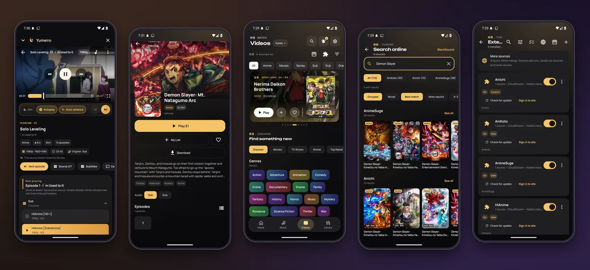
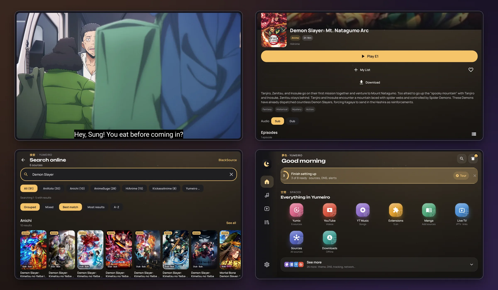

<div align="center">

<a href="https://yumeiro.click/">
  <picture>
    <source media="(prefers-color-scheme: dark)" srcset=".github/readme/hero-dark.svg" />
    <source media="(prefers-color-scheme: light)" srcset=".github/readme/hero-light.svg" />
    
  </picture>
</a>

<p>
  <a href="https://yumeiro.click/download"></a>
  <a href="https://yumeiro.click/beta"></a>
  <a href="https://github.com/siamform/yumeiro/releases"></a>
  <a href="https://github.com/siamform/yumeiro/stargazers"></a>
</p>
<p>
  
  
  <a href="LICENSE"></a>
  <a href="https://github.com/siamform/yumeiro/actions/workflows/ci.yml"></a>
  <a href="https://discord.gg/eqkNymUAMJ"></a>
  <a href="https://t.me/yumeiroofficial"></a>
</p>

<h3>
  <a href="https://yumeiro.click/download">Download</a> ·
  <a href="https://yumeiro.click/beta">Try the Beta</a> ·
  <a href="https://yumeiro.click/">Website</a> ·
  <a href="https://yumeiro.click/changelog">What's new</a> ·
  <a href="https://yumeiro.click/status">Source status</a> ·
  <a href="https://github.com/siamform/yumeiro/issues">Report a bug</a>
</h3>

<sub><b>夢色</b> (yumeiro) means "dream-coloured". One app for every song, video, anime, manga, novel and live channel you love,<br/>on Android phones, tablets, Android TV, Google TV and Fire TV. No account. No ads. No tracking.</sub>

</div>

<picture>
  <source media="(prefers-color-scheme: dark)" srcset=".github/readme/divider-dark.svg" />
  
</picture>

## Contents

[See it](#see-it) · [Why Yumeiro](#why-yumeiro) · [Features](#features) · [What's new in Beta](#whats-new-in-beta) ·
[Stable and Beta](#stable-and-beta) · [Install](#install) · [Android TV](#android-tv-google-tv-and-fire-tv) ·
[Verify a release](#verify-a-release) · [Compared](#how-yumeiro-compares) · [Build](#build-from-source) ·
[Community](#community) · [License](#license)

## See it

<div align="center">





<sub>Real captures from the app on Android phone and Android TV emulators, playing titles through third-party extensions the
user installed (Device check runs 45957262641 and 45957265712). Yumeiro hosts no media. Solo Leveling © Chugong, DUBU (REDICE STUDIO) / Solo Leveling Animation Partners.
Demon Slayer © Koyoharu Gotouge / SHUEISHA, Aniplex, ufotable. Shown only to illustrate the player.</sub>

</div>

## Why Yumeiro

Most people juggle four or five apps: a music player, a video player, YouTube, something for anime, something for manga
and something for live TV. **Yumeiro is all of them in one fast, offline-first app**, and it reads the extension
formats you already use, so your repositories just work.

<picture>
  <source media="(prefers-color-scheme: dark)" srcset=".github/readme/features-dark.svg" />
  
</picture>

## Features

<table>
<tr>
<td width="50%" valign="top">

### Anime, manga and online
- **CloudStream extensions**, **Aniyomi** anime, **Mihon** manga (extensions-lib up to 1.6, Keiyoushi works),
  **LNReader** novels, **Stremio** add-ons and **JavaScript** sources
- Extension **markets** for every format, with search, ranking and one-tap Add
- **Source Finding**: the same title on every installed extension, ranked, and your pick remembered
- **Other extensions**: when a title won't play, try the same title in your other extensions
- **Tracking** for AniList, MyAnimeList, Kitsu, Trakt and Simkl, with an offline-safe queue
- Skip intro and outro from AniSkip and IntroDB
- **Home servers**: Jellyfin, Emby, Plex, DLNA, WebDAV, SMB

</td>
<td width="50%" valign="top">

### Video player
- **Auto decoder**: hardware first, AC-3 / E-AC-3 / DTS / TrueHD in software, one automatic retry from the same spot
- **Dynamic range compressor** (Light, Night, Strong, Custom) without reloading
- **Anime4K** presets, rotation, picture size, aspect ratio, speed, audio tracks, PiP, background play
- **Subtitles**: embedded, local, or OpenSubtitles, SubDL and SubSource at once, in any text encoding,
  with a full style editor
- A floating player like YouTube, gestures and pinch to zoom
- Every player button can be hidden or reordered

</td>
</tr>
<tr>
<td valign="top">

### Music
- Your local library: songs, albums, artists, folders, playlists
- **Synced lyrics** that scroll with the song (tap a line to seek)
- 10-band **equalizer**, sound FX and the compressor
- **YouTube Music** without an account, with background play
- Sleep timer with a gentle fade-out

</td>
<td valign="top">

### Live TV and streams
- HLS, DASH, RTSP, MP4 / MKV and IPTV **M3U playlists**
- A **playlist market** with hundreds of lists, refreshed every 3 days
- Channel search, a Country sheet and genres
- Custom headers, ClearKey / Widevine, smart link detection
- **Auto-unlock for HTTP 403** with browser, VLC and host-player headers

</td>
</tr>
<tr>
<td valign="top">

### Designed, not just built
- **Tsuki** design: calm ink-black nights or warm paper days, one moonlight-gold accent
- **Ambient colour** that follows the artwork that is playing
- One floating dock for the mini player and navigation
- Skeleton loading instead of spinners, and a signature splash
- English, Bangla and Arabic (right-to-left)

</td>
<td valign="top">

### Private and honest
- No account, no ads, no analytics, no tracking
- Every site security check is listed in one place; Yumeiro never solves a CAPTCHA for you
- Releases are built in public CI, checksummed and signed with one published key
- Every error comes with a suggestion for what to try next

</td>
</tr>
</table>

## What's new in Beta

The Beta channel has the next release, **2.4.0**, while it is being tested. Highlights:

| | |
|---|---|
| **BlackSource search** | Find anime by genre, tags and demographic, then the copies of each title in your own extensions (off until you turn it on) |
| **Yumeiro Vault** | Keep a title from any website with the links on its page, as a small file you own |
| **Bangla and Arabic** | Settings › Appearance › Language, with right-to-left layout |
| **60+ extensions, still smooth** | Home no longer rebuilds for every extension that loads; playback keeps going while extensions install, load and search |
| **Other extensions** | When a title won't play, Yumeiro tries the same title in your other video extensions |
| **Play a pasted link** | A video link, magnet link or info hash in Search plays at once |
| **Compressor controls** | Threshold, ratio, make-up, attack and release, in the player and in Settings |
| **Profiles fixed** | Each profile has its own search history, downloads and saved websites |

Every item was checked with automatic tests on Android phone and TV emulators; checks on real phones and TVs are still
open. Full list: [yumeiro.click/changelog](https://yumeiro.click/changelog) and [CHANGELOG.md](CHANGELOG.md).

## Stable and Beta

<div align="center">

<a href="https://yumeiro.click/get"></a>
&nbsp;
<a href="https://yumeiro.click/get?beta=1"></a>
&nbsp;
<a href="https://yumeiro.click/get?beta=1&tv=1"></a>

</div>

**Yumeiro Beta** gets new features and fixes first, so it **may contain unfinished features and bugs**. Use Stable if
you want the app that has passed every check. Beta is a separate app, so both can be installed side by side.

| | Stable | Beta |
|---|---|---|
| Branch | `main` | `beta-main` (protected) |
| Android package | `dev.asfakul.yumeiro` | `dev.asfakul.yumeiro.beta` |
| GitHub release | tag `vX.Y.Z`, marked **Latest** | tag `beta-vX.Y.Z-beta.N`, marked **Pre-release** |
| Phone file | `release-Yumeiro-vX.Y.Z.apk` (+ per-processor files) | `Yumeiro-Beta-vX.Y.Z-beta.N.apk` |
| TV file | `Yumeiro-TV-vX.Y.Z.tv.apk` | `Yumeiro-Beta-TV-vX.Y.Z-beta.N.tv.apk` |
| In-app updates from | the latest Stable release | the newest Beta pre-release |
| Built by | `.github/workflows/release.yml` | `.github/workflows/release-beta.yml` |

<details>
<summary><b>More about Beta</b>: data, updates and sign-in links</summary>

- **Install next to Stable.** Beta is a different Android app (`dev.asfakul.yumeiro.beta`), so it never replaces
  Yumeiro and Yumeiro never replaces Beta. Both are signed with the same release key (see
  [Verify a release](#verify-a-release)).
- **Separate data.** Beta has its own library, settings, accounts, downloads and history. Use Settings › Backup &
  restore to move data between them.
- **Updates stay in their channel.** Beta updates only to newer Betas, Stable only to newer Stable releases.
- **Sign-in links.** Both apps answer `yumeiro://` links (AniList, MyAnimeList); with both installed, Android asks which
  app should finish a sign-in, so pick the one you started it from.
- **Push notices** in Beta work only after the Beta package is added to the project's Firebase setup.
- Each push to `beta-main` builds and checks a Beta; it is published as a pre-release only while Beta publishing is
  switched on, so there may be none at times. All Betas: [Releases](https://github.com/siamform/yumeiro/releases).

</details>

## Install

1. Open **[the download page](https://yumeiro.click/download)**. It checks your processor and picks the right file:
   `Yumeiro-vX.Y.Z-arm64-v8a.apk` for most phones, `Yumeiro-vX.Y.Z-armeabi-v7a.apk` for older 32-bit phones, or the
   universal `release-Yumeiro-vX.Y.Z.apk` if you are not sure. TVs: `Yumeiro-TV-vX.Y.Z.tv.apk`.
2. Open the file and allow "Install unknown apps" for your browser or file manager.
3. Done. Yumeiro checks for new versions and shows the version and source before installing (Settings › Updates).

Phones and tablets need Android 9 or newer; Android TV, Google TV and Fire TV need Android 7.0 or newer.

## Android TV, Google TV and Fire TV

The TV APK switches to TV mode on its own: a left navigation rail, a visible focus ring on everything, and a player
built for the remote. Install it with a file manager, or from a computer on the same network:

```sh
adb connect <tv-ip>:5555
adb install -r Yumeiro-TV-v<version>.tv.apk
```

Install help: [yumeiro.click/download](https://yumeiro.click/download).

## Verify a release

GitHub Actions builds every release from this repository with a pinned JDK, pinned action SHAs and no build cache, and
never makes a debuggable build. The signing key exists only as an encrypted GitHub secret and is shredded after the
build. Each release publishes `SHA256SUMS.txt`, generated in the same CI job.

```sh
# 1. Checksum: download the APK and SHA256SUMS.txt from the same release
sha256sum -c SHA256SUMS.txt --ignore-missing

# 2. Signing certificate (apksigner ships with Android SDK build-tools)
apksigner verify --print-certs release-Yumeiro-vX.Y.Z.apk | grep SHA-256
```

The SHA-256 certificate digest must be:

```
2e:cd:fd:04:f3:b2:d1:28:05:01:33:4a:5c:24:7d:71:29:ba:fa:2b:5a:43:48:47:28:9d:fc:06:9a:41:3f:6b
```

The same value is in [`.github/release-signing-cert.sha256`](.github/release-signing-cert.sha256), and CI checks it on
every release. Do not install an APK with any other certificate; it was not built by this project. The in-app updater
does the same checks: it downloads only from this repository's releases, compares the APK against the published
SHA-256, and relies on Android's same-signature rule when installing.

## How Yumeiro compares

Yumeiro learned from great open-source apps and puts their worlds in one place. This is about scope, not quality: each
of these apps is excellent at what it does.

| Built in | Yumeiro | CloudStream | Aniyomi | Mihon |
|---|:---:|:---:|:---:|:---:|
| CloudStream extensions | ✅ | ✅ | — | — |
| Aniyomi anime extensions | ✅ | — | ✅ | — |
| Mihon manga extensions | ✅ | — | ✅ | ✅ |
| Light novels (LNReader sources) | ✅ | — | — | — |
| Stremio add-ons and JavaScript sources | ✅ | — | — | — |
| Local music with synced lyrics and EQ | ✅ | — | — | — |
| YouTube and YouTube Music without an account | ✅ | — | — | — |
| IPTV playlists with a playlist market | ✅ | — | — | — |
| Android TV app with a remote-first player | ✅ | ✅ | — | — |

<sub>Based on each project's public README and features at the time of writing; tell us in an issue if something changed.</sub>

## For extension authors

The [extension kit](extension-kit/README.md) has a working sample for each format Yumeiro reads: a static Stremio
add-on you can host on GitHub Pages for free, a JavaScript source with its `index.json`, and pointers for CloudStream,
Aniyomi and Mihon templates. Repositories in [.github/extensions/sources.json](.github/extensions/sources.json) are
checked every 3 days and shown on the [public status page](https://yumeiro.click/status).

## What Yumeiro hosts (and doesn't)

Yumeiro is a player. **It hosts no media.** Playlists, live-TV streams and online-video extensions come from third
parties, and the market branches only index links that other people publish. Extensions are third-party code that runs
inside the app, so install only those you trust. See [DISCLAIMER.md](DISCLAIMER.md).

## Tech stack

Kotlin, Jetpack Compose (Material 3), Media3 / ExoPlayer, OkHttp with DNS over HTTPS, WorkManager, Coil, Firebase Cloud
Messaging for push only (no Analytics), and on-device ML Kit for translation. Extensions run through the CloudStream,
Aniyomi, Mihon, LNReader, Stremio and JavaScript runtimes Yumeiro ships.

## Build from source

```bash
git clone https://github.com/siamform/yumeiro.git
cd yumeiro
git checkout beta-main                # Beta, where new work lands first
./gradlew assembleMobileDebug         # JDK 17+, Android SDK 37
./gradlew testMobileDebugUnitTest     # unit + UI tests
```

Design notes, test plans and release evidence are kept in a separate private repository.

## Contributing

Pull requests are welcome. Branch from **`beta-main`**, use [Conventional Commits](https://www.conventionalcommits.org/),
and open the pull request against `beta-main`; CI must pass. Work reaches `main` (Stable) only after it has been tested
in Beta.

## Security

Report vulnerabilities privately via
[GitHub security advisories](https://github.com/siamform/yumeiro/security/advisories/new), not in public issues. Scope,
response times and the disclosure policy are in [SECURITY.md](SECURITY.md). Privacy: [PRIVACY.md](PRIVACY.md) · Terms:
[TERMS.md](TERMS.md).

## Community

<div align="center">

Yumeiro is **@officialyumeiro** everywhere

<a href="https://yumeiro.click"></a>
<a href="https://t.me/yumeiroofficial"></a>
<a href="https://t.me/chatyumeiroofficial"></a>
<a href="https://discord.gg/eqkNymUAMJ"></a>
<br/>
<a href="https://www.facebook.com/officialyumeiro"></a>
<a href="https://www.instagram.com/officialyumeiro"></a>
<a href="https://x.com/officialyumeiro"></a>
<a href="https://www.tiktok.com/@officialyumeiro"></a>
<a href="https://www.reddit.com/user/officialyumeiro"></a>

Developer, **Asfakul Siam**:
[Facebook](https://www.facebook.com/siam1p) · [Instagram](https://www.instagram.com/asfakul_siam) ·
[Telegram](https://t.me/siamorwho) · [GitHub](https://github.com/siamform)

</div>

## Support the project

If Yumeiro replaced a few apps on your phone, **[give it a star](https://github.com/siamform/yumeiro/stargazers)**. It
is the single best way to help more people find it. Share it with a friend who still uses four apps.

<a href="https://star-history.com/#siamform/yumeiro&Date">
  <picture>
    <source media="(prefers-color-scheme: dark)" srcset="https://api.star-history.com/svg?repos=siamform/yumeiro&type=Date&theme=dark" />
    
  </picture>
</a>

## Acknowledgments

Yumeiro builds on the work of CloudStream, NewPipe, Aniyomi, Mihon, LNReader, Stremio and Media3, and learned from
Zangetsu and Hikari on novels, tracking and Anime4K presets. Anime4K by bloc97. Thank you.

## License

Yumeiro is free software under the **[GNU GPL v3](LICENSE)**, the same licence as the CloudStream and NewPipe code it
builds on. You may study, change and share the code; modified versions must stay open source under the same licence.

The **Yumeiro name, logo and icon are not covered by the licence**: forks must use their own name, icon and
`applicationId`. See [TRADEMARKS.md](TRADEMARKS.md) and [NOTICE](NOTICE).

Fonts: Manrope and Unbounded, and Shippori Mincho in the README artwork, all SIL Open Font License 1.1
([licenses](licenses/)).

<div align="center">

<picture>
  <source media="(prefers-color-scheme: dark)" srcset=".github/readme/divider-dark.svg" />
  
</picture>

**Made with 夢 in Bangladesh**

</div>
