<div align="center">


# Yumeiro

### 夢色 · One dream-coloured app for every song, video, anime and live channel you love.

**The all-in-one entertainment hub for Android. Made in Bangladesh.**

No account. No login. No ads. No tracking.<br/>
Local music and video, YouTube, YouTube Music, live TV / IPTV, CloudStream, Aniyomi, Mihon, Stremio and JavaScript
sources, plus your own Jellyfin, Plex, DLNA, WebDAV and SMB servers — unified in one fast, beautifully designed player.

<p>
  <a href="https://yumeiro.click/download"></a>
  <a href="https://github.com/siamform/yumeiro/releases"></a>
  <a href="https://github.com/siamform/yumeiro/stargazers"></a>
</p>
<p>
  
  
  <a href="LICENSE"></a>
  <a href="https://github.com/siamform/yumeiro/actions/workflows/ci.yml"></a>
</p>

**[Download the APK](https://yumeiro.click/download)** · **[Website](https://yumeiro.click/)** · **[Full guide](docs/GUIDE.md)** · **[Source status](https://yumeiro.click/status)** · **[Report a bug](https://github.com/siamform/yumeiro/issues)**

</div>

---

## One app instead of five

Great apps exist for each piece of the puzzle — **CloudStream** for extensions, **ArchiveTune**, **InnerTune** and
**Metrolist** for YouTube Music, **NewPipe** and **LibreTube** for YouTube, **VLC** and **MX Player** for local video,
**TiviMate** for IPTV. Each one does its own job well, and each one stops there.

**Yumeiro brings all of them together in one app** — one library, one player, one history, one design:

| | What you get |
|---|---|
| **Everything in one place** | Local music and video, YouTube, YouTube Music, IPTV/M3U and CloudStream `.cs3` extensions share one player, one queue and one *Continue watching* row. |
| **Your existing extensions work** | CloudStream extension repos install as they are, with a built-in market, auto-updates, sub/dub, seasons and a crash guard, so one broken extension can't take the app down. |
| **Fixes refused streams for you** | Before showing an error, Yumeiro retries the link with different headers, fetches fresh links, and if needed captures the stream from the page itself. |
| **Offline downloads** | Save a whole season or the next five episodes into one folder per series (`Solo Leveling-(HiAnime-(Sub))`), pin what you want to keep, and let an auto-delete timer clear the rest. YouTube videos in every quality up to 4K, or music as audio only. Prefer **1DM** or **ADM**? Pick it in Settings → Downloads and episodes go straight to it, with the right headers. |
| **Every extension format** | CloudStream `.cs3`, Aniyomi anime and Mihon/Tachiyomi manga APKs, Stremio add-ons and Mangayomi-style JavaScript sources, side by side in one Sources hub. |
| **A market for every format** | No more hunting for repo links: each Sources tab has a Discover list of repositories and add-ons found on GitHub and in Stremio's catalogs, ranked by stars, recent updates and size, with search, sort and one-tap Add. Pasting a link by hand still works. |
| **Your home servers** | Jellyfin, Emby, Plex, DLNA/UPnP, WebDAV and SMB shares show up as sources, with natural episode order. |
| **Track, back up, stay private** | AniList, MyAnimeList, Kitsu and Trakt; one-file backup and restore; app lock and incognito mode. |
| **Watch together** | Rooms on the same Wi-Fi keep play, pause and seek in sync. No account, no server. |
| **No login, ever** | YouTube and YouTube Music — search, quick picks, background play — with no Google account. |
| **Live catalogs** | The playlist market, extension market and in-app news update without a new app release. |
| **Safe updates** | Releases are signed with one key, and the in-app updater checks the signing certificate and SHA-256 before it installs anything. |
| **Designed, not assembled** | The *Tsuki* design system, background glow that takes its colour from the artwork, one floating glass dock, and smooth 60 fps. |

---

<div align="center">

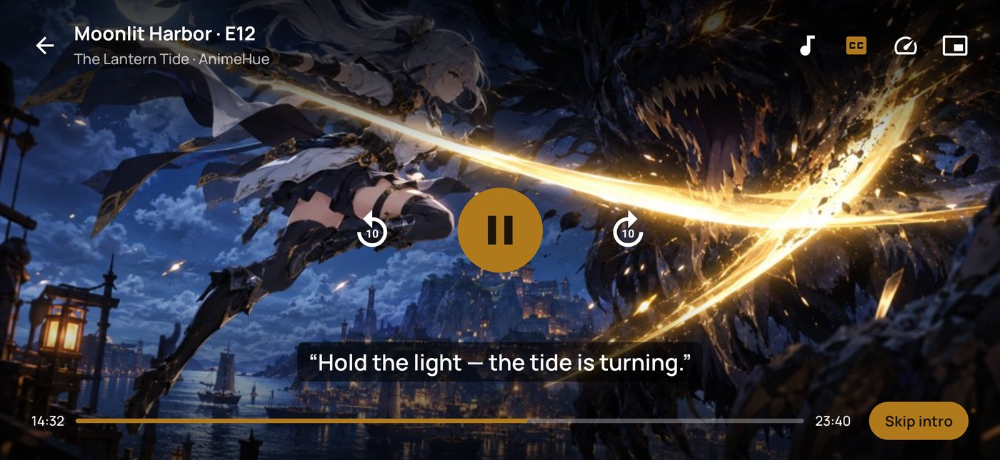

**Full-screen player** · subtitles from OpenSubtitles, SubDL and SubSource · Skip intro · audio, captions, speed and picture-in-picture one tap away

| Hues (anime, movies, drama, live) | Inside a Hue | Watching an episode |
|:---:|:---:|:---:|
| 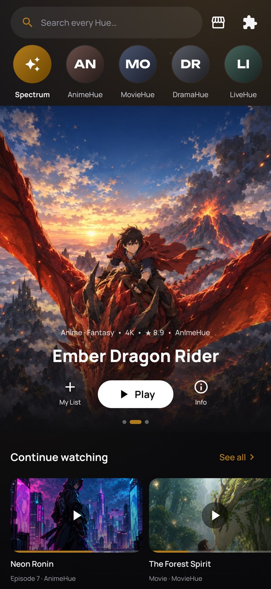 | 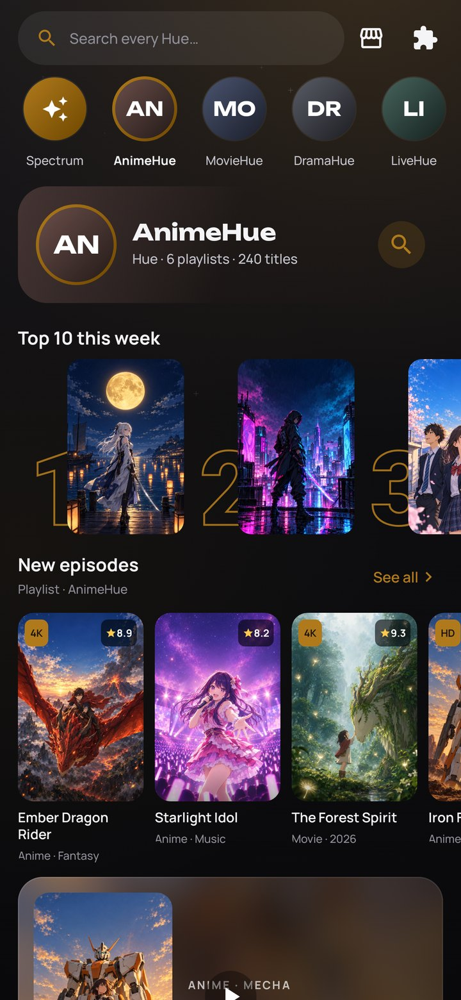 | 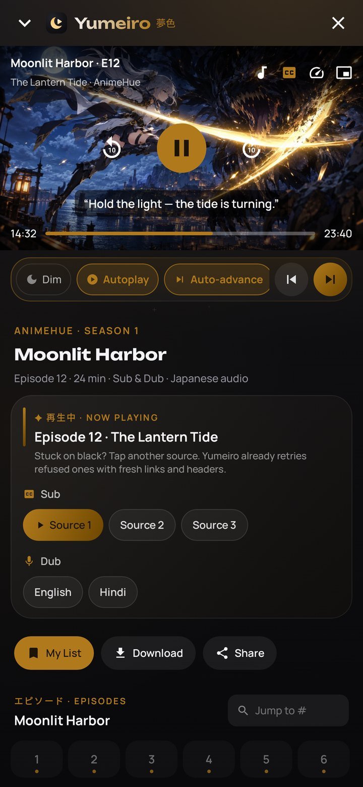 |
| **Home** | **Now Playing** | **Music** |
| 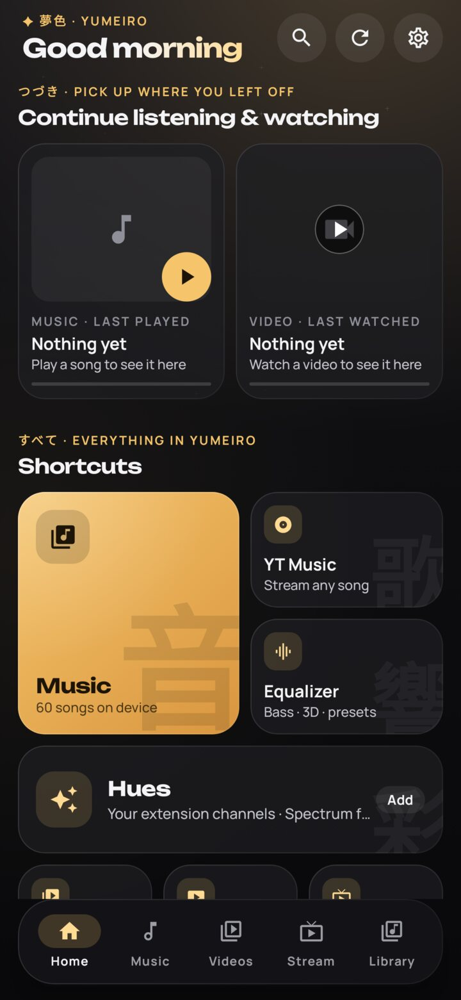 | 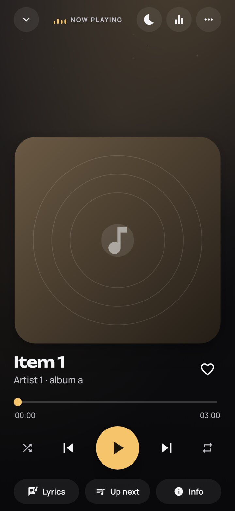 | 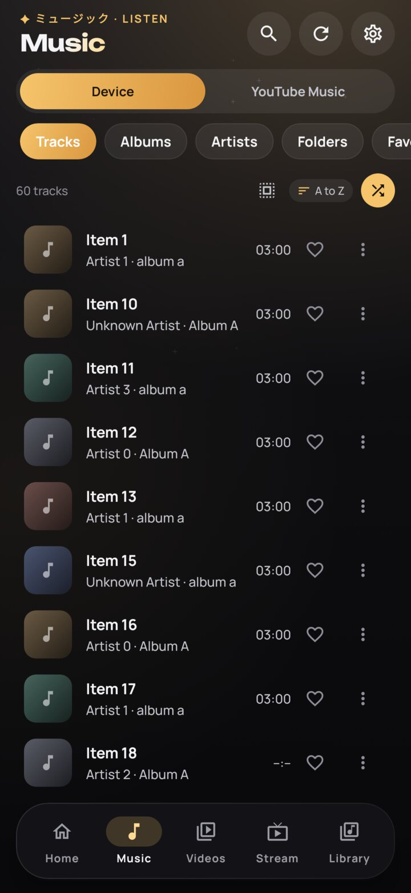 |
| **Videos** | **Stream (live TV playlists)** | **Library** |
| 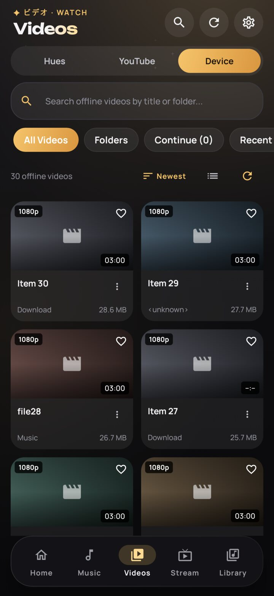 | 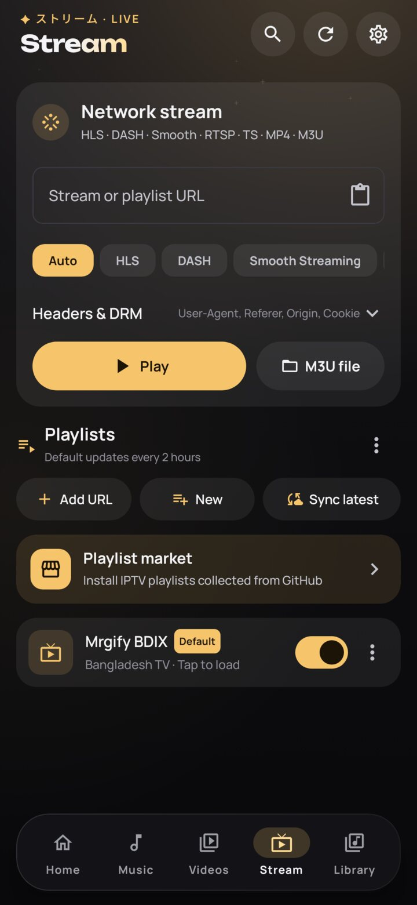 | 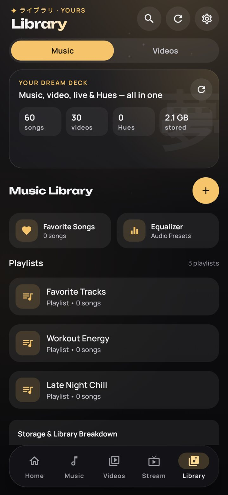 |
| **Built-in user guide** | **Song info + sleep timer** | **Errors come with a fix** |
| 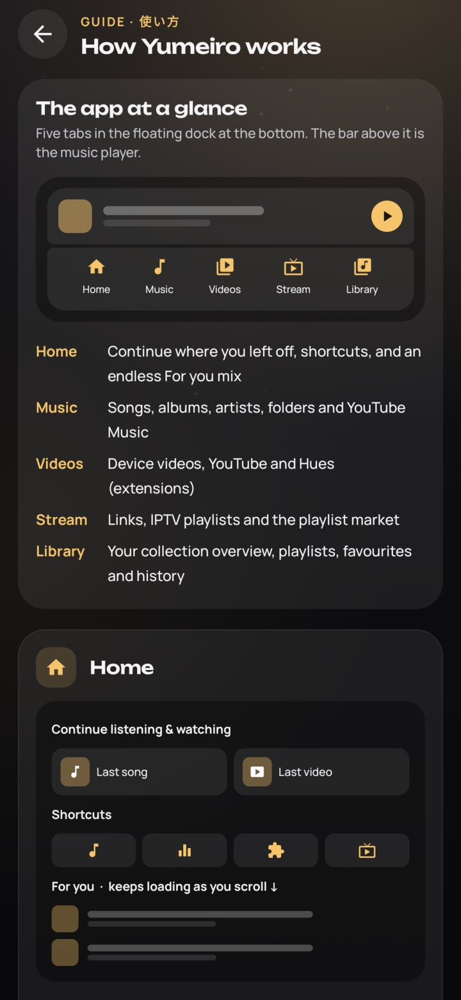 | 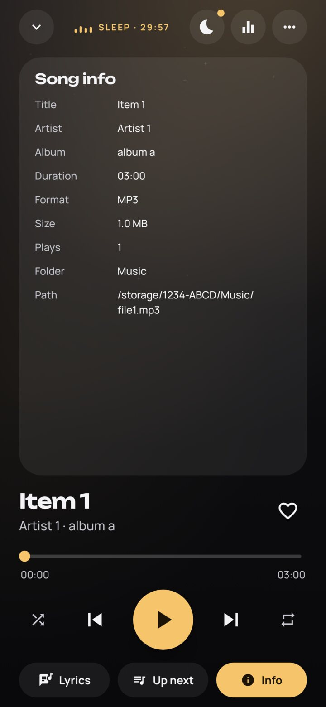 | 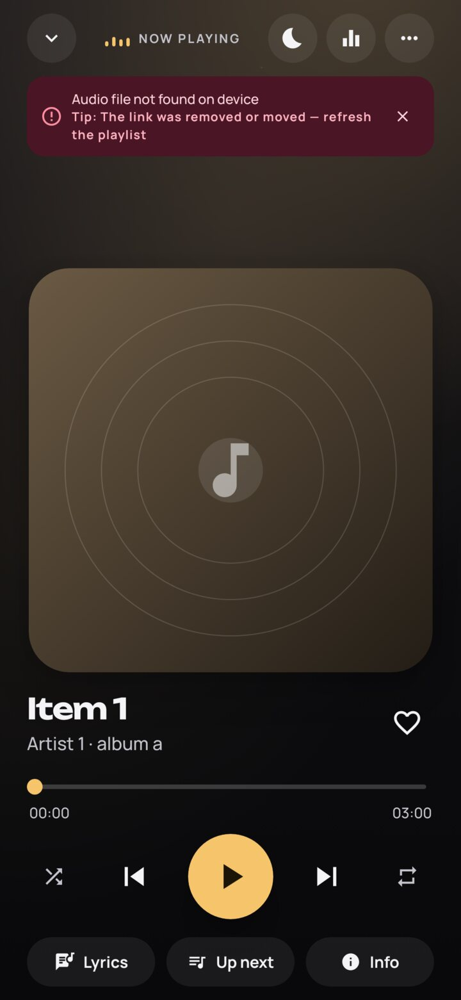 |

<sub>Screens are rendered from the app's real UI. Titles and artwork in the Hues shots are original samples made for this README, not real catalogue content.</sub>

</div>

## Why Yumeiro?

Most people juggle four apps: a music player, a video player, YouTube, and something for anime or live TV.
Yumeiro replaces all of them with **one fast, offline-first app that looks like it belongs in 2026.**

<table>
<tr>
<td width="50%" valign="top">

### Music
- Your local library: songs, albums, artists, folders, playlists
- **Synced lyrics** that scroll with the song (tap a line to seek)
- 10-band **equalizer** and sound FX
- **Sleep timer** — 5 to 90 minutes or end of song, with a gentle fade-out
- **YouTube Music** without an account — quick picks, search, background play

</td>
<td width="50%" valign="top">

### Video
- Grid of your device videos with **continue watching**
- Gestures, PiP, background play, speed, audio tracks
- **Floating player** like YouTube — press back or swipe the video down to keep watching while you browse
- Slim vertical brightness and volume bars, like your phone's own
- **Subtitles**: embedded, local files, or search OpenSubtitles, SubDL and SubSource at once (free keys, your own)
- **YouTube** with no login — trending, anime, AMV, live

</td>
</tr>
<tr>
<td valign="top">

### Anime & online
- Works with **CloudStream extensions** — your existing repos just work
- **Aniyomi** anime, **Mihon** manga (with a reader, extensions-lib up to 1.6 and the new store index — Keiyoushi works), **Stremio** add-ons and **JavaScript** sources
- **Home servers**: Jellyfin, Emby, Plex, DLNA, WebDAV, SMB
- Extension **markets** for every format (CloudStream, Aniyomi, Mihon, Mangayomi, Stremio) with search, ranking and one-tap Add
- Auto-updates, sub/dub, seasons, episodes
- A YouTube-style **For you** feed across every extension

</td>
<td valign="top">

### Live TV & streams
- HLS, DASH, RTSP, MP4/MKV, IPTV **M3U playlists**
- **Playlist market** with hundreds of lists, refreshed every 3 days
- Custom headers, ClearKey / Widevine, smart link detection
- **Auto-unlock for HTTP 403**: refused links are retried with browser, VLC and host-player headers automatically
- Watch page with next / previous channel, groups and sharing

</td>
</tr>
</table>

### Designed, not just built

- **Tsuki** design system — calm ink-black nights or warm paper days, with a single moonlight-gold accent.
- **Ambient colour** — the background glow quietly takes the colour of the artwork that is playing, like Spotify and Apple Music do.
- **One floating dock** — the mini player and the navigation bar are joined into one glass capsule.
- **Endless home** — *Continue listening & watching*, shortcuts, then a *For you* feed that mixes your own songs and videos with YouTube and online picks forever.
- **User guide in Settings** — illustrated diagrams of every tab, gesture and fix.
- **Every error comes with a suggestion** for what to try next.
- Smooth 60 fps: progress ticks never recompose the page, no blur on lists, baseline profiles included.

## Yumeiro vs. the usual stack

| | Yumeiro | Typical music player | Typical video player | YouTube app |
|---|:---:|:---:|:---:|:---:|
| Local music + video in one app | ✓ | – | – | – |
| YouTube & YouTube Music, no login | ✓ | – | – | needs account for most features |
| CloudStream extensions | ✓ | – | – | – |
| IPTV / M3U playlists | ✓ | – | some | – |
| Synced lyrics, equalizer | ✓ | ✓ | – | – |
| No ads, no tracking, no account | ✓ | varies | varies | – |
| Seamless self-updates | ✓ | – | – | via store |

## What's different

How Yumeiro compares with the apps it learns from. All of them are great at their own job; the point is having it in one place.

| | Yumeiro | Aniyomi | Mihon | CloudStream | Stremio | Kodi | Jellyfin app |
|---|:---:|:---:|:---:|:---:|:---:|:---:|:---:|
| CloudStream `.cs3` extensions | ✓ | – | – | ✓ | – | – | – |
| Aniyomi anime extensions | ✓ | ✓ | – | – | – | – | – |
| Mihon / Tachiyomi manga extensions + reader | ✓ | ✓ | ✓ | – | – | – | – |
| Stremio add-ons (HTTP streams) | ✓ | – | – | – | ✓ | – | – |
| JavaScript sources (Mangayomi format) | ✓ | – | – | – | – | – | – |
| Jellyfin / Plex / DLNA / WebDAV / SMB | ✓ | – | – | – | – | ✓ | Jellyfin only |
| Local music + video player | ✓ | – | – | – | – | ✓ | – |
| YouTube & YouTube Music, no login | ✓ | – | – | – | – | add-on | – |
| IPTV / M3U | ✓ | – | – | – | – | ✓ | Live TV via server |
| AniList, MAL, Kitsu, Trakt tracking | ✓ | ✓ | ✓ | AniList, MAL | Trakt | add-on | – |
| Backup / app lock / incognito | ✓ | ✓ | ✓ | backup | – | – | – |
| Watch together without a server | ✓ (same Wi-Fi) | – | – | – | – | – | SyncPlay via server |
| Crash guard for broken extensions | ✓ | – | – | partial | n/a | – | n/a |
| Public source status page | [✓](https://yumeiro.click/status) | – | – | – | – | – | – |

Yumeiro does not ship torrent streaming. Stremio add-ons that only return torrents are listed but their torrent streams are skipped.

## For extension authors

The [extension kit](extension-kit/README.md) has a working sample for each format Yumeiro reads: a static Stremio add-on you can host
on GitHub Pages for free, a JavaScript source with its `index.json`, and pointers for CloudStream, Aniyomi and Mihon templates.
Repositories listed in [.github/extensions/sources.json](.github/extensions/sources.json) are checked every 3 days and shown on the
[public status page](https://yumeiro.click/status).

## Install

1. Download `release-Yumeiro-vX.Y.Z.apk` from **[the website](https://yumeiro.click/download)** (or [Releases](https://github.com/siamform/yumeiro/releases/latest)).
2. Open it and allow "Install unknown apps" for your browser or file manager.
3. Done. Yumeiro checks for new versions and shows you the version and source before installing (Settings → Updates).

Android 7.0 or newer. Phones, tablets, Android TV, Google TV and Fire TV. Pick `arm64-v8a` (most devices), `armeabi-v7a` (older 32-bit phones and many TV sticks) or the universal APK.

## Verify a release

GitHub Actions builds every release from this repository. The build uses a pinned JDK, pinned action SHAs and no build
cache, and it never makes a debuggable build. The signing key exists only as an encrypted GitHub secret and is shredded
after the build. Each release publishes `SHA256SUMS.txt`, generated in the same CI job.

```sh
# 1. Checksum: download the APK and SHA256SUMS.txt from the same release
sha256sum -c SHA256SUMS.txt --ignore-missing

# 2. Signing certificate (apksigner ships with Android SDK build-tools)
apksigner verify --print-certs release-Yumeiro-vX.Y.Z.apk | grep SHA-256
```

The SHA-256 certificate digest must be:

```
2e:cd:fd:04:f3:b2:d1:28:05:01:33:4a:5c:24:7d:71:29:ba:fa:2b:5a:43:48:47:28:9d:fc:06:9a:41:3f:6b
```

The same value is in [`.github/release-signing-cert.sha256`](.github/release-signing-cert.sha256), and CI checks it on
every release. Do not install an APK with any other certificate; it was not built by this project. The in-app updater
does the same checks automatically. It only downloads from this repository's GitHub releases, compares the APK against
the published SHA-256, and relies on Android's same-signature rule when installing.

## What Yumeiro hosts (and doesn't)

Yumeiro is a player. **It hosts no media.** Playlists, live-TV streams and online-video extensions come from third
parties. The market branches only index links that other people publish. Extensions are third-party code that runs
inside the app, so install only those you trust. See [DISCLAIMER.md](DISCLAIMER.md).

## Security

Please report vulnerabilities privately via
[GitHub security advisories](https://github.com/siamform/yumeiro/security/advisories/new), not in public issues.
Scope, response times and the disclosure policy are in [SECURITY.md](SECURITY.md). Privacy: [PRIVACY.md](PRIVACY.md) · Terms: [TERMS.md](TERMS.md). Audit notes are in
[docs/security](docs/security/).

## FAQ

<details>
<summary><b>Why does Google Play Protect ask to scan the app?</b></summary>

Play Protect shows that prompt for sideloaded apps whose signing key it has not seen often yet — it is about the
app's reputation, not its code. Apps that have been installed by many people, or whose developer has registered
the signing key with Google's Android developer verification, stop getting the prompt. You can safely tap
**Scan app** or **Install without scanning**. Always check that the APK came from this repository's Releases page.
</details>

<details>
<summary><b>A stream says "Access denied (HTTP 403)". What now?</b></summary>

Yumeiro already retried it for you: with browser headers, the site and the host as referer, no referer,
a media-player and a VLC user agent, and the host's own web-player headers. If it still fails, the link's token
has expired (refresh the playlist or get a fresh link), the host needs a Cookie (add it under Headers & DRM),
or the stream is limited to certain countries. Yumeiro does not bypass geo-blocking or access controls.
</details>

<details>
<summary><b>Do I need an account?</b></summary>

No. There is no login anywhere in the app. YouTube and YouTube Music work without signing in.
</details>

<details>
<summary><b>Is it safe? What data does it collect?</b></summary>

Nothing. No analytics, no ads, no servers of ours. Your history, playlists and settings stay on your device.
Every update is verified against the official signing certificate before it is installed.
</details>

<details>
<summary><b>How do I know my APK is the real one?</b></summary>

Official releases are signed with one key; its fingerprint is in [SECURITY.md](SECURITY.md).
Re-signed copies are detected by the app and marked **Unofficial build** in Settings → About.
</details>

<details>
<summary><b>Where do online videos come from?</b></summary>

From CloudStream-format extensions that *you* choose to install. Yumeiro ships only one public-domain extension
(Internet Archive). Only add extensions for content you have the right to stream.
</details>

## Build from source

```bash
git clone https://github.com/siamform/yumeiro.git
cd yumeiro
./gradlew assembleDebug        # JDK 17+, Android SDK 37
./gradlew testDebugUnitTest    # unit + UI tests
```

Architecture, release pipeline, updater internals and the full feature list are in **[docs/GUIDE.md](docs/GUIDE.md)**
and **[docs/HANDOVER.md](docs/HANDOVER.md)**.

## Contributing

Pull requests are welcome. Branch from `main`, use [Conventional Commits](https://www.conventionalcommits.org/),
and make sure CI passes — merging to `main` ships a release automatically. Security issues: please use
[private reporting](https://github.com/siamform/yumeiro/security/advisories/new).

## Support the project

If Yumeiro replaced a few apps on your phone, **[give it a star](https://github.com/siamform/yumeiro/stargazers)** —
it is the single best way to help more people find it. Share it with a friend who still uses four apps.

<div align="center">

[Website](https://yumeiro.click/) · [GitHub @siamform](https://github.com/siamform)

**Made in Bangladesh**

</div>

## License

Yumeiro is free software under the **[GNU GPL v3](LICENSE)** — the same licence as the CloudStream and NewPipe code it builds on.
You may study, change and share the code; modified versions must stay open source under the same licence.

The **Yumeiro name, logo and icon are not covered by the licence** — forks must use their own name, icon and
`applicationId`. See [TRADEMARKS.md](TRADEMARKS.md) and [NOTICE](NOTICE).

Fonts: Manrope and Unbounded, SIL Open Font License 1.1 ([docs/licenses](docs/licenses/)).
