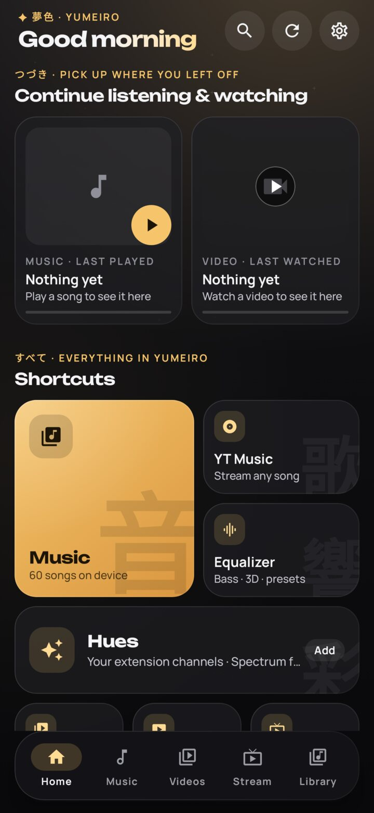
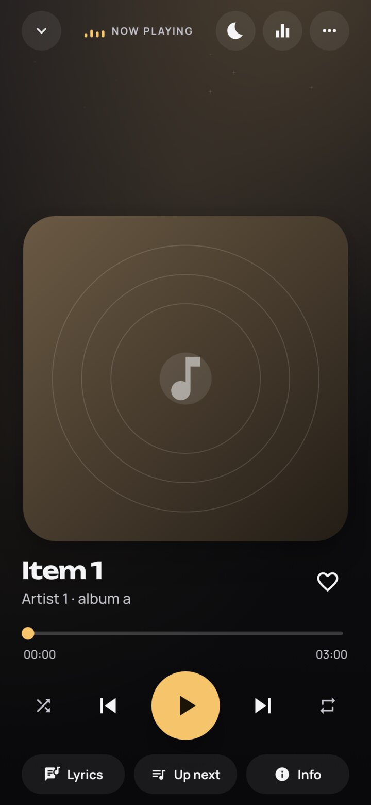
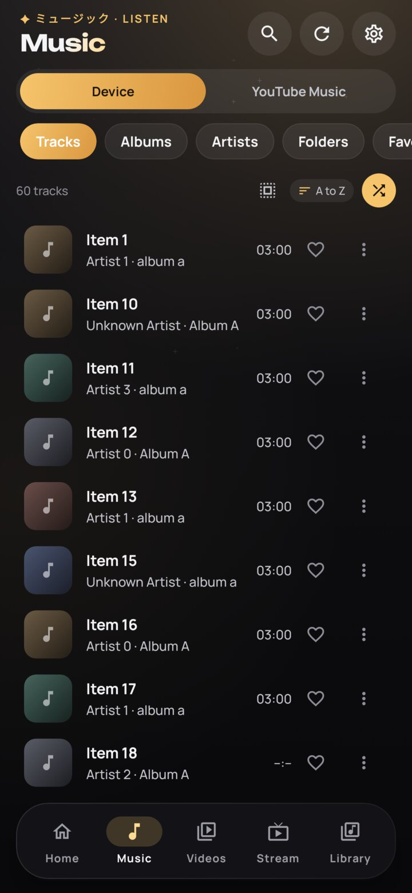
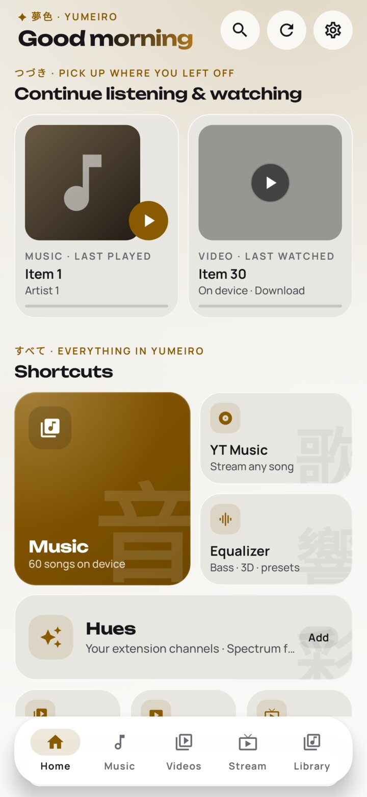
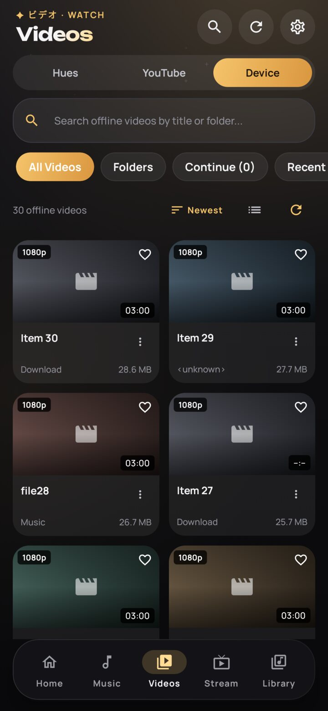
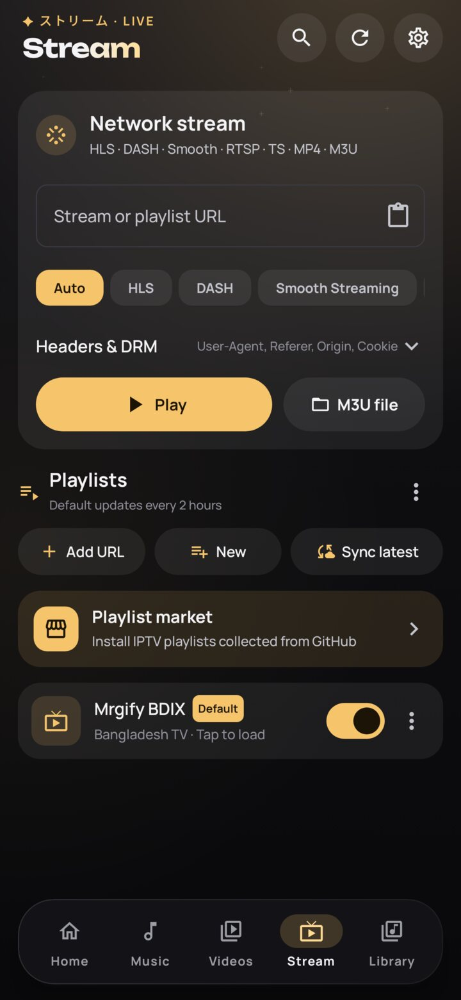
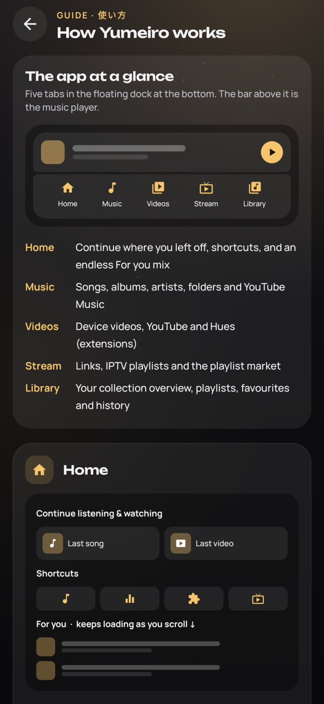
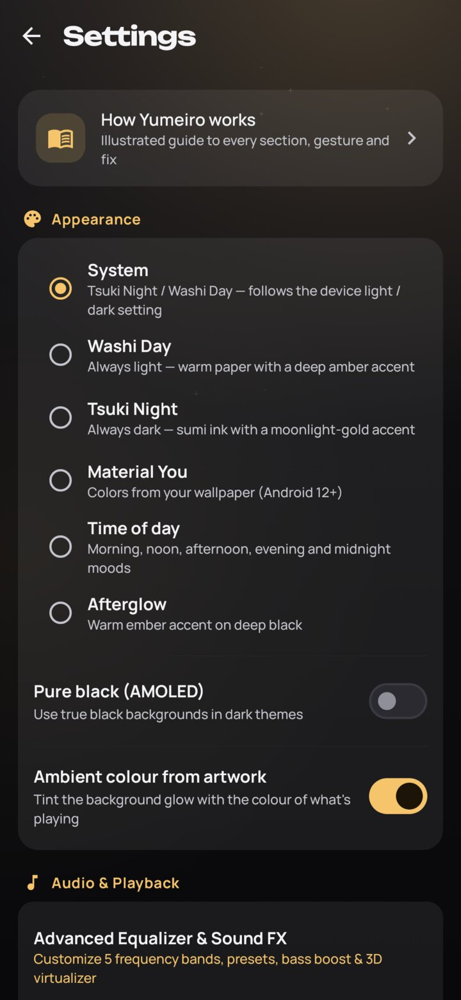
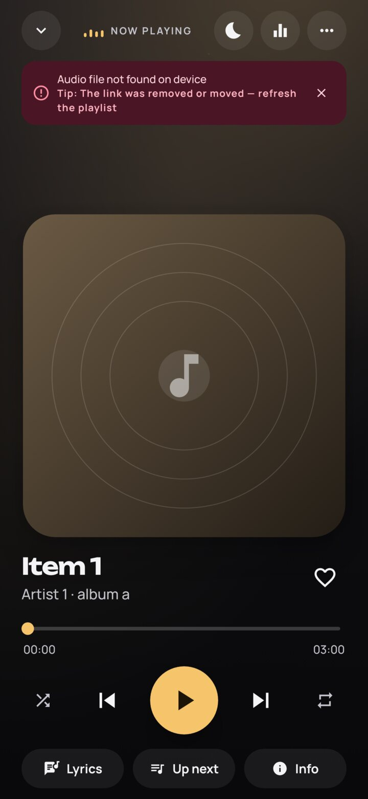

# Yumeiro — full guide

Everything the app does, how the pipelines work, and how to build and release it.
Back to the [README](../README.md).

## Features

### Playback
- **Local music and video**: songs, albums, artists, folders, playlists, favourites, equalizer and sound FX.
- **Media3 ExoPlayer** engine for music and video, with HLS (`.m3u8`), DASH and progressive streams.
- Tapping a song opens the full player; collapse it to the mini player, which has a **close (X)** button that stops playback.
- Favourites, playlists, recently played and play counts are **saved** across restarts.
- Songs without album art show a music-note placeholder.
- **Lyrics** in the full player: synced `.lrc` lyrics highlight and auto-scroll with the song (tap a line to seek), and plain lyrics are shown as text. Lyrics are read from the file's tags (MP3 ID3 `USLT`/`SYLT`, FLAC/OGG/Opus Vorbis `LYRICS`, M4A `©lyr`), from a `.lrc` file with the same name next to the song, or from a `.lrc` you import with the system file picker. No extra permission is needed.
- **Sleep timer** (moon button in Now Playing): 5, 10, 15, 20, 30, 45, 60 or 90 minutes, or **end of song**. The volume fades out over the last 20 seconds, then playback pauses; extend by 5 minutes or turn it off from the same sheet. The header shows `SLEEP · m:ss` while it runs.
- **Song info**: artist, album, album artist, composer, genre, year, track/disc number, duration, format, bitrate, sample rate, bit depth, size, play count and file path.
- **Network streams** (Stream tab): paste a URL, open an `.m3u`/`.m3u8` playlist file, or share a link to the app from any browser.
  - Formats: **HLS** (`.m3u8`), **MPEG-DASH** (`.mpd`), **Smooth Streaming** (`/Manifest`), **RTSP**, progressive **MP4 / MKV / WebM / TS / MP3**. Format is auto-detected, or pick it manually.
  - **Custom headers** (User-Agent presets, Referer, Origin, Cookie, any `Key: Value` header). Many servers block players with CORS/hotlink rules that check `Origin`/`Referer`; a native player is not bound by browser CORS, so sending the expected headers lets these streams play ("CORS bypass").
  - Cross-protocol redirects (http ⇄ https) are followed.
  - **Smart link detection**: links without an extension, `get.php?…` links and redirects are opened once with the same headers the player uses, and the type is taken from the response (HTTP status, `Content-Type`, the final URL and the first bytes: `#EXTM3U`, `<MPD`, MPEG-TS sync bytes, MP4 `ftyp`, MKV/WebM, MP3/AAC/FLAC/OGG …). An `.m3u8` that is really an IPTV channel list opens as a list; a single HLS stream plays.
  - **Web page links**: when a link is a streaming site's page (for example Toffee), the page's HTML is checked for its player source (`<video>`, `og:video`, manifests in scripts, JSON-LD) and played with the page as Referer/Origin. Pages that build the player with JavaScript or need a sign-in open in the **in-app page browser**: sign in and start the video there as usual, and the stream the site's player requests is picked up with the page's own session (cookies, User-Agent, Referer, auth headers). Region, sign-in and DRM checks stay with the site — nothing is bypassed.
  - **YouTube** links play in-app through the login-free YouTube engine (falls back to the YouTube app). DRM-only services (Netflix, Prime Video, Disney+, Hotstar, …) are opened in their own app.
- **YouTube & YouTube Music, no login** — Videos → YouTube (trending, anime, AMV, gaming, live shelves, search with suggestions, watch history) and Music → YouTube Music (quick picks, J-Pop / lo-fi / top hits shelves, song search, background playback with queue), powered by [NewPipeExtractor](https://github.com/TeamNewPipe/NewPipeExtractor).
  - Clear, specific errors: 401 / 403 (token, headers, region), 404 / 410 (expired), 429, 5xx, DNS, timeouts, DRM and unsupported formats each explain what to do next.
  - **DRM**: ClearKey (local `kid:key` pairs or license URL) and Widevine (license URL).
  - **M3U/M3U8 IPTV playlists** with `#EXTINF` (logo, group, name), `#EXTVLCOPT` headers, `#KODIPROP` license info and `url|User-Agent=...` pipe headers.
  - Recent streams history.
  - **Stream playlists** saved on the device:
    - One **default playlist**, *Mrgify BDIX* (Bangladesh). It can be disabled, edited (name / URL), refreshed, exported or deleted; *Restore default playlist* brings it back. The other former defaults (IPTV Scraper Zilla, Bangla Movies, BDxTV, YuppTV, T Sports, CricHD, CrestSport) moved to the Playlist Market; on upgrade they are removed unless you edited them.
    - Every playlist opens on **its own page** (`stream/playlist/{id}`) with search, group filters, pull-to-refresh, auto-update switch, edit / export / delete, skeleton loading, and clear error / not-found pages with Retry. Lists opened from a link or an M3U file appear as *Opened list* and can be saved.
    - **Playlist Market** (Stream → Playlist market): hundreds of IPTV playlists collected from GitHub (curated lists, iptv-org per country, Free-TV and newly discovered active repos), repaired and checked every 3 days. Search, category filters, stars, stream count, "responding" sample; **Install** adds a playlist to your Stream playlists. Installed playlists **update automatically** (checked when you open the Stream tab, at most every 6 h) or **manually** (*Update* / *Update all*), per playlist.
    - **Add playlist from URL** with *Analyse link*: follows redirects and shows the HTTP status, content type, size, number of streams, groups, header/DRM usage and EPG link before saving.
    - **Create your own playlists**: save the stream in the URL box (with its headers / DRM), or any channel from another list, then edit or remove streams.
    - **Export** any playlist (or an opened M3U) as a standard `.m3u` file; **import** an M3U file and save it as a playlist.
    - **Sync latest**: downloads the newest copies of the default playlists without updating the app (see below). Opened remote playlists also refresh themselves when their copy is older than 2 hours.
    - Everything is stored in the app's private storage; nothing is uploaded.
- **Opens from other apps**: video files, `http(s)` media links, `rtsp://` links and shared text containing a URL.

### Video player
- Opens in **portrait** with the status bar visible; the **fullscreen** button switches to landscape (immersive), back exits fullscreen first.
- **Previous / next video** buttons next to the 10-second seek buttons. The queue is the list you opened the video from (folder, All Videos, Continue, Recent, Favourites, Home), or the video's folder when opened from its details.
- When a video ends, the play button turns into **Replay** and an **Up next** card counts down 3 seconds before the next video starts (Cancel or Play now). If a file can't be played, the error card offers **Skip to next video**.
- **Double-tap left/right to seek 10 s** backward/forward; keep tapping to skip further.
- Videos are shown in a **grid** (2 columns on phones, more on tablets) with a list toggle.
- **CC on/off** button in the controls.
- **Multiple audio tracks**: switch language/track when the video contains more than one.
- **Subtitles**: embedded tracks, load a local `.srt` / `.vtt` / `.ass` / `.ssa` / `.ttml` file, or **search online** (OpenSubtitles by file hash or title; SubDL and SubSource too when you add their free API keys in Settings → Online videos) and load in one tap. Online videos search all three at once and pick the right episode out of season packs.
- **Picture-in-Picture** with play/pause, rewind and forward actions; enters PiP automatically when you leave the app. Can be turned off in Settings → Video Player (hides the PiP button too).
- **Background play for video**: audio keeps playing with the screen off or in other apps, with play/pause/seek controls in the media notification and lock screen. Can be turned off in Settings → Video Player (the video then pauses when you leave the app).
- Gestures for brightness, volume and seeking, playback speed, aspect ratio, lock. Brightness and volume show as slim vertical level bars at the screen edges, like the phone's own volume bar.
- **Floating player** (YouTube-style): press **back** or **swipe the video down** from the middle and it shrinks into a draggable mini window above the dock while you keep browsing. Tap it to expand, or use its play/pause and close buttons. Settings → Video player → **Back button** chooses Floating player (default), Picture-in-Picture or Close.
- **Stream watch page**: streams open on a watch page like episodes do — title, previous / next channel, share, copy link, open in another player, group chips and the rest of the playlist.
- **Quality** button for adaptive streams (HLS / DASH with several variants): **Auto** (adaptive bitrate, follows the measured bandwidth) or a fixed 1080p / 720p / 480p … from the stream's own tracks.
- Tuned for streams: deeper network buffer with a fast start, live streams stay close to the live edge (gentle 0.97×–1.03× catch-up) and jump back to live if they fall behind the live window.
- **Stream health** in the info dialog: playing resolution & bitrate, estimated bandwidth, buffer, live latency, rebuffers, dropped frames, server and which DNS resolved it. If playback keeps stalling (3 rebuffers in a minute) quality steps down automatically — back to Auto from a manual choice, or a lower bitrate cap.
- **Smart error recovery**, always bounded: dropped connections and timeouts retry with exponential backoff (up to 3 times), HTTP 5xx retries with backoff, HTTP 429 waits as long as the server's `Retry-After` asks, 403/404/410 re-open the original link or page once to get a fresh token/manifest, DNS failures retry and then point to Settings → Network, and a failing HLS/DASH variant is skipped in favour of another. Retry budgets reset after 30 s of healthy playback; there are no endless loops.

### Network (DNS)
- Settings → Network: **System default** (default), **Cloudflare 1.1.1.1**, **Quad9 9.9.9.9** or **Google 8.8.8.8** for playlists, stream links and playback inside the app.
- Encrypted lookups: **DNS-over-HTTPS** (default) or **DNS-over-TLS**, or plain DNS.
- **Only when system DNS fails** (default): lookups go to the system resolver first; the selected resolver is used only after a real resolution failure. Turn it off to use the selected resolver for every lookup (system DNS stays as the safety net). A **Test** button checks the resolver on the current network.
- This changes name lookups only. It is not a VPN, doesn't change your IP address or region, and needs no account. Cloudflare DNS (1.1.1.1) is a free public resolver and is a different service from Cloudflare WARP.

### Design
- **Tsuki** design system: calm ink-black (Tsuki Night) and warm paper (Washi Day) surfaces with one moonlight-gold accent. The page glow takes its colour from the artwork of what is playing (**Ambient colour**, can be turned off in Settings → Appearance), glass cards, pill filters and Unbounded / Manrope typography.
- Home: time-aware greeting, **Continue listening & watching** (last song + last video, device / YouTube / online), **Shortcuts**, and an endless **For you** feed that mixes your device songs, videos and albums with YouTube and online picks (pull more by scrolling, reshuffle any time). The collection overview (**Dream deck**) lives in Library.
- Now Playing: controls anchored to the bottom for one-handed use, artwork filling the space above them, a custom seek bar, a big round play button, and Lyrics / Up next / Info pills (Equalizer is in the header). The floating mini player has a live progress line.
- Built for **smooth 60 fps**: playback-position ticks are isolated from the rest of the UI (only progress bars redraw), animations run in the draw phase, no blur on lists, and bundled baseline profiles are installed on sideloaded APKs via ProfileInstaller.
- Clean page transitions: bottom-bar pages switch instantly, Settings/Equalizer slide in from the right over an opaque page; **press back twice to exit** from Home.
- **Themes**: System (Tsuki Night / Washi Day), Light, Dark, Material You (wallpaper colors, Android 12+), **Time of day** (morning, noon, afternoon, evening and midnight moods) and **Afterglow** (warm ember accent on deep black). Optional pure black (AMOLED).

| Home (dark) | Now Playing (dark) | Music (dark) |
|---|---|---|
|  |  |  |

| Home (light) | Videos (dark) | Stream (dark) |
|---|---|---|
|  |  |  |

| User guide | Settings | Error tip |
|---|---|---|
|  |  |  |

### Search
- **Suggestions while you type** in the library search (Music and Videos), Hue search and YouTube / YouTube Music search: recent searches, songs, artists, albums, videos, bookmarked and watched titles, plus YouTube's own suggestions. The matched part is highlighted; tap a row to search it, or the arrow to put it in the box and keep typing. Press Search on the keyboard to save a recent search.

### Help and errors
- **Settings → How Yumeiro works** opens an illustrated user guide: an app map plus chapters with drawn diagrams for Home, Music, player gestures, the floating player, Hues, Stream, YouTube, errors and updates.
- Every error card, empty state and banner shows **suggestions** for what to try next (refresh the playlist, add Referer / Cookie, check the network, switch decoder, and so on).
- **Made in Bangladesh** — shown in Settings and in the guide.

### In-app updates
- Checks GitHub Releases of this repo; verifies SHA-256, package name, `versionCode` and the **same signing certificate** before installing.
- Works with a private repository through a read-only token and falls back to the public URL.
- **Seamless updates** (Settings → Updates, on by default): checks, downloads quietly and installs
  when you leave the app and nothing is playing — no "Install now" step. A notification confirms the
  new version afterwards. Needs Android 12+ and "Install unknown apps" allowed once for Yumeiro.

---

## Developer

New here? Start with **[docs/HANDOVER.md](HANDOVER.md)** — architecture, current stage, root causes of past bugs and the roadmap.


| | |
|---|---|
| **Developer** | [siamform](https://github.com/siamform) |
| **Website** | [yumeiro.click](https://yumeiro.click/) |
| **Buy me a coffee** | [github.com/siamform](https://github.com/siamform) |

The same info is available in the app under **Settings → About & Developer**.

---

## Playlist Market

The [`Playlist market`](../.github/workflows/playlist-market.yml) workflow ([`build_market.py`](../.github/scripts/build_market.py)) runs every 3 days, on demand and when its sources change:

1. **Collects** playlists from [`.github/market/sources.json`](../.github/market/sources.json): curated files, repositories to scan (e.g. every country file of `iptv-org/iptv`), and GitHub searches (`topic:iptv-playlist`, `topic:m3u-playlist`, …) for active, starred repositories.
2. **Repairs** each file: strips BOM / CRLF, adds a missing `#EXTM3U` header, fixes broken or missing `#EXTINF` lines and blank titles, encodes spaces in URLs, keeps `#EXTVLCOPT` / `#KODIPROP` / `#EXTGRP` options, drops stray comments, invalid URLs and duplicate entries.
3. **Validates** it (must be a channel list with at least 3 streams, not a web page or a single HLS stream) and probes a sample of streams. The probe runs on GitHub's servers, so region-locked lists such as BDIX can look offline there; it is shown for information only.
4. **Publishes** the repaired files and `index.json` (id, name, category, country, repo, stars, channels, groups, sha256, updated, health) to the single-commit [`market`](https://github.com/siamform/yumeiro/tree/market) branch. A source that fails keeps its last good copy.

The app reads `https://raw.githubusercontent.com/siamform/yumeiro/market/index.json` (cached on the device for offline use). An installed playlist stores the sha256 it was installed from; when the catalog shows a different one, an update is offered (or applied automatically). To add a source, edit `sources.json`.

## Stream playlist sync

The default playlist comes from the auto-updated repositories of [abusaeeidx](https://github.com/abusaeeidx), which change every couple of hours. The [`Stream playlist sync`](../.github/workflows/stream-sync.yml) workflow runs every 3 days (and on demand):

1. Downloads every source listed in [`.github/streams/sources.json`](../.github/streams/sources.json).
2. Checks each one is a real channel list (`#EXTINF` + URL); a broken download keeps the previous copy.
3. Publishes the files and an `index.json` (name, category, channel count, groups, size, sha256, timestamps) to the single-commit [`streams`](https://github.com/siamform/yumeiro/tree/streams) branch.

The app's **Sync latest** button reads `https://raw.githubusercontent.com/siamform/yumeiro/streams/index.json`, updates the default playlist (new URL, name) and re-downloads it. If the mirror can't be reached, each playlist falls back to its original source URL. To add or change a default playlist, edit `sources.json`; users get it on their next sync, with no app release needed.

## Online videos (CloudStream extensions)

**Videos** has two tabs: **Device** (your local videos, unchanged) and **Online**. Online content comes from extensions in the [CloudStream](https://github.com/recloudstream/cloudstream) format, so existing CloudStream extension repositories work as-is.

- **How extensions work.** A CloudStream extension is a `.cs3` file: a zip with `classes.dex` and a `manifest.json` (`pluginClassName`, `version`, …). The app downloads it, checks its sha256, stores it read-only and loads it with a class loader. The plugin registers one or more providers (`MainAPI`) that supply home rows, search, title details (seasons, episodes, sub/dub versions) and stream links (`ExtractorLink` + subtitles). The app bundles CloudStream's official extension library (`com.github.recloudstream.cloudstream:library-android`, GPL-3.0) so extensions find the classes they were compiled against.
- **Where they come from.** Repositories publish a `repo.json` → `pluginLists` → `plugins.json` (name, url, version, apiVersion, status, tvTypes, language, fileSize, fileHash, iconUrl). CloudStream itself ships no repositories; this app ships one public-domain default, the **Internet Archive** extension.
- **In the app.** Online home shows rows from every enabled extension (with a per-extension filter), a combined search, title pages with seasons/episodes/versions and a sources sheet that plays links in the existing player (headers, referer and subtitles carried over). **Extensions** lets you turn extensions on/off, update, enable/disable auto-update, remove them, add repositories, or install a `.cs3` from a file or a link. The **Extension market** lists curated and user-added repositories with search, filters and install/update buttons.
- **Sync.** When the app opens it loads installed extensions, then (at most every 6 hours) refreshes the market and repositories, installs the default extension once and applies updates to extensions with auto-update on.
- **Limits.** DRM-protected, torrent and magnet links are skipped, Cloudflare challenges are not bypassed, and NSFW extensions are hidden. Extensions that depend on parts of the CloudStream app (not its library) show an "incompatible" error instead of crashing.

The [`Extension market`](../.github/workflows/extension-market.yml) workflow ([`build_extension_market.py`](../.github/scripts/build_extension_market.py)) runs every 3 days: it reads [`.github/extensions/sources.json`](../.github/extensions/sources.json), validates each repository and `.cs3` (zip, manifest, dex, size), mirrors the files and publishes `index.json` to the [`extensions`](https://github.com/siamform/yumeiro/tree/extensions) branch, read by the app at `https://raw.githubusercontent.com/siamform/yumeiro/extensions/index.json`. To add a repository to the market, edit `sources.json`. Only add extensions for content you have the right to stream.


### For you = YouTube-style home for extensions

Every enabled extension is a **channel** and each of its home rows is a **playlist**. "Mix"
interleaves titles from all channels into one infinite feed (with playlist shelves in between);
tapping a channel opens its own page. Extensions load in stages (3 at a time) and crashes inside
an extension are contained, so many extensions can be enabled at once.

### When a source says "Access denied (HTTP 403)"

The player retries the link with browser fetch headers, the site and host as referer, no referer,
a media-player user agent, a VLC user agent and the host's own web-player headers, then tries the other sources, then re-extracts fresh links, and
finally opens the source page invisibly and plays exactly what the page plays. Details in
[docs/HANDOVER.md](HANDOVER.md).

## Requirements

- JDK 17 or newer (CI uses Temurin 21)
- Android SDK with platform **android-37** and recent build-tools
- No need to install Gradle — always use the wrapper (`./gradlew`)

Create `local.properties` (not committed) if Android Studio didn't:

```properties
sdk.dir=/path/to/Android/sdk
```

## Build

```bash
# Debug build (applicationId suffix .debug, installs next to the release app)
./gradlew assembleMobileDebug

# Unit + screenshot tests
./gradlew testMobileDebugUnitTest

# Signed release build (needs the release keystore, see below)
./gradlew assembleRelease
```

Outputs are written to `app/build/outputs/apk/<variant>/`.

---

## Signing — constant release keystore

Android only accepts an update if it is signed with **the same key** as the installed app.
For that reason this project **never** generates a random or debug key for releases:

- CI restores one fixed keystore from repository secrets and fails the build if it is missing.
- After building, CI compares the APK certificate against `.github/release-signing-cert.sha256` and refuses to publish if it differs.
- Locally, a release build without credentials is produced **unsigned** instead of being signed with a throw-away key.

| GitHub secret | Value |
|---|---|
| `MT_KEYSTORE_BASE64` | `base64 -w0 yumeiro-release.jks` |
| `MT_KEYSTORE_PASSWORD` | keystore password |
| `MT_KEY_ALIAS` | key alias (`yumeiro`) |
| `MT_KEY_PASSWORD` | key password |
| `MT_UPDATER_TOKEN` | *optional* — read-only token for a private repo (see below) |

For local release builds copy `keystore.properties.example` to `keystore.properties` (git-ignored) and fill it in,
or export `MT_KEYSTORE_PATH`, `MT_KEYSTORE_PASSWORD`, `MT_KEY_ALIAS`, `MT_KEY_PASSWORD`.

> **Keep an offline backup of the keystore and its passwords.** If the key is lost, existing users can never receive an update again.
> GitHub secrets cannot be read back once saved.

---

## Versioning & releases

`version.properties` is the single source of truth:

```properties
VERSION_NAME=1.0.0
VERSION_CODE=1
```

Every push to `main` runs **Release** (`.github/workflows/release.yml`):

1. **Compute version** — if you bumped `VERSION_NAME` yourself it is used; otherwise it is bumped automatically from
   [Conventional Commits](https://www.conventionalcommits.org/) since the last tag:
   `feat!:` / `BREAKING CHANGE` → major, `feat:` → minor, anything else → patch.
   `VERSION_CODE` always increases.
2. **Build** the release APK, signed with the constant keystore, and verify the certificate.
3. **Commit** the bumped `version.properties` back to `main` (`[skip ci]`) when allowed. `main` is protected, so this push is usually rejected. That's fine: the release tag points at the bump commit and the next run reads the version from the tag.
4. **Publish** a GitHub Release `vX.Y.Z` with:
   - `release-Yumeiro-vX.Y.Z.apk` (the APK itself, not zipped)
   - `SHA256SUMS.txt`
   - Source code `.zip` and `.tar.gz` (added automatically by GitHub)
   - Release notes grouped from the commits since the previous release.

Changes that only touch Markdown/docs do not create a release. A release can also be started manually from
**Actions → Release → Run workflow** with a forced bump type (`patch`, `minor`, `major`).

**CI** (`.github/workflows/ci.yml`) runs on pull requests and non-main branches: wrapper validation, debug build, unit tests, lint and a version dry-run.

### Commit message examples

```
feat(player): add playback speed control      -> minor
fix(equalizer): keep preset after track change -> patch
feat!: change stream API                 -> major
```

---

## How the updater works

```
App start ──► background check (once per session, skipped if snoozed)
                │
                ├─ token present?  ──► api.github.com (authenticated)  ──┐
                │                      on failure ▼                       │
                └──────────────────► api.github.com (public)  ───────────┤
                                                                          ▼
                              newer versionCode/version?  ──► Update popup
                                                                │
                         Remind me later (24 h) ◄───────────────┤
                                                                ▼
                         Download (DownloadManager) ── Cancel / Download in background
                                                                │  notification when done
                                                                ▼
                 verify SHA-256 + package + versionCode + signing certificate
                                                                ▼
              seamless on? ──► wait until app is in background + no audio
                                                                ▼
              PackageInstaller (USER_ACTION_NOT_REQUIRED on Android 12+,
                                system confirmation otherwise)
                                                                ▼
                     MY_PACKAGE_REPLACED ──► "Updated to vX" notification
```

- Silent installs use `UPDATE_PACKAGES_WITHOUT_USER_ACTION` + `SessionParams.setRequireUserAction(USER_ACTION_NOT_REQUIRED)`.
  Android only skips the dialog when the installed app is the one updating itself and was installed by
  this installer, so the very first update after enabling this may still show one prompt. Android 9–11 always prompt.
- **Play Protect "scan app" prompt:** this comes from Google Play Protect on sideloaded APKs signed by a
  developer key that Google does not yet know — it is not caused by the app's code. Registering the release
  signing key in the Android Developer Console (developer verification) removes it; until then users can tap
  "Install anyway" / "Don't scan".

- The release notes contain a hidden `<!-- versionCode: N -->` marker that the app reads to compare versions.
- If the user has not yet allowed "Install unknown apps" for Yumeiro, the app opens the system screen once.

### Going private

When the repository becomes private, the updater needs a token to read releases:

1. Create a **fine-grained personal access token** — Repository access: *only* `yumeiro`; Permissions: **Contents: Read-only**. Nothing else.
2. Save it as the repository secret **`MT_UPDATER_TOKEN`**.
3. Push to `main`; the next release embeds the token and keeps updating normally. The release workflow
   only passes the token while the repository is private, so a public APK never carries it.

Without the secret the app simply uses the public URL, so it keeps working while the repo is public.

> **Security note:** a token inside an APK can be extracted by anyone who has the APK (it is only lightly obfuscated).
> Use the narrowest token possible (single repo, read-only contents) and rotate it if it leaks.

---

## Permissions

Only what the features need:

| Permission | Why |
|---|---|
| `READ_MEDIA_AUDIO`, `READ_MEDIA_VIDEO` | Show local music and videos (Android 13+) |
| `READ_EXTERNAL_STORAGE` (`maxSdkVersion=32`) | Same, on Android 9 – 12 only |
| `POST_NOTIFICATIONS` | Playback controls and "update downloaded" notification (Android 13+) |
| `FOREGROUND_SERVICE`, `FOREGROUND_SERVICE_MEDIA_PLAYBACK`, `WAKE_LOCK` | Background playback |
| `MODIFY_AUDIO_SETTINGS` | Equalizer |
| `INTERNET` | Network streams, optional DNS-over-HTTPS/TLS lookups, online subtitle search, checking and downloading updates |
| `REQUEST_INSTALL_PACKAGES` | Installing a downloaded update |
| `UPDATE_PACKAGES_WITHOUT_USER_ACTION` | Seamless self-updates without a confirmation dialog (Android 12+) |
| `DOWNLOAD_WITHOUT_NOTIFICATION` | Quiet background download of updates |

Hardening: cleartext HTTP is allowed only for user-entered stream URLs (many IPTV/camera streams are plain HTTP) and blocked for GitHub and the subtitle sites (OpenSubtitles, SubDL, SubSource), only system CAs are trusted, update files excluded from backups, only the receiver that needs it is exported, R8 shrinking and obfuscation enabled for release.

---

## Contributing

`main` is protected: no direct pushes, force-pushes or deletion. Every change needs a pull request with the **Build, test & lint** check passing.


1. Branch from `main` (`feat/...`, `fix/...`).
2. Use Conventional Commit messages — they drive the version bump and release notes.
3. Open a pull request; CI must pass.
4. Merging to `main` publishes a new release automatically.

## Third-party assets
- **Manrope** typeface by Mikhail Sharanda, bundled under the SIL Open Font License 1.1 — see [docs/licenses/Manrope-OFL.txt](licenses/Manrope-OFL.txt).
- **Unbounded** typeface by The Unbounded Project Authors, bundled under the SIL Open Font License 1.1 — see [docs/licenses/Unbounded-OFL.txt](licenses/Unbounded-OFL.txt).
