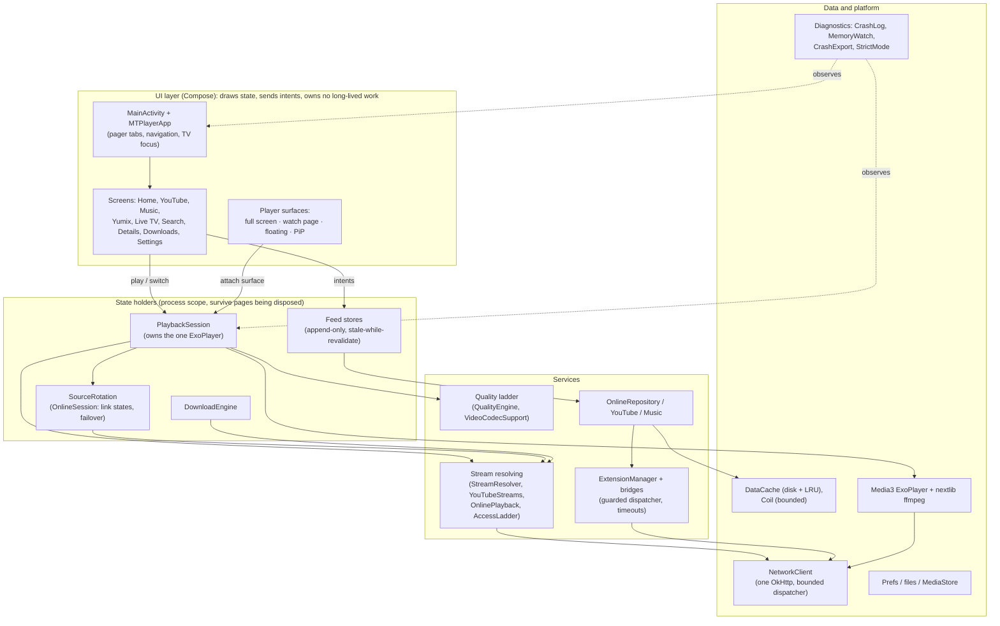
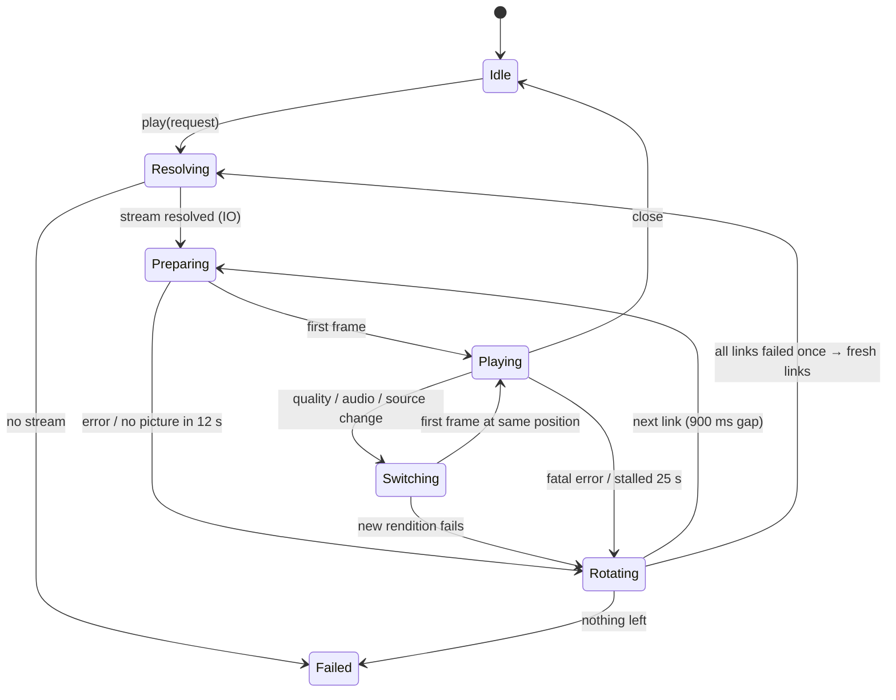
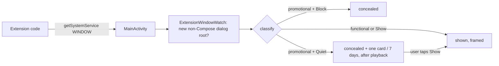
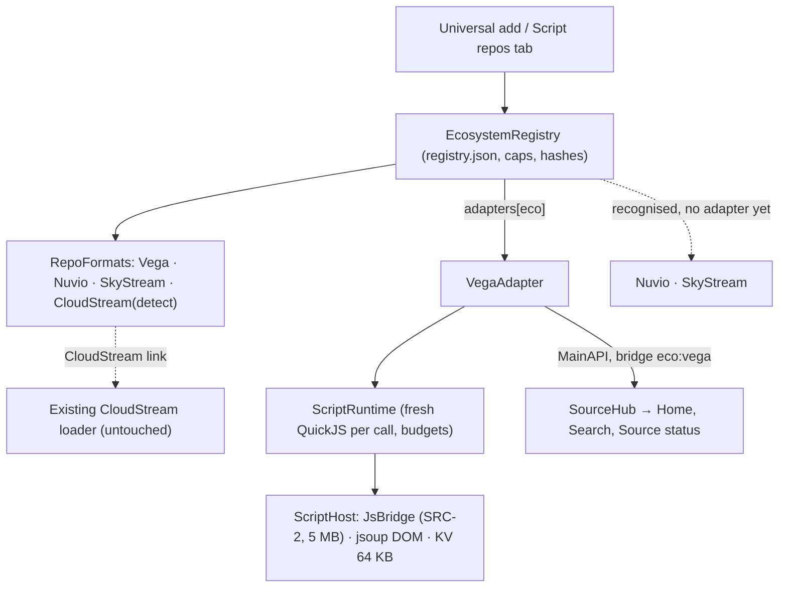

# Yumeiro system design (R15)

Written with the architecture-designer skill (jeffallan/claude-skills). Kotlin/Android specifics follow
the Kotlin agent skills. This document is the contract for how the app is built. Code that breaks a
rule here is a bug, and every rule has a test or a runtime guard named next to it.

Status markers: **[done]** implemented and covered by a test; **[in progress]** being moved now;
**[planned]** designed, not built yet.

## 1. Requirements

### Functional (what the app must do)

| Area | Requirement |
|---|---|
| Playback | One player for every kind of media: local files, YouTube, YouTube Music, IPTV/links, extension sources (CloudStream, Aniyomi, Stremio, JS, home servers). Quality, audio, subtitle, speed and source switching while playing. Full screen, docked watch page, in-app floating player, system picture-in-picture, background audio. |
| Sources | Extensions are installed by the user and run in-process. A dead link moves to the next one automatically, including after a manual pick. |
| Feeds | Home, YouTube, online music, Yumix (extensions) and live TV are endless and live: they never stop by themselves and are never replaced by an old saved copy while the user scrolls. |
| Downloads | Download any playable stream (direct, HLS, DASH, YouTube) during playback, even when the source page doesn't offer a download button. |
| Reliability | Crash, ANR and out-of-memory reports are written on the device and exported to a file automatically. |

### Non-functional (how well)

| Attribute | Target | How it is checked |
|---|---|---|
| Scale | 200,000 monthly users, every kind of device | Crash-free sessions ≥ 99.5 %; ANR rate < 0.47 % (Play "bad behaviour" line) |
| Devices | Android 7 TV boxes, 2 GB Android Go phones, flagships, Android TV | Device tiers in §5; emulator matrix in `.github/workflows/device-check.yml` |
| Main thread | No frame task ≥ 700 ms; no input event ≥ 5 s (ANR) | `MainThreadWatchdog` (debug), `StabilityStressDeviceTest` stall meter |
| Memory | No OOM on a 192 MB heap device under the stress test | `MemoryWatch` samples, stress test on the low-RAM emulator |
| Start-up | First frame without network, disk scans or extension loading on the main thread | `DevStrictMode`, start-up thread `yu-startup` |
| Privacy | No credential in code, logs, crash reports or backups | `CrashLog` scrubbing, secret scan before every commit |

### Constraints

Single Gradle module, Kotlin + Compose, minSdk 24. Extensions are third-party code that can block, throw,
leak or allocate without limit; the app must survive all of that. There is no app server: everything runs on
the device (GitHub Actions only builds the market and feeds).

## 2. Architecture at a glance

Dependency rule: arrows only point down. The UI never builds players, parses pages, compiles regexes or
talks to the network. State holders outlive any single composable.

### Code structure as measured (G12 X1, 2026-11-15)

| Package | Files | Lines | Role |
|---|---|---|---|
| `ui/` | 141 | 44,897 | Compose screens, components, theme, the one `MainViewModel` |
| `online/` | 61 | 8,779 | Extensions, online repository, Yumix, trackers' APIs |
| `sources/` | 30 | 5,151 | Drama, Tachiyomi/JS (Mangayomi) bridges, Stremio |
| `player/` | 32 | 3,550 | PlaybackSession, quality, heat guard, listening time |
| `stream/` | 20 | 3,250 | Resolving and forced downloading |
| others (21 packages) | 96 | 14,098 | update, youtube, notify, data, backup, network, lyrics, … |
| **total** | **380** | **79,725** | |

- State is held in 275 top-level `object`s (service-locator style; no DI framework) and one
  `MainViewModel`. This matches ADR-001/006 (process-scoped holders) and keeps start-up cheap, but
  makes unit tests reach into globals (`resetForTest` hooks) and hides dependencies. Proposal, not
  done: constructor-injected interfaces at the seams that tests fake most (network, prefs, clock).
- Largest files (review cost, recomposition scope): `VideoPlayerModal.kt` 2,388, `MediaComponents.kt`
  1,693, `MTPlayerApp.kt` 1,687, `HomeScreen.kt` 1,218 lines.
- Coroutines: 64 ad-hoc `CoroutineScope(...)`; those without a `SupervisorJob` are all
  `rememberCoroutineScope` (UI-bound, cancelled with the composable). `GlobalScope`: none (one comment).
  `runBlocking`: two, `JsBridge.extractor` (now bounded, X1-3) and `BrowserCheck` (guarded off main).
- `runCatching` around suspend calls catches cancellation; the shared `online/runCancellable` keeps
  timeouts as failures and rethrows real cancellation (X1-4). Other suspend `runCatching` sites were
  read: they check `isActive` afterwards or wrap `withTimeout` on purpose.
- Synchronous `SharedPreferences.commit()`: 10 calls, all deliberate (launch-time restore before
  anything loads, reset, crash export while the process may die).

## 3. Threading model **[done for regex/start-up/YouTube; enforced]**

| Work | Where it runs | Guard |
|---|---|---|
| Drawing, input, focus, small state updates | Main | `MainThreadWatchdog` logs `YuStall` (debug); stress test fails on a stall ≥ 4 s |
| Regex compilation | Never at run time on main; patterns are file-level constants or `RegexCache`. A file-level constant compiles in the class's static initialiser on whichever thread touches the class first, so `RegexWarmup` initialises all 91 holder classes on `yu-startup` | `RegexGuardTest` (no regex built inside a function; every holder class is in the warm-up list); stress test samples main for `Pattern.compile` |
| Focus and motion | Auto-advancing carousels (Home banner, Yumix hero) pause while focus is inside, on touch, with reduced motion and under `HeatGuard`, so a pager never moves a focused card away from bring-into-view. The tab pager takes no nested scroll from its pages: Compose's default page connection consumes `UserInput` pre-scroll while between pages, and bring-into-view is `UserInput`. An idle tab pager is always settled on a page | `dpadFocusSettles`, `swipeThenDpadSettles` (frames per 2 s must fall to 0); the stress test fails on any "Compose never idle" |
| Parsing (HTML, JSON, manifests), feed merging, sorting | `Dispatchers.Default` | code review + StrictMode |
| Network and disk | `Dispatchers.IO` through `NetworkClient` (16/32 requests, 4/6 per host) | StrictMode disk/network on main (debug) |
| Extension calls | `ExtensionGuard.dispatcher` with timeouts | crash guard, per-call timeout |
| Image fetch / decode | Coil, 4/8 fetchers, 2/3 decoders | `MTApplication` image loader |
| Start-up chores (workers, FCM, downloads resume, backups, janitor, regex warm-up) | `yu-startup` thread | — |
| YouTube extractor init | `yu-yt-init` thread | — |
| YouTube stream request (manifests, OTF) | `Dispatchers.IO` | `YouTubeStreams.videoRequest` |

Root cause fixed in R15: `Kana.forTitle()` compiled about 60 regexes per call and ran inside composition for
every card the pager prefetched, which matches the Xiaomi ANR stack (`Pattern.compile` under
`LazyLayoutPinnableItem` / `PrefetchHandleProvider`). See `docs/STABILITY-R15.md`.

## 4. Memory model **[done]**

| Budget | Low-end (≤192 MB heap, ≤3 GB RAM, ≤4 cores, Go) | Normal | TV |
|---|---|---|---|
| Image memory cache | 15 % of heap | Coil default (25 %) | Coil default |
| Image fetch / decode parallelism | 4 / 2 | 8 / 3 | 8 / 3 |
| Player buffer | `bufferBudgetBytes(memoryClass)` | same formula | same formula |
| `ReleaseTags` / `Kana` LRU | 1024 / 256 entries | same | same |
| Data cache in memory | 48 pages | same | same |
| Feed stores | rows × `MAX_ROW_ITEMS`, explore grows only as the user scrolls | same | same |

Pressure handling: `MemoryWatch` samples every 30 s (heap, native, free system memory, thread families),
clears the image cache at ≥ 85 % heap, and reacts to `onTrimMemory` / `onLowMemory`. `CrashLog` keeps a
512 KB reserve that is released when an OOM is thrown so the report can still be written. Background
low-memory kills reported by `ApplicationExitInfo` are labelled "Closed to free memory", not "Out of memory".

## 5. Device tiers

`DeviceClass.lowEnd` (pure function `isLowEnd`, unit tested) selects the low-end budgets. TV is detected
from `UI_MODE_TYPE_TELEVISION` and gets D-pad focus paths (see `docs/TV-AND-PHONE.md`). The emulator matrix
runs a low-RAM Android 13 device (2 GB RAM, 192 MB heap → low-end path) and a current Android image.

## 6. Feeds **[done for Yumix, Home, YouTube, online music, Live TV]**

Rules for every endless feed:

1. **Process-scoped store.** Feed state lives in an object that outlives the pager page. The main pager uses
   `beyondViewportPageCount = 0`, so a tab's composables are disposed when you leave it; state held in
   `remember` was thrown away and reloaded from the disk copy (up to 6 h old). That was the "suddenly shows
   saved cache" bug. Yumix: `YumixMemory` in `OnlineHomeScreen.kt`.
2. **Stale-while-revalidate.** A saved copy is shown at once; when it's older than the memory window
   (15 min) the live page is fetched in the background and merged with `mergeRows` (existing rows keep
   their order and items, new titles are appended, new rows go at the end).
3. **Append-only.** Cards already on screen never move, vanish or get replaced (`YumixFeed.appendNew`).
   Before R15 the explore feed was rebuilt and re-shuffled from scratch on each page, and round-robin put a
   short row's next page in the middle of what was already shown.
4. **A failed page is not the end.** `HueRowFeed.afterPage(null)` keeps the row open and retries with a
   back-off (2 s, 4 s, … up to 8 s, 3 tries in a row). Only an empty page or 3 failures in a row end it.
5. **Fetches survive navigation.** They run in the store's scope, so leaving a tab doesn't cancel them half
   way (a row stuck "loading").

6. **One store type for every feed (ADR-008).** `LiveFeed` / `LivePaged` hold the rows, the arrival order and
   a generation number. A load started for an older generation can't overwrite a newer one, and a failed
   refresh never wipes rows that are on screen. Home uses `HomeMemory` (rows in arrival order, a shuffle
   seed kept for the process), Live TV uses `LiveTvMemory` (per-playlist loads and stamps).

Tests: `LiveFeedTest` (append-only, retry, merge), `LivePagedTest`, `YumixFeedTest`.

## 7. Playback **[done: player ownership and recovery state machines; verified on device]**

### Before R15

The `ExoPlayer` was created inside `VideoPlayerModal` (`remember(video.id)`), so the player's life is tied
to one composable. Resolving, quality switching, failover timers and PiP handling also live in that
2,300-line composable. Consequences: a new video recreates the player; work that should survive a
navigation (download → downloads page with the video still playing) depends on the composable staying
alive; and blocking work started from the UI (the YouTube quality request) froze the screen.

### Target

- **One owner.** `PlaybackSession` (process scope) owns the single `ExoPlayer`, its media source factory and
  the state machine above. Surfaces (full screen, watch page, floating, PiP) attach and detach a
  `SurfaceView`; they never create or release the player.
- **Every expensive step runs off main.** Resolving and manifest building on IO, codec probing cached.
- **Quality ladder.** `QualityEngine` builds one list per source: the downloader's full list for
  YouTube/Video/Yumix; for single-rendition sources the engine adds scaled levels (GPU `Presentation`) and an
  upscaled level (Anime4K). `VideoCodecSupport` ranks codecs by hardware support so a 4K AV1 level on a
  phone without an AV1 decoder plays as VP9/H.264 instead of timing out.
- **Source rotation.** A link that fails, sends no picture in 12 s, or stalls 25 s hands over to the next
  link; a manual pick is just another start point for the same rotation.
- **Surface modes.** Starting a new video while the floating player or system PiP is showing expands to full
  screen. "View downloads" from the download toast moves the video to the floating player and opens
  Downloads.

### Player ownership (built in R15)

`player/PlaybackSession` owns the one `ExoPlayer` of the process:

- `acquire(key, uri)` returns a `Lease`. The next video reuses the same player (stopped, media cleared,
  speed, volume and track overrides back to their defaults) when the profile matches (network vs local
  file) and it never ran GPU effects. Otherwise the old player is released before a new one is built, so
  two players never exist together. Before R15 the next episode built a second player while the first
  was still alive: two sets of codecs and two media buffers on a 2 GB phone.
- Listeners are added through the lease. A handover revokes the old lease first: its listeners are
  removed, and its last position and duration are frozen for the old screen's final progress save. This
  stops the old screen from reacting to the new video's events, which ExoPlayer sends synchronously.
- On close the player pauses and is released after `GRACE_MS` (3 s). Reopening the same video inside the
  grace resumes it with no reload. `onTrimMemory(RUNNING_LOW)` releases a closed player at once.
- Header and DRM lookups read `PlaybackSession.currentUri`, so a reused player sends the new video's
  headers.

Tests: `PlaybackSessionTest` (reuse, fencing, grace, resume, local vs network) and
`PlaybackSessionDeviceTest` (three videos in a row through the real app = one player built, two reuses;
close → released after the grace; reopen inside the grace → resumed).

Migration (one step at a time, each with a device test):
1. **[done]** YouTube stream request off main; codec-aware rendition choice; start position passed to
   `setMedia`.
2. **[done]** Engine levels and DASH rendition switching, verified by `PlayerSwitchDeviceTest` on the
   emulator.
3. **[done]** Player creation, lifetime and listener ownership moved to `PlaybackSession`.
   **[done] 3b.** Recovery moved out of the composable: `StartWatch` (no picture: gives up after 12 s with
   10 s of no download, or 45 s in all; paused time does not count) and `StallWatch` (buffer frozen 25 s)
   in `player/SourceWatch.kt`, and `RecoveryRouter` (the order: GPU effect → local file → offline wait →
   link refresh → header ladder → quick retry → next source → generic bounded recovery). Retry and
   "stable playback" timers are lease-owned (`Lease.schedule`), so `revoke()`/`detach()` cancel them and a
   retry for one video can never fire on the next. Tests: `RecoveryStateTest`, `PlaybackSessionTest`
   (timer fence).
4. **[done]** Surface-mode rules (download → floating + Downloads; new video → full screen),
   `PlayerSurfaceRules` + `SurfaceModeDeviceTest`.

## 8. Failure modes

| Failure | Behaviour |
|---|---|
| Extension throws, hangs or returns junk | Guarded dispatcher, per-call timeout, row skipped; the rest of the feed continues |
| A feed page times out | Row stays open and retries with back-off (§6) |
| Network drops | `Connectivity.online` pauses stall timers; feeds keep what's on screen |
| Link dead / expired | Rotation (§7), then one fresh link extraction, then the site's own page |
| Decoder can't play a codec | Codec-aware choice; ffmpeg software decoders as fallback |
| Memory pressure | Image cache cleared, LRU bounded caches, OOM reserve for the report |
| Crash / ANR / LMK | `CrashLog` + `ApplicationExitInfo` import, breadcrumbs, auto export to `Download/Yumeiro/Crash reports` |

## 9. Security

Covered in `docs/ARCHITECTURE.md` (extension model, updates) and `docs/security/`. Additions in R15: crash
reports and breadcrumbs pass through `CrashLog` scrubbing (tokens, cookies, keys); the exported copy is the
scrubbed text. Credentials live only in CI secrets or the git-ignored `.secrets/` folder.

## 10. Decision records

### ADR-001: Process-scoped feed stores instead of composable state

- **Status:** Accepted, implemented for Yumix.
- **Context:** The main pager disposes tabs it isn't showing. Feed state held in `remember` was lost and
  reloaded from disk, which looked like the feed "stopped and showed old data".
- **Decision:** Keep feed state in process-scoped objects with bounded size; fetches run in the store's scope.
- **Alternatives:** `beyondViewportPageCount = 1+` (keeps more pages composed: more memory and prefetch work
  on low-end phones, the opposite of the ANR fix); Jetpack `ViewModel` per tab (the pager pages share one
  activity-scoped owner, so it would be the same lifetime with more plumbing); `rememberSaveable` (can't hold
  thousands of items in a Bundle).
- **Consequences:** Feeds survive tab switches and rotation; memory is held until the process dies, so every
  store must be bounded and cleared on "Clear caches".

### ADR-002: Append-only endless feeds

- **Status:** Accepted, implemented (`YumixFeed.appendNew`).
- **Context:** Rebuilding and re-shuffling the merged feed on every page moved and removed cards under the
  user's finger.
- **Decision:** A feed only appends entries it hasn't shown; each new batch is block-shuffled on its own.
- **Alternatives:** Stable sort by a per-item hash (still inserts new items between old ones).
- **Consequences:** Order is "arrival order", which is less evenly mixed than a full round-robin; acceptable
  for an endless feed.

### ADR-003: Stale-while-revalidate for saved pages

- **Status:** Accepted, implemented for extension home pages.
- **Decision:** Show the saved copy at once, refresh in the background when it's older than 15 min, merge.
- **Alternatives:** Always network first (blank screen on slow networks); always cache first with a 6 h
  freshness window (the old behaviour: old data until the window expired).
- **Consequences:** One extra request per stale extension per visit.

### ADR-004: No regex compilation at run time on hot paths

- **Status:** Accepted, implemented, enforced by `RegexGuardTest`.
- **Decision:** Patterns are file-level constants or come from `RegexCache` (LRU 128); heavy pattern
  objects are warmed on `yu-startup`.
- **Alternatives:** Only fixing `Kana` (the other ~70 call sites would come back as the next ANR).
- **Consequences:** Slightly more start-up work off main; a build-time rule developers must follow.

### ADR-005: One shared OkHttp client with bounded concurrency

- **Status:** Accepted, implemented.
- **Decision:** Coil, extensions, YouTube and the player share `NetworkClient` (dispatcher 16/32, 4/6 per
  host, one connection pool).
- **Alternatives:** Per-feature clients (dozens of `OkHttp` threads in the Pixel 6a report).
- **Consequences:** A slow host can't starve the others past its per-host limit.

### ADR-006: Player owned by a process-scoped PlaybackSession

- **Status:** Accepted. Ownership done (`PlaybackSession`, §7); recovery clocks and routing done (step 3b).
  The `PlaybackService` + `MediaController` move stays future work (see Consequences).
- **Context:** The player is tied to one composable, so player lifetime, surfaces and recovery depend on UI
  composition.
- **Decision:** One `PlaybackSession` owns the `ExoPlayer` and the playback state machine; UI surfaces attach.
- **Alternatives:** Keep the modal and patch each symptom (what earlier rounds did); move playback into
  `PlaybackService` + `MediaController` now (the long-term shape; bigger change, and the controller's async
  API would touch every player call at once).
- **Consequences:** Player survives navigation and mode changes; the modal shrinks to drawing and gestures.
  The `PlaybackService` move can follow without UI changes.

### ADR-007: Device evidence on emulators in CI

- **Status:** Accepted, implemented (`device-check.yml`).
- **Decision:** Instrumented tests on a low-RAM API 33 emulator and a current API image, uploading reports,
  logcat and optional heap dumps.
- **Alternatives:** Robolectric only (what v1.8.1 relied on; can't show ANRs, OOMs or decoder behaviour).
- **Consequences:** Each run costs about 30–45 minutes of CI time, so runs are manual.

### ADR-008: One live-feed store for every endless feed

- **Status:** Accepted, implemented (Yumix, Home, YouTube, online music, Live TV).
- **Context:** Every tab had its own copy of "load rows, keep them in `remember`, reload from disk when the
  page comes back". The disk copy could be hours old, so a live scroll was replaced by stale data.
- **Decision:** `LiveFeed` / `LivePaged` (process scope) with arrival order, append-only pages and a
  generation guard; loads run in `FeedScope`, never in the composable's scope.
- **Alternatives:** `beyondViewportPageCount` > 0 (more memory and prefetch work; the ANR cause); a
  `ViewModel` per tab (same lifetime as a process object here, more plumbing).
- **Consequences:** A feed survives tab switches; every store must be bounded and cleared on "Clear caches".

### ADR-009: Drama studio health as a background service

- **Status:** Accepted, implemented (`DramaHealth`, `YumeiroDramaProvider`).
- **Context:** Dramas often didn't appear and the banner showed episodes that never played: studios that
  refuse every episode were still shown, and each episode request could hang for 35 s.
- **Decision:** One `DramaHealth` checks each studio in the background and hides studios that refuse
  everything. Episode links run under one deadline (68 s): up to 3 tries on a hang, a refusal goes straight
  to mirrors, mirrors share what's left.
- **Consequences:** Studios come back by themselves when they recover. Evidence: live run b21, 24 of 24
  shown dramas played (`docs/evidence/round3/drama-live-b21.txt`).

### ADR-010: Forced downloading in the built-in engine (ForceGrab)

- **Status:** Accepted, implemented (`online/download/ForceGrab.kt`).
- **Context:** Some sources "don't allow downloads": they refuse a plain request, serve DASH, or keep the
  sound in a separate track.
- **Decision:** IDM-style engine: multi-connection byte ranges (2 connections on low-end phones, 4
  otherwise; 4 MB chunks, resumable with a `.chunks` file), header escalation on 401/403 (the player's
  headers, then browser UA + Origin + Sec-Fetch + WebView cookies, then without Referer), DASH saved as
  one file (one container family per pair, main or phone-language audio, joined with `MediaMuxer`), and
  torrents handed to TorrServer. DRM is never bypassed: protected tracks are skipped, and our own scan
  catches `<ContentProtection>` tags media3 drops.
- **Alternatives:** Hand everything to an external downloader (can't join DASH or split audio; such
  sources are now kept in the app).
- **Consequences:** More parallel requests per download, bounded by the shared client's per-host limit.
  Evidence: `ForceGrabTest` (live byte-identical multi-connection and resumed downloads),
  `ForceDownloadDeviceTest` (DASH save on the emulator).

### ADR-011: Pinned extensions

- **Status:** Accepted, implemented (`online/PinnedExtensions.kt`).
- **Decision:** Up to 8 pins kept in prefs, shown first in "Show videos from" and as a chip bar under
  the extension bar. 48 dp touch targets, labelled for TalkBack (UI/UX Pro Max rules).

### ADR-012: Start-up is measured on the R8 preview build (G12 X2)

- **Context:** debug builds are not optimised and JIT-only, so their start-up (X2-1: ~5.9 s first
  composition on the low-RAM emulator) says little about the release. A benchmark needs a
  non-debuggable, R8-optimised build that installs next to the store app.
- **Decision:** a `:benchmark` `com.android.test` module (Macrobenchmark 1.5.0) targets the existing
  `preview` build type; `src/preview` adds `<profileable shell=true>` for preview only. Cold start is
  measured with no AOT and with the baseline profile; the profile is generated by
  `BaselineProfileGenerator` and committed as `app/src/main/baseline-prof.txt`.
- **Consequences:** emulator numbers compare before/after on one image only; a real-phone number is
  an owner test. No release-manifest or signing change.
- **Status:** accepted (2026-11-15).
- **Amendment (2026-11-16, X2-1):** the first generated profile (43787473722) held obfuscated names
  (`La41;`) because `preview` is minified, so it could not be committed. Profile generation now
  builds `preview` with `-Pyu.profileGen=true`, which adds `app/proguard-profilegen.pro`
  (`-dontobfuscate`, `-dontoptimize`); release and normal preview builds are unchanged. Before
  numbers (43784533563, TTID median of 8): api33-lowram 3145 ms without AOT / 2905 ms with the
  library profiles; api36 3899 / 2731 ms.
  After the app profile (fef01c6, run 43790371337): api33-lowram 3924 / 2837 ms, api36 2509 / 1853 ms.
  Emulator run-to-run noise is larger than the gain, so the real-phone check is OMT-12.

### ADR-013: Keys in the APK, by class (G12 X7-3)

- **Context:** every BuildConfig value can be read out of an APK. The owner delegated the decision
  (orders 4): classify every key as (1) public identifier, (2) restricted public (public by nature,
  limited by the provider's own controls), or (3) true secret, following each provider's rules.
  Class 3 must not ship in an APK.
- **Table** (provider rule checked 2026-11-16):

| Key (BuildConfig) | Provider rule | Class | Decision |
|---|---|---|---|
| `ANILIST_CLIENT_ID` | AniList implicit grant uses the client id alone ([docs](https://docs.anilist.co/guide/auth/implicit)) | 1 | keep |
| `MAL_CLIENT_ID` | MAL Authorization Code with PKCE "mainly native apps" ([docs](https://myanimelist.net/apiconfig/references/authorization)); no secret in the build | 1 | keep |
| `SIMKL_CLIENT_ID` | "Your `client_id` is public and safe to commit" ([Simkl](https://api.simkl.org/authentication)) | 1 | keep |
| `TRAKT_CLIENT_ID` | id is public; PKCE/device sign-in | 1 | keep |
| `TRAKT_CLIENT_SECRET` | "The Client Secret is deprecated for user sign-in and should only be used server to server" ([Trakt](https://developer.trakt.tv/docs/authentication-oauth)) | 3 | **removed** from BuildConfig and release.yml; a user's own Trakt app may still carry its own secret (Settings) |
| `KITSU_CLIENT_ID` / `KITSU_CLIENT_SECRET` | "The client secret **must** be kept confidential", but "Application registration has not yet been implemented … can be omitted" ([Kitsu](https://kitsu.docs.apiary.io/)) | 3 | **removed**; the password grant is sent with no client fields. Live probe 2026-11-16 (kitsu.app and kitsu.io): no client fields → `invalid_grant` (user check reached), empty fields → `invalid_client` |
| `TMDB_API_KEY` | — | 3 by default | **removed**: shipped but read by no app code (it was reserved for the gated trailer feed; that feature's proposal must classify it again here before it ships) |
| `LASTFM_API_KEY` | key identifies the app; ToS has no confidentiality rule ([ToS](https://www.last.fm/api/tos)) | 2 | keep |
| `LASTFM_SHARED_SECRET` | the mobile flow signs `auth.getMobileSession` on the device with the secret ([mobile auth](https://www.last.fm/api/mobileauth)); no confidentiality rule in the ToS | removed (ADR-048) | Superseded by ADR-048: Yumeiro uses web auth, not the mobile flow, so Yumeiro Cloud signs the built-in key's calls and the secret left the APK. Old note: the provider's own mobile flow requires it on the device. A Worker signing service would need the user's password to pass through our server for `getMobileSession`, which is worse for users. Users can enter their own key and secret |
| `OPENSUBTITLES_API_KEY` | key identifies the consumer app (sent as the `Api-Key` header from the client); the getting-started docs state no confidentiality rule | 2 | keep; users can enter their own |
| `LRCLIB_APP_ID` | client identification header | 1 | keep |
| `FCM_APP_ID`, `FCM_PROJECT_ID`, `FCM_SENDER_ID` | "API keys for Firebase services are not secret" ([Firebase checklist](https://firebase.google.com/support/guides/security-checklist?hl=en)) | 1 | keep |
| `FCM_API_KEY` | not secret, but "Always restrict an app's API key to the set of APIs used by that app" ([Firebase checklist](https://firebase.google.com/support/guides/security-checklist?hl=en)) | 2 | keep; restriction check is OMT-13 (owner's Google Cloud console). Probe of the v1.8.1 key without Android headers: Firebase Installations reached argument validation (no Android-app restriction seen) |
| `CLOUD_HOST`, `UPDATE_REPO_OWNER`, `UPDATE_REPO_NAME` | public host and public repository | 1 | keep |
| `UPDATER_TOKEN_BYTES` (`MT_UPDATER_TOKEN`) | GitHub token | 3 | the release repository is public, so the updater needs no token. The build now **fails** for any release or preview task when `MT_UPDATER_TOKEN` is set; CI has no such secret. Debug builds of a private fork can still use one |
| `UPDATER_TOKEN_KEY`, `INTEGRITY_BYTES` | XOR key and the SHA-256 of the public signing certificate | 1 | keep |
| Cloudflare token, Firebase service account, D1 ids | server-side only (`server/`, CI secrets) | 3 | never in the APK (unchanged) |

- **Guards:** `ApkSecretsTest` (unit) fails when a removed key returns or a new secret-like BuildConfig
  field is not in this table; `KitsuLoginTest`; the Gradle release/preview token guard; the APK and
  git-history secret scan before any release.
- **Status:** accepted (2026-11-16), implemented (X7-3).

### ADR-014: Windows that third-party extensions open (G12 X9-7)

- **Status:** accepted (owner orders 4: convert, never block; design delegated). Built; evidence in
  `docs/DONE-LEDGER.md` (X9-7 / ADR-014 row).
- **Context:** CloudStream plugins run in our process with the activity as context and open their
  own View windows. phisher98's repo opens "Support Phisher Repo" (donation, "Watch an Ad") while it
  loads; on TV it takes D-pad focus and the next Back closes it instead of the screen (TV
  43775191888, `docs/evidence/round3/x9-7-extension-dialog-tv.png`; EXT-T1 on api33-lowram). The
  same mechanism carries legitimate plugin UI (log-in forms, WebView captcha, settings, server
  choice), so blocking dialogs would break extensions.
- **Decision:**
  1. Two classes. **Functional** = has an input field or a WebView, or mentions log-in / password /
     captcha / verify / cookies / token / choose / select / settings / confirm, or has no readable
     text. **Promotional** = none of that, and mentions donate / Ko-fi / Patreon / PayPal / sponsor /
     "support the developer" / Telegram / Discord / "rate us" / "star the repo" / "watch an ad".
     Anything unclear is functional: it is shown, never lost (`ExtensionPopups.classify`, unit).
  2. Functional windows are always shown, in every mode and even over the player (a captcha while
     links resolve), inside a Yumeiro frame: a thin accent outline round the dialog card and the
     window title "From extension: <name>" for accessibility.
  3. Setting **Extensions → Pop-ups from extensions: Show / Quiet / Block promotional**, default
     **Quiet**. Show = every window as the extension built it (framed). Quiet = a promotional window
     is concealed in place and announced by one quiet, non-modal card ("<name> has a message ·
     Show", the app message bar, auto-dismissed), at most once per extension per 7 days, never
     while a video plays (full screen, mini player or PiP: the card waits until it closes). The
     message stays listed under the setting with Show / Dismiss. Block promotional = concealed, no
     card.
  4. Mechanism (`ExtensionWindowWatch`): MainActivity.getSystemService(WINDOW_SERVICE) reads the
     stack only while an extension is loaded; when extension code asks (Dialog / AlertDialog /
     PopupWindow do while they are built), the root windows are checked right after that message —
     before the next frame, so nothing flashes — and again at 16 ms … 5 s for dialogs built first
     and shown later. A new dialog-type, non-Compose root is the extension's. Concealing = the
     window stays attached but invisible, not focusable, not touchable, no dim, so Back and D-pad
     stay with the app on phone and TV and the extension's own `dismiss()` still works; "Show"
     restores its exact layout parameters.
  5. Main-thread guard: an extension window added after its screen is gone throws BadToken inside
     `ViewRootImpl.setView`; ExtensionGuard now swallows that (it is not a drawn frame) instead of
     crashing. Extension callbacks that throw on the main thread are swallowed as before; worker
     threads die quietly as before.
- **Alternatives rejected:** (a) wrap the WindowManager — the framework casts it to its own class in
  `Window.setWindowManager`, so every extension Dialog would crash while built (found while
  building, before any run); (b) remove promotional windows — the extension's later `dismiss()`
  throws "not attached"; (c) block all plugin dialogs — breaks log-ins and captchas; (d) re-parent
  the dialog into a Compose container — DecorView must be the window root (insets, Back dispatch),
  too risky for "no extension may break"; (e) remove the repo from the market — loses its sources.
- **Consequences / trade-offs:** + Back and focus are predictable; no extension code path changes;
  nothing is lost (Show from the card or the setting). − The classifier is word-based (English);
  an unknown promo wording is shown (safe side). − A dialog built and shown more than 5 s apart is
  not judged (shown as built). − A concealed window keeps its memory until the extension closes it
  or the screen goes.

- **NFRs:** no work unless an extension is loaded; one stack read per window-manager request; the
  check walks at most 400 views. **Failure modes:** conceal fails (updateViewLayout throws) → the
  window simply stays as built. **Security:** no extension code is skipped or rewritten; only window
  flags of its own window change.
- **Tests:** `ExtensionPopupsTest` + `ExtensionGuardSetViewTest` (unit); `ExtensionPopupsDeviceTest`
  p1–p7 with the `FakeExtension` test extension (donation + log-in dialogs, Back, modes, playback,
  BadToken, throwing callback) on both phone emulators and the TV emulator (emulator).

### ADR-015: Jackson 2.13.5 on the TV build (G12 X13-1)

- **Scope:** Android 7 TV boxes only (TV flavour, minSdk 24). The phone flavour keeps 2.19.4.
- **Context:** Jackson 2.14+ needs Android 8 (jackson-databind#4653); on Android 7 every CloudStream
  source failed with `NoClassDefFoundError` (run 43765162241). The TV classpaths resolve 2.13.5, the
  last release of the 2.13 line, which gets no more fixes. Approved by the owner with conditions
  (orders 4, X13-1).
- **Known advisories affecting 2.13.5** (OSV.dev query, 2026-11-16): jackson-core 3
  (CVE-2025-52999 deep nesting → StackOverflowError, fixed 2.15.0; CVE-2026-89425 error-token
  length; CVE-2026-68494 async-parser number length), jackson-databind 11 (CVE-2026-50193 deep
  `JsonNode.toString`; CVE-2026-54512 / -54513 / -83557 polymorphic-validator bypasses;
  CVE-2026-54514 / -77310 InetSocketAddress/InetAddress DNS on deserialisation; CVE-2026-19032
  `Path` deserialisation; CVE-2026-91776 / -91777 type-id retention and forward-reference cost;
  CVE-2026-54515 / -59889 ignore/view bypasses).
- **Exposure (checked in code):**
  - Who parses with Jackson: extension code and the bundled CloudStream extractors / sync
    providers, through the shared `com.lagradost.cloudstream3.mapper` (site JSON, untrusted). Our
    own repo, market and settings parsing uses `org.json`, not Jackson; `DataStore` reads only our
    own preferences.
  - The shared mapper is `JsonMapper.builder().addModule(kotlinModule())
    .configure(FAIL_ON_UNKNOWN_PROPERTIES, false)` (bytecode of CloudStream library 4.8.0
    `MainAPIKt.<clinit>`). It has no default typing, and neither the library, the app nor our
    bundled code uses `@JsonTypeInfo` or a `PolymorphicTypeValidator`, so the gadget and allowlist
    advisories need an extension that opts in itself. An extension is already arbitrary code in our
    process, so it gains nothing from them.
  - The realistic risk is denial of service from a hostile site: deep nesting can overflow the
    stack in bean binding and in `JsonNode.toString` (`readTree` itself is iterative in 2.13).
    Untyped binding (`readValue(json, Any::class.java)`) does not overflow: 2.13.5 has a depth guard
    in `UntypedObjectDeserializer.Vanilla` that throws `JsonParseException` "JSON is too deeply
    nested" at about 1000 levels (string present in the 2.13.5 jar; seen on CI 43825446008). The
    earlier text said it overflowed; CI 43803887311 and 43825446008 both failed the test on that
    assumption (correction 2026-11-16). For `toString` the test accepts overflow or success (frame
    sizes differ by JVM) and checks containment. Either way it fails only that call: home, search and detail calls sit in `runCatching` (catches Errors) or the
    `ExtensionGuard` handlers. No `InetSocketAddress`, `InetAddress` or `Path` fields exist in the
    provider models.
- **Mitigation:** `JacksonTvExposureTest` (testTv, in the CI TV unit step with
  `JacksonTvCompatTest`) fails if the shared mapper gains default typing, if deep nesting stops
  being contained by the caller pattern, or if normal JSON stops parsing. CI also fails if the TV
  classpath leaves the SDK-24 line.
- **Removal conditions:** remove the `tv*` resolution rule in `app/build.gradle.kts` and the
  `jacksonTv` version when either (a) the TV minSdk becomes 26 or higher, or (b) a Jackson release
  that runs on SDK 24 contains these fixes.
- **Related finding (phone, not changed):** OSV lists 16 advisories for the phone's 2.19.4 (the
  2.19 line is no longer patched). 2.18.11 has none and stays below the 2.20 `invokeExact` limit.
  Moving the phone to 2.18.11 conflicts with the owner's condition 3 (phone keeps its current
  version), so it is proposed (X13-6) and needs the owner's decision.
- **Status:** accepted (2026-11-16) with the owner's five conditions.

### ADR-016: Segmented downloads: request restarts against wasted data (G8 DL-11 part 2)

- **Scope:** `ForceGrab.Segmented` (direct files of 16 MB or more), `RequestPace`.
- **Context:** BUG-3 (owner, high): many hosts serve each request fast and then cap it. 3c85a72 made a
  request that falls under a third of its own baseline for one 256 KiB window ask for the rest in a new
  request. The closed request throws away the bytes already on the way. Measured on the device
  (emulator, cdn.kernel.org, 134.7 MB, a host that never caps a request), 44036060683 and 44037559115:
  1 to 29 restarts per download, 1.04 to 1.44× the file received, about 2 MB lost per restart; the
  download with 29 restarts was also the slowest (3.58 MB/s against 5.9–7.8). Local server, capped
  profile (CI 44026316670): segmented2 67.6 MB/s, tail 0.14×, 1.28× the file served.
- **Options measured:**
  - A. One slow window (current). Fast on capped hosts; wastes data on hosts with an uneven link.
  - B. Two slow windows in a row (6e40982, reverted in f60d808): CI 44037788044 segmented2 17.8 MB/s,
    tail 3.23×; segmented4 75.7 → 48.0 MB/s; 1.04× served. Rejected: a speed regression on the
    owner's case.
- **Options not yet measured:**
  - C. A smaller receive buffer on the segmented connections (`SO_RCVBUF`, e.g. 1 MiB), so less is on
    the way when a request is closed. Risk: caps one connection at buffer / round trip (1 MiB at
    100 ms = 10 MB/s; 4 connections 40 MB/s).
  - D. Stop pace restarts for the rest of a download when restarted requests are not faster than the
    ones they replaced (measured over their first window after the baseline).
- **Option E (added 2026-11-17, eighth cycle):** time each window by the time spent waiting inside
  `read()`, keeping the wall clock for the baseline. Our own pauses (disk write, GC, busy low-RAM CPU)
  are not host time. A capped host still trips, because the read is the thing that waits.
- **Competitors read:** aria2 9e72735 (`FileEntry::findFasterRequest`: compares with the fastest other
  connection, 10 s cooldown; never trips when every request is capped), CloudStream 5d66bbe (open-ended
  ranges closed at chunk end, the same waste on every chunk), Nuvio 04cfe4a (one request). Note:
  docs/proposals/FEATURE-DL-11-segmented-overread.md.
- **Decision (2026-11-17):** D + E (commit 4fa126e). C is rejected (it costs speed on flagships at high RTT).
  `PaceGate`: a restart helped when the new request's first MiB is ≥ 1.5× the slow window. Pace restarts
  stop for the download after 2 that did not help, if those outnumber the ones that helped.
- **Budget:** real host received ≤ 1.10× each and median ≤ 1.06× (both phones, three downloads each);
  BUG-3 case d total ≤ 10 s and last 10 % ≤ 3.5 s; unit capped profile with no more than 10 % speed loss.
- **Status:** accepted (2026-11-17), pending the evidence above; DL-11 part 2 closes only when it is met.
  Device 44110174701: worst 1.44× → 1.12×, median 1.10–1.11× (not met). Next: H3 (HTTP/2 streams), see the note §7.
- **Option F (2026-11-17):** H3 proven (protocol=h2). Byte ranges over HTTP/1.1 (`ForceGrab.rangeClient`),
  one TCP connection per segment. Device 44118957078 (same run): h2 median 1.113/1.086×, HTTP/1.1 median
  1.040/1.030× (max 1.065×) and faster (median 20.18/29.09 against 14.82/15.18 MB/s); case d 6/6. Decision: D + E + F.
  Note §8.
  Pass-after 44121429260 (7a85df6): medians 1.057/1.042×; one download 1.1004× (over 1.10 by 0.04 %), so the
  budget is not claimed met; status accepted, evidence nearly met.

### ADR-017: Glass theme tiers (F-10, proposed)

- **Scope:** `ui/theme` (a new opt-in `ThemeMode`), app chrome only (bars, sheets, dialogs, player overlays).
- **Context:** F-10 asks for a glassmorphism theme. Backdrop blur costs GPU and memory; Yumeiro runs on
  2 GB phones and TV boxes (phone minSdk 28, TV 24). `RenderEffect` exists from API 31 only.
- **Options:** A. Blur everywhere (Prismal "Liquid" with AGSL): best look, highest cost, API 33+ only.
  B. Tiered: blur on API 31+ non-low-end, translucent tint elsewhere, off by kill switch.
  C. Tint only: cheapest, no real glass.
- **Proposed decision:** B, chrome only, quality 0.5, no AGSL in step one; tier chosen once per process
  (`GlassTier`), dropped to tint on trim memory, battery saver and "reduce transparency".
- **Evidence needed before acceptance:** FrameTimingBenchmark Home P90 within 5 % of Tsuki Night on both
  phones; contrast ≥ 4.5:1; APK growth ≤ 300 KB. Note: docs/proposals/FEATURE-F-10-glassmorphism-theme.md.
- **Status:** proposed (2026-11-18). **Accepted 2026-11-19 (agent decision, master order) as a first step without
  blur:** `ThemeMode.GLASS` "Kasumi" gives translucent chrome (`GlassTier.GLASS`) and a solid tint (`GlassTier.TINT`)
  on low-RAM, TV, battery saver, hot device and reduced motion; no `RenderEffect`, no AGSL, no APK growth.
  Kill switch `f10_glass_theme`. Backdrop blur is not in this release. Evidence owed: frame timing, contrast test
  (`F10GlassThemeTest`), device check. Status word: Built, not tested.

### ADR-018: Vertical shorts player: one player and preloaded sources (F-12, proposed)

- **Scope:** a new `ShortsPlayerScreen`; player creation (`StreamMediaFactory`), the player cache.
- **Context:** F-12 asks for a dedicated vertical player. Feed libraries read (RN-VideoFeed ee2394f,
  compose-reels be0373c) keep 7–8 prepared ExoPlayers. Low-RAM phones have few hardware decoders and
  little heap; Yumeiro already recovers decoder faults with a ladder that assumes one active player.
- **Options:** A. Pool of prepared players (fastest swipe, most memory, decoder contention).
  B. One player + Media3 `DefaultPreloadManager` (buffers ahead, one decoder).
  C. No preload (lightest, slow first frame).
- **Proposed decision:** B; preload 2 ahead / 1 behind, 1 ahead on low-end; existing cache with a 64 MB
  share for shorts.
- **Evidence needed before acceptance:** one decoder in use during 30 rapid swipes; first frame after
  settle ≤ 600 ms (api36) / ≤ 1200 ms (api33-lowram) on the fixture server; no ANR; player parity tests
  green. Note: docs/proposals/FEATURE-F-12-vertical-video-player.md.
- **Status:** proposed (2026-11-18). **Accepted 2026-11-19 (agent decision) as option B without
  `DefaultPreloadManager`:** one player through the shared `PlaybackSession` lease, stream links resolved ahead
  (`ShortsWindow`: 2 ahead / 1 behind, 1 ahead on low-end), resolved entries outside the window dropped. Media
  buffering ahead is not in this release. Phones only; TV keeps the normal player. Kill switch `f12_shorts_player`.
  Status word: Built, not tested.

### ADR-019: Music queue kept across a process death (G6-QP)

- **Scope:** `player/LastPlayed` (new queue file), `player/MusicPlayerManager` (save on queue change),
  Home Continue (`HomeScreen`, `MTPlayerApp`), `backup/Backup` + `ResetCenter` (exclude / reset).
- **Context:** Home Continue rebuilt the queue from Recently played after a process death, so album and
  playlist order and the songs not yet played were lost. The single song and its position were already saved
  (Round 13, G5-PC2).
- **Options:** 1. Extend `LastPlayed` with a `SafeJsonFile` queue file; position stays in the 5 s `audio` save.
  2. Room table. 3. Restore into the player at service start (InnerTune v0.5.10).
- **Decision (2026-11-18, owner: Option 1):** 1. A JSON file written on every queue change on one background
  thread, latest request wins. Read once on IO and used by Continue only when it holds the Continue song.
  A missing, broken or old file falls back to the previous behaviour. No save in incognito; at most 1000 songs.
  Not in backups.
- **Consequences:** no startup cost and no schema. No auto-restore into the notification after a reboot.
  Shuffle and repeat are not restored (as before).
- **Alternatives rejected:** 2 (schema and migrations for one list), 3 (changes startup and ADR-002 player
  lifecycle; not requested).
- **References:** docs/proposals/FEATURE-G6-QP-queue-persistence.md; InnerTune v0.5.10 `MusicService.kt`;
  Metrolist v14.0.0 `PersistPlayerState.kt`, `MusicService.kt`.
- **Status:** accepted and verified 2026-11-18: device pass-after 44266534566, regression 44272600174, CI 44268336205.

### ADR-020: Download work files, HLS renditions and the join space check (G8, v1.8.2 audit)

- **Scope:** `online/download/` — `ForceGrab` (Segmented, DashGrab, RequestPace), `HlsDownloader`,
  `DownloadWorker.forced`, `OnlineDownloads` (work-file removal). No UI, no schema, no new dependency.
- **Context (findings G8-1…G8-7, DL-11 part 2):** each engine deleted its resume record the moment its own
  track finished, so a job that stopped later (other track, join, pause, retry) fetched finished tracks again;
  the DASH record was two files written one after the other; the HLS parser had no byte ranges and no audio
  renditions and named fMP4 output `.ts`; split video + audio checked space per track, without the join;
  the HLS retry back-off slept the thread; a single stalled read restarted a healthy request (DL-11).
- **Options:** A. One owner of work files: engines keep their records; the worker removes every side file of
  the job (`<file>.part.*`) after the final rename (NewPipe `DownloadMission`: state deleted only after
  post-processing, lines 380–394). B. Keep deleting per engine and add a job-level "track done" marker.
  C. Move all engines to media3 `HlsDownloader`/`DashDownloader` + a cache (media3 1.11.1 offline).
- **Decision:** A for records (one record per track in one write, the HLS `count:bytes` format; an old
  int-only DASH record restarts that track). HLS: parse `#EXT-X-BYTERANGE` / MAP `BYTERANGE` (media3
  1.11.1 `HlsPlaylistParser` rules: no `@offset` continues after the previous range of the same URI); a
  chosen variant with an `AUDIO` group whose rendition has a URI also saves that rendition (DEFAULT=YES
  first) and joins it with `MediaMux`; output with `EXT-X-MAP` or a join is `.mp4` (renamed like the WebM
  case). Split video + audio: the space check counts the join (twice the bytes still to fetch, both tracks
  together). Back-off uses `delay`. DL-11: a slow pace window whose wait is one read (≥ 60 % of the window's
  wait) gets one window of grace (aria2 averages speed over a window; curl `speed-time`); a second slow
  window, or waits spread over many reads (a capped host, BUG-3), restarts as before.
- **Consequences:** a rerun after a late failure costs one probe per finished track instead of the track.
  Side files live until the worker finishes or the item is deleted (DL-7 already removes `x.*`). A stalled
  read costs at most one more 256 KiB window before a restart.
- **Alternatives rejected:** B (a second record format for the same fact); C (rewrites every engine, loses
  RequestPace/BUG-3 behaviour and the forced-download header escalation; far from least risk).
- **References:** docs/groups/GROUP-8-DOWNLOADS.md "v1.8.2 full audit"; ADR-016 (DL-11); NewPipe 853917509100;
  androidx/media 1.11.1 (8c6678b657ed); CloudStream 2dcc25c3945c; aria2 9e7273583f83.
- **Status:** accepted (agent decision inside the approved G8 audit scope); verified only after the G8
  pass-after and group regression runs.

### ADR-021: Restoring sources after "Clear all data" (G9, v1.8.2 audit, NBUG-7)

- **Scope:** `backup/Backup.sectionOf`/`isCode`, `ExtensionManager` (repair, plugin file clean-up),
  `TachiyomiExtensions.reinstallAfterRestore`, `JsSources` (missing code). No UI change, no schema change
  (backup format 2 kept; old backups restore as before), no new dependency.
- **Requirements:** a default backup (Extension files unticked) restored on a cleared or new phone gives back
  every source list and, once online, every extension, without the user restarting the app; a file the
  user accepted after a safety warning is not installed silently and not refused silently; one extension
  installed from two repositories must not break the other. Non-functional: no extra work when nothing is
  missing; no loop when a repository is gone for good; works on the TV app (minSdk 24) and low-RAM phones.
- **Context (G9-1, G9-2, G9-5, G9-7):** `isCode` put every `js/` file in EXTENSION_FILES, so JS lists were
  dropped; each ecosystem tried its restore download once per process, and returned at once when offline;
  the CloudStream repair used AUTO review (DANGER refused, user never asked); plugin files are named by
  internal name + hash, so two repository entries can share one file, and every delete ignored that.
- **Options:** A. Small fixes in place: lists → SOURCES; one shared retry helper (start, network back,
  back-off 30 s / 2 min / 10 min, stops when nothing is missing or after 12 tries per process); repair asks
  (IF_RISKY) when the review host is on screen, otherwise waits for the next try; each installed entry gets
  its own plugin file (`<name>-<sha12>-<keyhash8>.cs3`, because providers are unregistered by file path, so
  a shared file would still unload both copies) and a file is deleted only when no other entry uses it
  (older installs that already share a name); JS code of a listed source is downloaded again like an install.
  B. Always put extension files in backups (big files, stale code, defeats "they come from their own
  repositories"). C. A WorkManager job per ecosystem for restore downloads (survives process death, but
  adds a second scheduler, and process start already runs the repair).
- **Decision:** A. Trust of Aniyomi/Mihon extensions stays device-bound (G9-4; Mihon keeps
  `trusted_extensions` as app state outside backups); restored entries from a repository with a signing key
  are trusted at once, others need one Trust tap, as on a new install.
- **Security:** no silent install of a flagged file: the restored `sha256` comes from a backup file the user
  picked, so it is not proof of an earlier acceptance; the user is asked again. JS code gets the same check
  as a user install (`DefaultExtension` marker).
- **Failure modes:** repository gone → stays missing after 12 tries, retried at the next start (as before);
  user says No → not asked again in this process; offline → waits for `Connectivity.online`.
- **Consequences:** at most 12 small requests per missing extension per process; JS sources work after a
  restore; uninstalling one of two copies keeps the other.
- **Alternatives rejected:** B (size, stale code), C (second scheduler for a once-per-restore job).
- **References:** docs/groups/GROUP-9-SETTINGS.md "v1.8.2 full audit"; Mihon `SourcePreferences.kt`
  (`Preference.appStateKey("trusted_extensions")`) and `PreferenceBackupCreator` (`isAppState` filtered).
- **Status:** accepted (agent decision inside the approved G9 audit scope); verified only after the G9
  pass-after and group regression runs.

### ADR-022: Video + audio join on Android 7–8.1 (G8 reopen, G8-9, G8-10)

- **Scope:** `online/download/MediaMux.merge` only (callers unchanged: `YtDownloads`, `DownloadWorker`,
  `ForceGrab`). New dependencies `androidx.media3:media3-muxer` and `androidx.media3:media3-inspector`, same
  pinned Media3 version (1.11.1, Apache-2.0, the release train already used for playback).
- **Requirements:** a split video + audio download (DASH, YouTube, HLS rendition) saves one playable MP4 on
  every supported device, including the TV build on Android 7 (minSdk 24). Non-functional: no re-encode; no
  change on phones (minSdk 28) or TVs on Android 9+, where the platform path is verified; low memory (one
  shared sample buffer, as before); WebM output keeps working where it works today.
- **Context:** the TV regression on tv-api24 (44314925557) failed two DASH downloads. G8-9: Android 7's
  `MPEG4Writer` rejects B-frame video (`do not support out of order frames`). G8-10: Android 7's
  `MediaExtractor` cannot open a joined SegmentTemplate fMP4 track (`Failed to instantiate extractor`).
- **Options:** A. Below Android 9 (`SDK_INT < 28`, all TV-only API levels), MP4 joins use Media3's
  `MediaExtractorCompat` (Media3 extractors) and `MediaMuxerCompat` (Media3 `Mp4Muxer`, writes `ctts` for
  B-frames); the platform pair stays on 28+. B. Media3 on every API level (one path, but it changes the
  verified phone path for no fix there). C. Hand-written `ctts`/fMP4 handling (large, untested format code).
  D. Refuse split downloads on Android 7–8.1 with a clear message (feature loss on older TVs).
- **Decision:** A. The cut-off is API 28 because the phone minSdk is 28 (no phone changes) and API 26/27 have
  no emulator in CI; they get the same code path as the verified API 24.
- **Failure modes:** a codec `Mp4Muxer` does not support → the same "Couldn't join video and audio" error as
  before (no partial file kept); an input neither reader sniffs → the same IOException.
- **Security:** reads only local work files written by the downloader; no new network or permission.
- **Consequences:** about 150 KB of AARs before R8 (muxer ~110 KB, inspector ~40 KB). WebM joins on
  Android 7–8.1 still use the platform muxer (not exercised by the TV tests; queued for stability-v2).
- **Alternatives rejected:** B (risk on the verified path), C (scope and risk), D (drops a working feature).
- **References:** androidx/media 1.11.1 `muxer/MediaMuxerCompat.java`, `muxer/Mp4Muxer.java`
  (`writeSampleData`: samples written immediately when batching is off), `inspector/MediaExtractorCompat.java`;
  docs/groups/GROUP-8-DOWNLOADS.md findings G8-9, G8-10.
- **Status:** accepted (agent decision inside the approved G8 audit scope; new dependency from the same pinned
  Media3 release, reported to the owner); verified only after the tv-api24 pass-after and the G8 regression.

### ADR-023: 18+ mark stored with each play count (NBUG-11, NB11-1, NB11-2)

- **Scope:** `data/PlayCounts` (an optional 18+ mark per entry, kept in the same prefs file, old files
  still read), `online/OnlineSession` (passes the mark when a play is counted), `online/AdultContent`
  (one decision for a stored entry), Home "Most played" (`HomeScreen`). No other surface changes.
- **Requirements:** with 18+ off, or on but private, no 18+ title shows in Home → Most played, at any
  time after a cold start, for any extension state (loading, loaded, turned off, removed), and for 18+
  titles of mixed extensions. With 18+ on and public every title shows. Non-functional: no disk or
  extension work on the main thread while Home composes; old play-count files keep working; no
  new permission, network or dependency.
- **Context:** Continue watching already stores `adult` per entry at record time (`OnlineHistory`) and
  never leaks. Most played asked the live extension list once, at Home's first composition, before the
  extensions load; unknown counted as "not 18+" (NB11-1). Play counts kept no type, so an NSFW item of
  a mixed extension could never be told apart (NB11-2).
- **Options:** A. Store the mark at record time (`isAdult(api, type)`, as Continue watching), and for
  entries saved before the mark: learn it once the extension is loaded (persisted), or from a
  Continue-watching entry of the same title; while still unknown, hide it whenever 18+ is hidden (fail
  closed). Recompute Most played when the extension state changes. B. Only add the extension state to
  the `remember` keys (fixes the cold-start case, not removed/disabled extensions or mixed extensions).
  C. Delete 18+ entries when 18+ is turned off (loses data the owner may want back; still leaks
  entries of unloaded extensions).
- **Decision:** A. Fail closed matches the setting's promise ("18+ titles are left out"); a title of
  unknown status from an extension that is not loaded cannot be opened anyway until it loads, and it
  comes back as soon as the extension loads and the mark is learned.
- **Failure modes:** an extension never loaded again → its old unmarked entries stay hidden while
  18+ is hidden (safe side; they still count and show with 18+ on); a wrong `TvType` from an extension
  → same result as Continue watching (one rule for both).
- **Security / privacy:** the mark lives only in the existing local prefs file (not in backups beyond
  what `play_counts` already does); no new data leaves the device.
- **Consequences:** one optional field (`"ad"`) per entry; older app versions ignore it.
- **Alternatives rejected:** B (partial), C (data loss and still partial).
- **References:** docs/groups/GROUP-14-OWNER-BUGS.md NBUG-11; CloudStream's per-provider and per-type
  NSFW filters ([recloudstream/cloudstream#1149](https://github.com/recloudstream/cloudstream/issues/1149)).
- **Status:** accepted (agent decision inside the owner-ordered bug-list scope); verified only after the
  fail-before and pass-after runs.

### ADR-024: Refused direct links: title page, page HTML and KVS players before WebView (NBUG-12, NBUG-13)

- **Scope:** `online/OnlineSession` last resort (`pageFor`, a new page-HTML step before
  `HeadlessCapture`), new `online/CapturePage` (which page to open), new `stream/KvsPlayer` (KVS /
  kt_player `flashvars`, de-scrambling), `stream/WebPageExtractor` (KVS candidates first). No change to
  the AccessLadder, the player or extension loading.
- **Requirements:** a title whose extension link is refused for everyone, but whose site page still
  plays, must play from that page; KVS pages (links ending `.mp4/`, inside `flashvars`, often scrambled
  with `function/0/`) must be read; links needing login (`_redirect=1`, no `/get_file/`) skipped.
  Non-functional: no new dependency or permission; at most one extra page request and the existing
  `StreamResolver` probe limit (6); the WebView capture stays the final step.
- **Context:** NB12-1 (`pageFor` opened the refused `.mp4` as "the page"), NB12-3 (no KVS support; the
  live WebView capture of a real KVS page found nothing, diagnostic 44389256785). The owner's extension
  (Porn4fans, third party) reads a dead `contentUrl` (NB12-2): only the site's page has working links.
- **Options:** A. title page + page HTML (OkHttp, referer = site, CloudStream User-Agent) with KVS
  support, then WebView. B. WebView only, simulating a tap on the player (fragile per site, slow,
  needs a visible-like WebView). C. Patch the extension (third party; not ours to ship).
- **NB12-4:** a play after the refresh gets its own video id (link hash + `r`), so an identical refreshed
  link is really played again (new extraction session, cookies) and its failure reaches the last resort.
  `PlayerSurfaceRules` keys on the part before the last `:`, which is unchanged.
- **Decision:** A. It is how yt-dlp handles KVS (ported from `_kvs_get_real_url`, Unlicense), it needs no
  JavaScript, and B remains as the fallback that already exists.
- **NBUG-13 (network):** `SmartDns` with "auto" already resolves blocked hosts over DoH on every OkHttp
  path (the new page step included). WebView has no DNS hook, and IP/SNI blocking (Bangladesh gateway
  filtering, [OONI 2025](https://ooni.org/post/2025-bangladesh-report/)) cannot be bypassed by DNS. Options
  for the owner, **nothing built without approval** (new network feature): (1) a user proxy (HTTP/SOCKS5)
  for OkHttp and, through `androidx.webkit.ProxyController`, WebView; (2) a local DNS proxy for WebView
  (DNS-only blocks); (3) rely on a system VPN / Private DNS. Retest on the owner's network: OMT.
- **Failure modes:** page HTML needs JavaScript to build links → step 3 (WebView) as before; KVS
  scrambling changes → no candidate, WebView as before; a page with many links → probe limit 6.
- **Security / privacy:** only the title page the user opened is fetched, with the same client, DNS
  and cookies as the extension; no new data leaves the device.
- **Consequences:** refused direct links get one more attempt (a page request + probes) before the
  WebView step; the final error text is unchanged.
- **Status:** accepted (agent decision inside the owner-ordered bug-list scope) for NB12-1 / NB12-3;
  NBUG-13 options await the owner. Verified only after fail-before and pass-after.

### ADR-025: Data branches publish reliably; installed versions come from the file (NBUG-16)

- **Scope:** `.github/workflows/{playlist-market,extension-market,stream-sync}.yml`, `.github/scripts/data-changed.sh`,
  new `.github/scripts/open-data-branch.sh` and `.github/scripts/tests/data-branch-test.sh` (run in `ci.yml`);
  `stream/PlaylistStore.refresh`; `online/ExtensionManager` (`install`, `sync`); `online/ExtensionSources.all`;
  `ui/screens/MTPlayerApp` (when background checks run).
- **Requirements:** a catalog with new files publishes; an error in the change check fails the job instead of
  skipping; the previous data is on disk while building; after any install or refresh, the item is not
  flagged again for what it already has; a newer copy anywhere the app reads wins; background checks run when
  the app comes to the front, at most every 6 h; a refused automatic update is reported once.
  Non-functional: no new dependency or permission; no more network than today (same 6 h gates).
- **Options (workflows):** A. `open-data-branch.sh`: fetch + `git worktree add` + `git -C out sparse-checkout disable`,
  and `data-changed.sh` with `git add -A --sparse` and three outcomes (changed 0, unchanged 1, error 2 fails the
  job). B. Drop the sparse checkout (fetches the whole `main` tree in every data job). C. `git add --sparse` only
  (publishes, but NB16-2 stays). **Decision: A.**
- **Options (versions):** A. Store the version from the file's manifest when present (CloudStream does the
  same); the stored value is the higher of the manifest's and the listing's version (ec7163c), so a file whose
  manifest is older than its listing is never flagged for the listing it already matches. B. Compare by sha256 for every origin (community listings carry no reliable hash; would flag on every
  rebuild). **Decision: A.** Playlists: record the sha256 of the bytes actually downloaded from the market mirror
  (the catalog's digest is the sha256 of exactly those bytes, `build_market.py`); a download from the original
  source keeps the old value (it can never equal the mirror digest).
- **Merge:** community/discovered copies: the higher version wins (metadata stays the market's); curated
  (mirrored, checked) keeps the market copy.
- **Timing:** one `BackgroundUpdates` entry point, called on every app start-to-front (`ON_START`) after the
  welcome guide; extension sync and playlist market check keep their own 6 h gates.
- **Refused updates:** still never installed silently (G9-5 rule); the user gets one message per sync naming
  the extension and saying it needs review, and the Update button stays.
- **Failure modes:** data branch missing → first publish (unchanged); git error → job fails (visible in
  Actions, was silent); manifest without a version → the listing's version (old behaviour).
- **Consequences:** the NB16-1/NB16-2 fixes take effect only after `r15-stability` is merged to `main`
  (scheduled workflows run there); until then the live catalog stays frozen. Owner action at release.
- **Status:** accepted (agent decision inside the owner-ordered bug list). Verified only after fail-before
  and pass-after.

### ADR-026: Channel logos: the market fills in iptv-org logos; images carry a named User-Agent (NBUG-14)

- **Scope:** `.github/scripts/build_market.py` (repair step), new `.github/scripts/tests/test_build_market_logos.py`
  (run in `ci.yml`); app image loading (`MTApplication.newImageLoader`, `widget/ContinueWidget`) through a new
  `ui/image/ImageHttp`.
- **Requirements:** a market channel whose source has a known logo shows it; an image host that refuses
  library User-Agents (Wikimedia: "Please set a user-agent", 403) serves the app. Non-functional: no new
  dependency, no new permission, no extra request per channel in the app, the catalog's sha256 rule unchanged.
- **Evidence:** 340 of the market's 400 entries are iptv-org country files from the repository's `streams/`
  folder; those files carry only `tvg-id` (0 `tvg-logo`, 0 `group-title` in `bd`, `us`, `in`); iptv-org adds
  logos and categories only when it publishes (`iptv-org.github.io/iptv/countries/bd.m3u`: 43 logos). The API
  `logos.json` (35 726 rows, 5.8 MB) and `channels.json` key them by channel id; `tvg-id` is `Channel.cc@Feed`.
  Wikimedia: 3 117 of the API's logos and 457 of the curated lists' logos are on `upload.wikimedia.org`, which
  answers 403 to `okhttp/4.12.0` and 200 to `Yumeiro/1.8.2 (https://github.com/siamform/yumeiro)`; 80 samples
  over the 40 commonest logo hosts: only Wikimedia answers differently (network probe, 2026-11-19).
- **Options (data):** A. Fill in missing `tvg-logo` (and missing `group-title`) at build time from the iptv-org
  API by `tvg-id` (feed match first, then the channel's own logo; raster formats only). B. Switch to the
  published country lists (different channel sets, no `_samsung`/`_pluto` variants; every installed id changes).
  C. Look logos up in the app (5.8 MB per device, every device, every refresh). **Decision: A.**
- **Options (app):** A. One image client = the shared client plus a named User-Agent when a request has none
  (a channel's own headers still win). B. A browser User-Agent (Wikimedia asks for a named one; some hosts
  answer 429 to browser strings without cookies). **Decision: A.**
- **Not done here:** SVG logos (18 in the curated lists; would need a new decoder dependency) — raster logos are
  picked instead where the API has one; queued as NB14-OB1.
- **Failure modes:** API unreachable at build time → lists published as today (no logos added), build not failed.
- **Consequences:** every iptv-org file changes once (sha256), so installed copies get one update (NBUG-16
  auto-update applies it). Like ADR-025, the data part reaches users only after `main` runs the market workflow.
- **Status:** accepted (agent decision inside the owner-ordered bug list). Verified only after fail-before
  and pass-after.

### ADR-027: Two stream recents: Play Link and Live TV (NBUG-15 d)

- **Scope:** `stream/StreamRepository` (stores), `stream/IncomingMedia.open` (who records where), the Play Link
  page list, a "Recently played" row on the Live TV feed (`StreamScreen` hub, `LiveTvHub`).
- **Requirements (owner spec):** Play Link recents hold only links opened through Play Link; channels played
  from Live TV go to a "Recently played" row on the Live TV feed. Non-functional: no new dependency or
  permission, same prefs file (backed up as before), no extra work on the main thread.
- **Who records where:** `IncomingMedia.open(…, recent = Recent.NONE)` replaces `remember = true`; the default
  records nothing, so a new caller cannot leak into either list.
  LINK: the Play Link page (typed or pasted link, its resolved stream, its page finder, its own recents) and
  links shared from other apps (the Play Link page offers sharing as its other way in).
  LIVE: Live TV hub tiles, the playlist page, the watch panel's channel list, the new row.
  KEEP: the watch panel's header modes re-open the current stream; the entry is refreshed where it already is.
  NONE: websites, the player's page finder, YouTube, online extensions.
- **Options (old data):** the old list mixed both. A. Move entries that carry a playlist mark (`group` or
  `logoUrl`, which links typed into Play Link never have) into Live TV once, keep the rest in Play Link.
  B. Move everything to Play Link (keeps the owner's complaint until the user clears it). C. Match every entry
  against every installed playlist (loads every channel list at start). **Decision: A** (one-time, flag
  `recents_split_v1`).
- **Live TV row:** on the "All" view, above the playlists strip, newest first, at most 20 tiles (the same
  `LiveChannelTile`), with Clear. Playing from the row gives the player the channel's playlist when that list is
  loaded (channel up/down keeps working), otherwise the channel alone.
- **Sizes:** Play Link 40 (unchanged), Live TV 30 (20 shown).
- **Not done here:** incognito and "Clear watch history" for stream recents (NB15D-OB1, owner decision).
- **Status:** accepted (owner spec; agent decisions inside it). Verified only after fail-before and pass-after.

### ADR-028: Live TV page redesign: filter sheet, one merged feed by category, Tools modal, Playlists page (NBUG-15 a–c)

- **Scope:** `StreamScreen` hub (header, feed), `LiveTvHub`, `YumixFilter.SourceFilterSheet` (generalised by
  parameters, Yumix texts and tags unchanged), new `PinnedPlaylists`, new `LiveFeed` (pure model), new
  `PlaylistsScreen`. Proposal: docs/proposals/FEATURE-NBUG-15-live-tv-redesign.md.
- **Requirements (owner spec 2026-11-18):** filter button with "Show videos from", search and pins; no
  playlist names or "View" on the feed; channels grouped by category across all playlists; 50 channels, more on
  scroll; one Tools button → modal with every tool incl. Playlists → playlist management page.
  Non-functional: no new dependency; feed built off the main thread; LargePlaylistMemory budget kept; D-pad
  usable on TV (full-height sheets, focusable buttons); 48 dp targets.
- **Options (feed):** A. One merged list, category sections, global paging of 50, category chips to filter.
  B. One horizontal shelf per category with "See all" (needs "View"-like buttons the owner asked to remove).
  C. Category list first, channels on a second level (TiviMate TV guide; one more step on phones).
  **Decision: A.** Duplicate URLs across playlists show once (first copy, pinned playlists first).
- **Options (filter):** A. Reuse `SourceFilterSheet` with parameters. B. A copy for Live TV (two sheets to
  keep in step). **Decision: A.** Single choice like Yumix; pins by playlist id (names can repeat), ≤ 8.
- **Options (tools):** A. Modal sheet with a tile grid (today's tiles and tags). B. Dropdown menu (long
  list on TV, no status lines). **Decision: A.**
- **Playlists page:** rows built from the existing card actions and dialogs (no behaviour change); sections
  On / Off; search from 6 playlists.
- **Migration / rollback:** device tests move to the new tags in the feature commits (reason given, none
  weakened); one revert restores the old page; `PinnedPlaylists` is its own prefs file.
- **Not built (new features, owner decision):** channel search on the feed, hiding categories, favourites,
  drag reordering.
- **Status:** accepted (owner spec; agent decisions inside it, reported to the owner). Verified only after
  fail-before and pass-after.

### ADR-029: Error wording and dialog rules (G10 re-audit, ER-21…ER-30)

- **Scope:** `OnlineErrors.friendly`, `ErrorHelp`, `PlaybackRecovery.decide`, `StreamResolver.failureFor`,
  `AppMessageHost`, `UpdateDialog`, `ExtensionReviewHost`, every `ModalBottomSheet`. No new dependency.
- **Rules (each one a finding of the 2026-11-19 re-audit, docs/groups/GROUP-10-ERRORS.md):**
  1. Cause before keyword: an errno on a socket or a DNS lookup (EPERM / EACCES) is a blocked network, never a
     storage problem (Chromium `net_errors_posix.cc` maps both to ERR_ACCESS_DENIED). ER-21.
  2. Offline first: every network failure seen while `Connectivity.online` is false says "No internet
     connection"; DNS or VPN advice only when online. ER-26 (the shared mapper already did this).
  3. Name the decoder only for decoder errors (4xxx). Audio output errors (5xxx) retry once, then say audio;
     other codes say what failed and offer Retry. ER-25 (NewPipe v0.28.0 Player.java, media3 1.8.0 demo).
  4. Timed messages honour Android's accessibility timeout (`LocalAccessibilityManager`, as Material3
     SnackbarHost). ER-22.
  5. A dialog's actions are always on screen: long content takes the remaining height
     (`weight(1f, fill = false)`, as Material3 AlertDialog) and scrolls. ER-23.
  6. A modal progress state can always be left with Back; the work goes on and reports through its normal
     path. ER-24.
  7. A second confirm for a dangerous action counts only after a pause (1 s) after arming. ER-27.
  8. On TV no sheet has a drag handle (`sheetDragHandle()` is null on TV): a remote can't drag, and Material's
     handle is a focusable button that dismisses the sheet. ER-28 (NB15-OB2).
  9. A message the app posts on its own (an extension's promo card) waits behind the message on screen
     (`AppMessages.showQuiet`); only messages caused by the user replace. ER-29.
  10. A timeout on extension code must not depend on that code suspending: the extension runs as a detached
     job and the caller awaits it under the timeout (`ExtensionCall.bounded`). ER-30 (NBUG-8).
- **Options considered:** A. Fix each call site. B. One rule per layer as above, each with its test.
  **Decision: B** (small, testable, no new abstraction beyond `sheetDragHandle()`).
- **Rollback:** one revert per finding commit.
- **Status:** accepted; Verified only after fail-before and pass-after.

### ADR-030: Integration failures are failures (G11 re-audit, IG-9…IG-13)

- **Scope:** `AnimeIds`, `AniList`, `MyAnimeList`, `Kitsu`, `Trakt`, `Simkl`, `EpisodeStills`. No new dependency.
- **Rules:**
  1. A network helper returns "not found" only for HTTP 404 or an empty result. 429, 5xx, other 4xx and
     network errors throw. IG-9, IG-13 (Mihon v0.19.1 `awaitSuccess`).
  2. A tracker write that gets 429, 5xx or a network error throws, so AnimeSync's per-tracker retry
     (IG-2, ≤3 attempts) runs. IG-10.
  3. "Never lowers progress" needs a successful read; without one nothing is written. IG-11.
  4. A token the service rejects (AniList 401; refused refresh elsewhere) signs the account out, so Settings
     shows the truth. IG-12 (Mihon `AnilistInterceptor`).
- **Options considered:** A. A persistent retry queue like Mihon's `DelayedTrackingStore` (new storage and a
  worker: a new feature, needs owner approval, proposal material). B. Throw on failure and keep the existing
  in-session retry. **Decision: B.**
- **Rollback:** one revert per finding commit.
- **Status:** accepted; Verified only after fail-before and pass-after.

### ADR-031: Pickers with a search box open fully; wide screens get a video grid (G15)

Status: accepted 2026-11-19 (G15-1, G15-2).

Context: NBUG-10 (owner report) — on phones the "Show videos from" sheet opened at half height; when the keyboard
opened the matches stayed under it. TV-YT-1 — the YouTube stream used one column of full-width cards at every width.

Decision: (1) every bottom sheet that holds a search field opens fully (`skipPartiallyExpanded = true`), like
YuSearch, CloudStream's provider picker (STATE_EXPANDED) and Mihon's AdaptiveSheet. Sheets without a search field
may keep a half-height state. (2) Video streams use a grid on wide screens: columns = width / 300 dp, 2–4, from
600 dp; one column below that (NewPipe's Auto mode does the same on large landscape screens).

Consequences: one Back closes a search sheet; TV and tablets show 2–4 videos per row; phones in portrait unchanged.

### ADR-032: Script sources run with a time limit and reach the public internet only (SRC-1, SRC-2)

Status: accepted 2026-11-19 (feat/sources).

Context: Mangayomi JavaScript sources run in QuickJS with no evaluation time limit
(`sources/js/JsEngine.kt:79-81`), so one `while(true)` blocks the source forever, and `JsBridge.http`
(`sources/js/JsBridge.kt:120-140`) fetches any URL a script asks for, including the router, a NAS or
TorrServer on 127.0.0.1, and hands the answer back to the script. The two QuickJS runtimes given to
DEX extensions (`JavaScriptEngine`, `app.cash.quickjs.QuickJs`) also have no limit.

Options: (A) quickjs-kt `evaluationTimeoutMillis` plus an OkHttp network interceptor that refuses
private addresses after DNS on every hop; (B) a custom `Dns` that filters answers (misses IP literals,
which OkHttp does not resolve through `Dns`); (C) a URL host deny-list (misses DNS rebinding and
redirects).

Decision: A. Limits: 20 s to load a source, 60 s per call (wall clock per `evaluate`, which also covers
the HTTP calls a source makes), 10 s in the helper runtimes; after a stop the runtime is closed and
rebuilt. `JsBridge` adds `PublicOnly`, which checks the connected socket address with
`SmartDns.isBogon` (plus multicast) on every network hop. Repo index and code downloads typed by the
user (`JsSources`) are not guarded, so home-hosted repos keep working. Nuvio, SkyStream and Vega support
(F-05) reuse the same rules.

Consequences: a source that needs a LAN server no longer works through the bridge (none known);
slow sources over 60 s per call fail with a clear message. Rollback: revert the two commits.

### ADR-033: Watch later and Favorite live in My List (F-09)

Status: accepted 2026-11-19 (F-09, stream A-yumix).

Context: users want to save a title from any poster without opening it, as Watch later or as a Favorite.
CloudStream keeps favorites in a store apart from the watch state and opens its long-press popup only after loading
the full detail page; Aniyomi adds to the library on long press; Hikari uses a hold-and-slide menu with no remote path.

Decision: one store (`online_bookmarks.json`). Watch later is status PLAN. Favorite is an additive flag (`"fav"`).
A Favorite outside My List has the in-memory status NONE, written as `"status":"PLAN"` + `"nostatus":true`, so older
builds still read the title (as Watch later). File version stays 1. Every `PosterCard` and the hero open a small sheet
on long press, hold OK or the TV Menu key; the sheet uses only the item on screen (no network). A corner mark shows the
saved state; My List gets a Favorites chip; Yumix gets a Favorites shelf. A new Favorite starts with alerts off.

Consequences: no new file and no backup change; the 1000-title cap covers both. After a downgrade, a Favorite-only
title shows as Watch later; an edit in the old build drops the Favorite flag. Rollback: revert the commits; files stay
readable.

### ADR-034: Upcoming calendar from Simkl's public files (F-08)

Status: accepted 2026-11-19 (agent decision per the master order; was waiting on the owner).

Context: F-08 asks for upcoming movies, series and anime. TMDB needs a key, which ADR-013 keeps out of the APK;
AniList covers anime only. Hikari 8aa1652b reads Simkl's public calendar files for anime.

Decision: Simkl's public calendar files (`data.simkl.in/calendar/*.json`, no key, no account) for all three kinds,
next 14 days, decoded one element at a time, at most `MAX` kept per kind, reduced list cached 6 h. Kill switch
`f08_upcoming`. Consequences: no key in the app; if Simkl changes the files the page shows its error state, nothing
else breaks. Rollback: flag off.

### ADR-035: Workstream F decisions: Jackson line, SVG logos, private 18+ feeds (X13-6, NB14-OB1, NB11-OB1)

Status: accepted 2026-11-19 (agent decision; the owner asked the agent to decide with evidence).

- **X13-6 (OMT-23 option A):** the phone build moves from Jackson 2.19.4 (16 OSV advisories, the 2.19 line gets no
  patches) to 2.18.11 (0 advisories, below the 2.20 `invokeExact` limit for minSdk 28). A resolution rule pins
  every `mobile*` classpath so a library can not pull it back up; the TV rule (ADR-015, 2.13.x) is unchanged.
  This conflicts with the owner's earlier "condition 3" (keep the phone version); the master order of 2026-11-19
  says the agent decides, so the change is made and reported to the owner. Evidence owed: extension device suite on
  both phones. Rollback: one line in `gradle/libs.versions.toml`.
- **NB14-OB1:** `io.coil-kt:coil-svg` 2.7.0 (Apache-2.0, same Coil version) is added to the one ImageLoader, so
  SVG `tvg-logo` channel logos show. It only claims SVG responses; other images keep the default decoders.
- **NB11-OB1:** with 18+ on but private, CloudStream titles marked `TvType.NSFW` from mixed extensions are kept out
  of feed rows (home rows, paging, recommendations), the same rule `AdultContent.hideInFeeds()` applies to whole
  18+ extensions. Search and opening a title stay available.
- **NB15D-OB1:** incognito records no stream or Live TV recents; "Clear watch history" clears both lists.

### ADR-036: TV and Home search reach online sources in one step (TV-4, OMT-21 option B)

Status: accepted 2026-11-19 (agent decision; recommendation of OMT-21).

Context: Home's search box ranks only the device library, so an empty TV library gave no results. Kodi and
SmartTube search online from one box; option C (one global screen across Yumix, manga and Live TV) is a new feature.

Decision: option B as one explicit step. Local results stay first; once a query of two or more letters is
committed (Search key or a picked suggestion), a 48 dp focusable "Search online for …" button opens the
all-extension Yumix search with the same words (`OnlineSearchPending`). No network call per keystroke (data saver
and 2 GB phones). Phone and TV. Kill switch `tv4_online_search`. Option C is not in this release.

### ADR-037: Not in this release, with reasons (F-02, F-03 login path, F-11, NBUG-6, NBUG-13 proxy, F-13…F-15 moved to ADR-040)

Status: accepted 2026-11-19, amended same day by ADR-040, ADR-042, ADR-044 and ADR-045 (agent decision per the master order: unfinished work stays out, flag off, listed).

| Item | Why not now (evidence) | What ships instead |
|---|---|---|
| ~~F-02 Telegram~~ | moved into this release on 2026-11-19 without login (owner decision 22:23 +06, ADR-042) | see ADR-042 |
| F-03 TeraBox / DiskWala login path | the logged-in path needs account cookies and conflicts with the sites' terms; no DRM or auth bypass (master rule) | the existing hidden-WebView catch of public links (BEHAVIOR-SPEC "Cloud links") stays |
| ~~F-11 manga translation~~ | moved into this release on 2026-11-19 (master prompt item 3; owner: size doesn't matter), ADR-044 | see ADR-044 |
| NBUG-6 per-feature DNS | measured side effects (2 connections instead of 1, 5–6 threads per resolver, split cache, WebView not covered). docs/proposals/FEATURE-NBUG-6-per-feature-dns.md | the automatic DNS bypass already shipped; re-checked at the 2026-11-19 gate: still rejected, cheaper fallback offered to the owner (FEATURE-NBUG-6 gate section) |
| ~~NBUG-13 proxy~~ | moved into this release on 2026-11-19 (master prompt item 5), ADR-045 | see ADR-045 |
| Vega (OMT-24) | decided in F-05: Vega means the Vega app's provider repositories, not Amazon Vega OS (does not run Android apps). Step 4 (running Vega providers) is not in this release | repository detection from F-05 step 1 |
| ~~F-13, F-14, F-15~~ | moved into this release on 2026-11-19 (ADR-040); flags `f13_offline_manga`, `f14_live_failover`, `f15_live_guide` | see ADR-040 |

### ADR-038: Catalog and setup appear at once; extensions load in the background (SPD-1…SPD-4)

Status: accepted 2026-11-19 (owner report: fresh and old installs wait too long for setup, feed, extensions and catalog).

Context: start-up waited for every extension before Home showed anything; an extension update cleared the
saved catalog pages (`clearCaches`), so the next open fetched everything again; first run waited 4 s before the
first checks; starters installed one after another and the market list loaded only after the welcome screen.

Decision: (1) `StartupSpeed.loadOrder` loads pinned extensions first and publishes each one as soon as it is
usable (`Snapshot.partial`); Home shows rows from the first ready source, the skeleton only while none is ready
(open-ahead 2 on low-RAM phones, 4 otherwise). (2) `refreshAfterExtensionChange` keeps saved pages and marks them
stale, so they show at once and refresh behind. (3) No first-run delay; the market list is fetched while the
welcome screen is open. (4) Starters install side by side. Tests: `StartupSpeedTest` (8, fail-before run
44499065629). Same features; nothing removed.

### ADR-039: Broadcast notices also go straight to phones whose topic subscription failed (NOTIFY-1)

Status: accepted 2026-11-19 (owner report: users do not receive notifications properly).

Context (evidence, production D1 2026-11-19): of 226 phones on app v16, 87 lack the always-on `updates` topic and
32 have no topic at all, so FCM topic broadcasts never reach them. Subscribing is a Play-services call that can time
out; the old Worker sent only to topics. Production also runs code from 2026-11-12 without migration 0003, the R11
abuse guards and the X16-2 fix.

Decision: the app reports `want` (its switches) with each check-in (fingerprint includes it). `/v1/admin/notify`
still sends the topic copy, then picks devices whose `topics` lack the broadcast topic but whose `want` asks for it
(older apps with no `want`: only the always-on `updates`), and queues direct per-FID copies, 40 per queue message.
Gone FIDs are deleted. A phone that gets both copies shows one (same notice id, inbox de-duplicates). Episode alerts
stay on the app's own check (`NewEpisodesWorker`); FCM airing wakes need follows uploaded and are not in this release.
Deploy (owner "go" only): `npm run db:migrate:guards && npm run db:migrate:want && npx wrangler deploy`.

### ADR-040: Offline manga chapters, Live TV failover, Now/Next guide, and the small G7/G8/G9 queue fixes

Status: accepted 2026-11-19 (master order: finish every remaining feature; amends ADR-037).

F-13 offline manga (`sources/manga/MangaOffline.kt`, flag `f13_offline_manga`): a chapter is saved page by page into
`filesDir/manga_offline/<hash>.part` and renamed only when complete (no half chapter is ever shown as saved); one
download at a time, cancellable, progress per chapter. The reader prefers the offline copy; the detail page lists
saved chapters when offline or when the source extension is gone. Tests: `MangaOfflineTest` (4).
F-14 Live TV failover (`StreamWatch.failoverSource`, flag `f14_live_failover`): when a channel gives up, the player
tries the next saved source for the same channel within a 2-minute window, then the old auto-switch. Tests:
`WatchLogicTest` failover pair. F-15 guide (`stream/EpgGuide.kt`, flag `f15_live_guide`): XMLTV from the playlist's
`url-tvg`/`x-tvg-url`, matched by `tvg-id`; streaming pull parser, gzip, 80 MB cap, 12 h window, 8 programmes per
channel, 6 h cache in cacheDir, no download on metered networks. Shows Now/Next only; no full grid (memory on
2 GB phones). Tests: `EpgGuideTest` (5).
Queue fixes: G7-L5-A single-quoted M3U attributes; G7-L5-B relative links resolve against the playlist URL;
G7-L5-D audio/subtitle track label; G9-CQ-1 backup time written with `commit()` (survives process death right after
backup); G8-CQ-1 dead `deleteFolder` removed. Tests: `QueueSmallFixesTest`. F-09 (same day): the TV poster sheet
requested focus once from outside its Dialog; on api33-lowram the window attached later and focus stayed on the
poster. It now requests from inside the Dialog each frame until held (`PosterActionsDeviceTest`).
Same features; nothing removed. Each new feature can be switched off by its flag.

### ADR-041: Profiles with locks, private downloads, accent tones, hold for 2x (PR-1, DL-H, TH-1, P-2X)

Status: accepted 2026-11-19 (owner feature request "Privacy & Stealth Controls"; agent decision with the evidence below,
master order: research competitors first, do not ask the owner).

Context. Owners share one phone or TV with family. They asked for: downloads hidden behind a PIN / biometric
"stealth vault" and out of the gallery; Blue and other accents next to Golden; CloudStream-style user profiles with a
lock, each with its own history, favourites, 18+ settings and private downloads; and a 2x speed toggle. Budgets:
2 GB phones, Android TV 7 (minSdk 24 on TV), no new network calls, nothing sent anywhere. Competitor behaviour read
(behaviour only, no code copied):
- Netflix: a 4-digit profile lock is needed to open the profile and to play its downloads; "require PIN to add new
  profiles" ([help 114277](https://help.netflix.com/en/node/114277), [help 122551](https://help.netflix.com/en/node/122551)).
- Plex: PIN on user switch; a beta fixed "Play and Back on the remote reached the video behind the profile selection
  screen, letting you skip the PIN" ([fast user switching](https://support.plex.tv/articles/204232453-fast-user-switching/),
  [beta notes](https://forums.plex.tv/t/plex-for-mobile-tvs-android-ios-android-tv-tvos-beta-release-notes/912796/110)).
- Kodi: master lock with 3 tries; "a locked profile doesn't provide any kind of security if other users have access
  to the underlying file system" ([Profiles](https://kodi.wiki/view/Profiles),
  [Master lock](https://kodi.wiki/view/Settings/Interface/Master_lock)).
- Files by Google Safe folder: PIN or pattern; a forgotten PIN means a reset and lost files
  ([answer 9935264](https://support.google.com/files/answer/9935264), [thread](https://support.google.com/files/thread/420855314)).
- Jellyfin Bonfire profiles: salted PBKDF2 PINs ([repo](https://github.com/AHouseOfBards/Bonfire-JellyProfiles)).
- CloudStream (webOS port read for behaviour): profile 0 keeps old data, keys scoped by profile index, PIN pad
  ([profiles.hpp](https://github.com/sostk/cloudstream-webos-native/blob/b9293686/apps/csweb-tv/src/profiles/profiles.hpp),
  [profiles_screen.hpp](https://github.com/sostk/cloudstream-webos-native/blob/b9293686/apps/csweb-tv/src/ui/screens/profiles_screen.hpp)).

Decision.
- PR-1 (`profiles/Profiles.kt`, UI `ui/screens/profiles/`, flag `f18_profiles`): up to 8 profiles. Profile "0" keeps
  every legacy file and pref name, so an upgrade changes nothing. Other profiles get `profiles/<id>/` files
  (online history, bookmarks), `@p<id>` pref names (YouTube history, 18+ keys). PIN 4–8 digits, PBKDF2WithHmacSHA1,
  12 000 rounds, 16-byte random salt (SHA-256 PBKDF2 needs API 26; TV minSdk is 24). Optional phone biometric /
  screen lock. Switching restarts the app so every store reloads cleanly. Accent and other settings stay global.
- DL-H (`online/download/PrivateDownloads.kt`, `PrivateVault.kt`, flag `f18_private_downloads`): a hidden download
  moves to `filesDir/private/<profile>/` (app sandbox, never MediaStore, so never in the gallery), leaves every list,
  search, Continue watching and auto-delete. "Private" opens with the profile PIN or the phone lock. Stealth hides
  the entry; a long press on the storage card opens it.
- TH-1 (`ui/theme/AccentTone.kt`): Gold (default), Ao (blue), Sakura, Matcha, Fuji; all contrast-checked on the dark
  and AMOLED surfaces; Dynamic colour ignores the accent.
- P-2X: hold on the video for 2x while held (YouTube / MX behaviour), long-press the speed button to flip 1x / 2x.

Security review (bounty pass, 2026-11-19) and fixes, each with a test that fails on the first build
(`ProfilesGuardTest`, `ProfilesDeviceTest`):
1. Lockout counted in memory: killing the app gave 5 new tries. Now on disk in `_profile_guard`, 30 s doubling to 1 h.
2. A restored older profile list removed a PIN. Restores now keep local locks and local profiles.
3. The restart pass could come back from a backup. One-time, 60 s, in a `_` file that backups skip.
4. A backup made in another profile held the locked profile's history. Locked other profiles' data is left out.
5. The home widget showed a locked profile's Continue watching. Hidden while the current profile is locked.
6. "Who's watching?" was drawn over the app, so D-pad focus / Play could reach it (the Plex bug). The app is now
   composed only after a profile is chosen (`ProfileSession.decide` before the first frame).
7. A child's profile could add profiles or switch 18+ on. Both need the main profile's lock when it has one.
8. No way out of a forgotten PIN. "Forgot?": the phone screen lock removes the PIN; with no screen lock the PIN goes
   only with the data it protects (profile deleted, or the main profile's lists / history / private downloads).
9. Private stayed open in the background and could be captured: FLAG_SECURE while open, closes on ON_STOP.
10. A second wrong PIN left the digits in the pad. The pad clears after every try.

Consequences.
- Positive: family sharing without accounts or servers; nothing leaves the phone; upgrade-safe (profile 0); each
  part has a kill switch; no new dependency; no work at start-up when only one unlocked profile exists.
- Negative / honest limits: not encryption: files sit in the app sandbox (allowBackup=false), safe from the gallery
  and other apps, not from a rooted phone; a 4–8 digit PIN can be brute-forced offline from its hash on a rooted
  phone; the lockout trusts the wall clock; normal (not hidden) downloads are shared by all profiles; a forgotten PIN
  without a phone screen lock costs that profile's data; anyone who knows the phone's own PIN can remove a profile PIN.
- Neutral: switching profile restarts the app (about one cold start); accent is per device, not per profile.

Alternatives considered. (a) Jetpack Security / Keystore encryption of the vault: rejected for this release:
deprecated library, a large copy per file on 2 GB phones, and a lost key loses videos; revisit when files are
streamed through a cipher. (b) One shared history with a profile column: rejected, one bug would leak between
profiles; separate files fail safe. (c) No restart on switch: every singleton store would need a reload path;
too much risk for one release. (d) Per-profile accent: deferred, no request.

UI/UX check (ui-ux-pro-max `references/pro-rules.md`, 2026-11-19): PIN keys 64 dp and avatars 72 dp (over the 48 dp
minimum); each key has a spoken label ("OK", "Delete", digits) and the dots say "n digits entered"; the error is
text, not colour alone; D-pad and keyboard focus use the app-wide accent focus ring (Theme.kt `SoftPressIndication`,
lifted on TV); remote number keys and Backspace work on the pad; first focus lands on key 1 / the first profile;
accent swatches carry a name and a check mark, not colour alone; contrast of every accent on dark and AMOLED is
asserted in `AccentToneTest`; Back on "Who's watching?" leaves the app (never into it).

References: `ProfilesTest`, `ProfilesGuardTest`, `PrivateDownloadsTest`, `AccentToneTest`, `HoldSpeedTest`,
`ProfilesDeviceTest`; CHECKLIST rows P-2X, TH-1, PR-1, DL-H; OWNER-MANUAL-TESTS OMT-44…OMT-46.

### ADR-042: Public Telegram channels without login; TeraBox / DiskWala streams found again when they expire (F-02, F-03)

Status: accepted 2026-11-19. F-02 scope is an owner decision (22:23 +06): "go with no login system like other but with
a better experience". F-03 is the least-risk build from its proposal. Network and player change; both are behind
flags (`telegram_public`, `cloud_capture_v2`).

Context. Telegram links fell through to the generic page probe and a saved t.me site opened the page browser.
TeraBox / DiskWala streams that the link finder captured expire after some time, and then the player showed "Access
denied". Competitors read (ideas only, nothing copied; commits in the proposals): Hikari b186ab9b (web preview plus
optional TDLib), FreshRSS TelegramChannels 6ebe781e, TMPlayer e674f784; terabox-gateway 063f61fc and TeraboxDL
dbf7f2ce (both call TeraBox's share API with jsToken and usually a copied `ndus` account cookie: rejected because it
gets around the site's own access).

Decision.
- F-02 reads only Telegram's public web preview: `t.me/s/<channel>` (`?before=`, `?q=`) and `t.me/<channel>/<post>?embed=1`.
  - New `LinkHosts` routes `TelegramPost` / `TelegramPrivate`. Private links fail with a message and make no request.
  - `TelegramPlayback` is a `StreamRefreshers` refresher: on 403/410 it reads the post again, and `RecoveryRouter.RefreshLink` resumes at the saved position.
  - Channel screen: header, new-since-last-visit marks (`tg_seen_<channel>` in `yu_sites`), automatic older pages (at most 5), "Open in Telegram" for app-only posts.
  - No TDLib, no account, no api_id.
- F-03 `CloudRecapture` is a `StreamRefreshers` refresher for requests whose page is on a TeraBox / DiskWala host.
  - It opens the same page once more off screen in a hardened WebView, starts its player the way the link finder's auto mode does, and returns the stream that the page itself requests.
  - Budget: 2 tries per page per 10 minutes, 25 s each, and the WebView is destroyed afterwards.
  - A page that needs the user (sign-in, check) returns null, so the player shows its error card.

Consequences.
- No startup or background cost: two registrations, no I/O.
- The Telegram parser can break when Telegram changes its page. When that happens the list is empty and a message shows; nothing crashes.
- The TeraBox folder-share file list is queued with a reason: there's no verifiable public fixture, and the API route is rejected.
- Live checks with a real channel or share are owner/community tests.

### ADR-043: Episode-airing wakes for Firebase phones (F-AIR)

Status: accepted 2026-11-19. Server + startup-adjacent (push). Server not deployed until the owner's "go".

Context. In production, 405 of 406 push users are Firebase phones (read-only D1 count). Airing wakes went only to
UnifiedPush endpoints, and Firebase phones never reported their shows. Competitors (Mihon f64d82b9
`LibraryUpdateWorker`, Kotatsu 34f6e523 `TrackWorker`) only poll periodically.

Decision.
- Migration 0005 adds `fcm_follows`. Firebase check-ins carry `anilist`/`airing` and are stored by the same code as UnifiedPush.
- The cron queues `{wake:{fids}}`, and the Worker sends a data-only, high-priority `kind=wake` message (TTL 6 h, collapse key).
- The app routes it to `BackgroundWork.wake` (unique work `push_catch_up_episodes`).
- Tokens that are gone delete their row and follows.

Consequences.
- Alerts arrive about 30 min after airing instead of at the next periodic check.
- No new permission, and no change for UnifiedPush.
- Deploy needs migrations 0003, 0004 and 0005 first (the script is in SERVER.md).

### ADR-044: Manga page translation on the device (F-11)

Status: accepted 2026-11-19. Startup + extensions-adjacent (reader). Flag `f11_manga_translate`.

Context. The reader had no translation. The owner said APK size doesn't matter. Competitors
(jedzqer/manga-translator-android c980b45b, AGPL; Kala9527/ImmersiveComicReadingTranslation 54867de0, no licence)
need screen capture or an overlay, and one uploads pages to a cloud model with the user's key.

Decision.
- Bundled ML Kit text recognition (ja/zh/ko/Latin) and on-device ML Kit Translation, with language packs downloaded once (Wi-Fi only optional).
- Inside Yumeiro's reader only.
- `MlKitInitProvider` is removed so startup is unchanged.
- One page at a time; memory LRU 48 and 8 MB disk cache, cleared by Clear caches; models released on trim memory and reader close.
- OCR capped at 2048 px. There's no cloud path, so no key and no upload.

Consequences.
- A larger APK (accepted by the owner).
- The quality is ML Kit's, and real-chapter quality is an owner/community test.
- With the setting off nothing new runs.

### ADR-045: The user's own HTTP / SOCKS5 proxy for app requests and web pages (NBUG-13)

Status: accepted 2026-11-19. Network + startup. Flag `nbug13_proxy`. Replaces the NBUG-13 row of ADR-037.

Context. OMT-33: some hosts are blocked by IP/SNI and played only through a system VPN, and DNS can't
fix that. Competitors: alexch33/super-video-downloader 1ae2300a (GPL-3.0) uses JVM-wide proxy properties,
a default Authenticator and a local 127.0.0.1 relay; nextcloud/android 0c1060ce (AGPL) uses a WebView
`ProxyController` override only, without a login.

Decision.
- `AppProxy` is a `ProxySelector` plus an OkHttp authenticator on the shared `NetworkClient`. The five
  `HttpURLConnection` calls go through `AppProxy.open`.
- No JVM-wide properties and no local relay. Local and private hosts stay direct. A failing proxy never
  falls back to direct.
- The password is sealed with SecretBox in `mt_proxy_secret`, which is excluded from backups and cleared
  by Reset.
- `java.net.Authenticator` is set only while a proxy with a login is on, and answers only for that host.
- WebView uses the `ProxyController` override; the proxy's login is answered at most 3 times a minute,
  and an unsupported WebView is reported as such.
- Settings load lazily, so startup isn't touched.

Consequences.
- Off: behaviour is identical to before.
- On: one network hop. Torrent peers and SmartDns's own DoH are not proxied, and the UI says so.
- SOCKS5 with a login can't cover web pages, a WebView limit that is shown in Settings.
- A real blocked host is an owner/community test.

### ADR-046: Automatic DNS fallback, sequential, default Off (NBUG-6 F1)

Status: accepted 2026-11-19 (tenth cycle). Network. Flag `nbug6_dns_fallback`. Replaces the "rejected,
fallback waits for the owner" row of NBUG-6; per-feature DNS stays rejected.

Context. Per-feature DNS failed the side-effect gate (device 44192612391, CI 44192309663). The 15 s
worst case was three 5 s DoH bootstrap *connect* timeouts in a row, not a lookup of the resolver's
name (bootstrap entries are IP literals).

Options. (a) Race resolvers in parallel: fastest, but three engines at once — rejected (§2 cost).
(b) Wrap every system lookup in a 3.5 s timer thread: bounds the OS timeout, but costs a thread hop
on every healthy lookup — rejected (side effect on a healthy network). (c) System DNS untouched,
sequential chain only after a failure, session-cached resolver, engine shared via `newBuilder()` —
chosen.

Decision. System DNS → 1.1.1.1 → 9.9.9.9, 3.5 s per DoH attempt, one walk at a time under one lock,
only on failure; the resolver that answered after a system-wide failure is used first until the
network changes. User setting "Automatic DNS fallback", default Off. Details and evidence:
docs/proposals/FEATURE-NBUG-6-per-feature-dns.md "Tenth cycle".

Consequences. Off: identical to before. On, healthy network: no extra work. On, dead DNS: the OS
resolver's own timeout once per session plus ≤ 7 s. Real-network proof is owner test OMT-47.

### ADR-047: Script ecosystems — one registry, one parser per format, one adapter per ecosystem (Vega step 4)

Status: accepted 2026-11-20 (tenth cycle). Sources. Flag `scripts_vega`. Corrects proposal F-05
(docs/proposals/FEATURE-F-05-nuvio-skystream-repos.md), which planned three separate loaders
(`NuvioRepo`, `VegaRepo`, `SkyStreamRepo`).

Context. Vega (Zenda-Cross/vega-providers 24054d4484), Nuvio (tapframe/NuvioStreaming e022cfdf7f,
tapframe/nuvio-providers cb4bf14421) and SkyStream (sky-universe a0dc58fde3, skystream-plugins)
publish JavaScript plugins in three repository formats. Hikari v0.12.51 and NuvioStreaming were read
as references (design only; no code copied). The CloudStream loader must stay untouched and no
ecosystem may break another.

Evidence (read from the projects, not assumed).
- Vega: `manifest.json` is a bare array `{display_name, value, version, type, disabled}`; code is
  `dist/<value>/{catalog,posts,meta,episodes,stream}.js`, CommonJS from esbuild; `ProviderContext`
  is `{axios, cheerio, commonHeaders, kvStore, getCookies, openWebView}`; `Stream.drm` carries keys.
  It browses its own site (posts → meta → episodes → stream), so it maps onto `MainAPI` like any
  source. Verified locally: the real `dist/` files ran in QuickJS-WebAssembly (quickjs-emscripten
  0.31.0) under `provider_runtime.js` with a Node host emulating the bridge: `getPosts` → 2 posts,
  `catalog` export read, `getMeta` → title, synopsis, imdbId, type series.
- Nuvio: object manifest `{name, version, scrapers:[{id, filename, supportedTypes, enabled}]}` or a
  bare array of scrapers; each scraper is `getStreams(tmdbId, mediaType, season, episode)` and needs
  `cheerio-without-node-native`. It has no catalog: it adds streams to a title the app already knows
  by TMDB id. Yumeiro has no seam that merges extra streams into another source's title — even
  stream-only Stremio add-ons are unused today (`StremioAddons.publish` only publishes add-ons with
  catalogs). Building that seam is a separate feature with its own side effects.
- SkyStream: `repo.json {name, packageName|id, manifestVersion, pluginLists}` and
  `mega_repo.json {name, id, manifestVersion, repos}`; plugins are `.sky` archives; shortcodes
  resolve through `https://cutt.ly/sky-<code>`. The plugin API is also TMDB-keyed.

Options. (a) Three loaders as F-05 wrote — rejected by the tenth-cycle order and because each would
re-implement download, caps, hashes, storage and UI. (b) One registry, one `ManifestParser` per
format, one `RuntimeAdapter` per ecosystem, sharing one sandboxed `ScriptRuntime` — chosen.
(c) Ship all three runtimes now — rejected: Nuvio and SkyStream would need the stream-merge seam
first (above); shipping them half-working would show sources that never return a stream.

Decision.
- `RepoFormats`: parsers for Vega, Nuvio (both shapes), SkyStream (repo and mega repo) and
  CloudStream (detect only, so a CloudStream link is sent to the existing loader). Parsers read JSON
  only; ids pass `safeId` so a manifest can't name a path outside the plugin folder.
- `EcosystemRegistry`: the user's repositories and installed plugins in
  `filesDir/scripts/registry.json` (`SafeJsonFile`); no repository is built in. Install is explicit
  per provider (Install tap), staged in `<id>.new` and renamed; 1 MB manifest, 2 MB per file, 50 MB
  in total; SHA-256 per file, re-checked before every publish. Each ecosystem publishes on its own
  bridge key `eco:<name>`; a plugin that fails to build is left out and reported in the Script repos
  tab; the others go on. Kill switch per ecosystem.
- `ScriptRuntime` (shared): a fresh QuickJS per call, closed after; 48 MB (32 MB on low-end and TV),
  1 MB stack; each evaluate gets what is left of a 25 s call budget (at most 20 s); 4 calls at once
  (2 on low-end and TV); network only through `JsBridge`, so SRC-2 `PublicOnly` and the 5 MB cap
  apply, 12 s per request, 30 requests per call; a 64 KB key/value store per provider; no
  `openWebView` (rejects with a message).
- `VegaAdapter`: catalog → home rows (read once at install), posts → home and search, meta →
  details (movie or seasons), episodes → episode lists, stream → links. Streams with `drm` are
  dropped (no provider-supplied keys, same rule as F-05 §4 and the terms check).
- Nuvio and SkyStream: recognised; adding one says Yumeiro can't run that ecosystem yet and saves
  nothing. Queued in UNVERIFIED-QUEUE (needs the stream-merge seam, then one adapter each).

Shape (architecture-designer skill: diagram, trade-offs and failure modes stated):

Trade-offs. Isolation (a fresh runtime per call) is chosen over speed: each call pays the QuickJS
start (measured by VegaProviderDeviceTest's log line) instead of keeping a warm engine that could
leak state between titles. Failure modes: provider throws → that call fails, the title shows the
usual error; provider loops → stopped at the budget; repo unreachable → Available keeps the last
list; registry file corrupt → `SafeJsonFile` keeps a `.bad` copy and starts empty.

Deviation noted. F-05 asked for the extension review screen before install; `ExtensionReview` is for
DEX permissions and does not fit scripts. Consent here is the explicit Install tap per provider, as
in the JavaScript tab, with the sandbox stated on the tab.

Consequences. CloudStream code is untouched. Vega providers appear in Home, Search and Source status
like any source (Source status lists `SourceHub.ecosystemOf(api).label`). A hostile or broken
provider can use at most its call budget and memory cap, can't reach the home network and can't
leave its folder. Not backed up: `filesDir/scripts` and `script_kv_*` (re-install from the repo).
Real-repository proof is an owner test (OMT-48).

### ADR-048: Yumeiro Cloud signs Last.fm calls for the built-in key; no shared secret in the APK (SEC-LFM)

Status: accepted 2026-11-20 (final-test cycle, security check §9). Supersedes the `LASTFM_SHARED_SECRET`
row of the ADR-013 secrets table.

Context. The final-test prompt (§9) says the APK must not contain the Last.fm shared secret. The release
build put it in `BuildConfig.LASTFM_SHARED_SECRET` (app/build.gradle.kts, release.yml), so anyone could
read it from the APK and sign calls as Yumeiro. ADR-013 accepted that because it assumed the mobile flow
(`auth.getMobileSession`) where a server signer would see the user's password. Yumeiro does not use that
flow: it uses web auth (`auth.getToken` → the user approves in the browser → `auth.getSession`), so a
signer only ever sees the call's parameters and the session key, never a password.

Competitors. Pano Scrobbler (kawaiiDango/pano-scrobbler) ships its key and secret in the app; Web Scrobbler
(web-scrobbler/web-scrobbler) ships them in the extension; both accept the leak. Neither uses a server
signer. Yumeiro already runs a Worker (ADR-013 Yumeiro Cloud), so it can avoid the leak at low cost.

Options. (a) Keep the secret in the APK — rejected by §9. (b) Drop the built-in key, own key only —
rejected: most users would lose scrobbling. (c) Worker endpoint `POST /v1/lastfm/sign` that returns
`api_sig` for the built-in key only — chosen.

Decision.
- Worker (server/src/lastfm.ts): `signRequest` accepts `{params}`, refuses any `api_key` that is not the
  built-in one (403 `wrong_key`), refuses a method outside an allow list (auth.getToken, auth.getSession,
  track.updateNowPlaying, track.scrobble — the only calls the app makes), caps the body (260 params, 32 KB), and
  returns `{api_sig}`. Rate limit `LASTFM_SIGN` 30 per 60 s per IP. 503 `lastfm_off` when the secret is
  not set. The secret is a Worker secret, put by `scripts/deploy-worker.sh --go` from stdin.
- App (scrobble/LastFm.kt): `sign()` signs locally with the user's own key and secret; for the built-in
  key it calls `cloudSig()`. 429 → error 29 (transient); 5xx, unreadable or bad signature → 16 (transient);
  a refusal → 16 (transient); no cloud host → 26 with "add your own API key". Transient keeps the plays
  in the queue for the next flush; nothing loops (the queue flushes on its own schedule).
- The secret no longer exists in BuildConfig or the release workflow. `ApkSecretsTest` now lists it with
  the other removed secrets.

Side effects. Built-in Last.fm sign-in and scrobbling only work after the Worker is deployed with
`LASTFM_SHARED_SECRET` (owner's go, §12). Until then the app says so and keeps the plays; a user's own key
works without the Worker. One extra request per Last.fm call (small JSON, same host as other cloud calls).
The Worker and the phone sign identically: server/test/lastfm.test.ts checks the app's test vectors.

Terms. Last.fm API ToS (https://www.last.fm/api/tos): the key identifies the app; signing on our own server
for our own key is the documented model (https://www.last.fm/api/authspec). No access control is bypassed.

Tests. Fail-before branch `tmp/sec-lfm-fail-before`: `ApkSecretsTest.removedTrueSecretsStayOut` fails and
`LastFmCloudSignTest` does not compile. After: both pass; `ScrobbleFlushMockedTest` and
`ScrobbleFlushDeviceTest` answer the sign call from their mock servers. Server: 38/40 → 40/40, then 5/5
in lastfm.test.ts with the cross-vectors.

## 11. Risks

| Risk | Mitigation |
|---|---|
| Extension code still compiles regexes or blocks inside its own calls | Runs on the guarded dispatcher, never on main |
| Process-scoped stores grow with very long sessions | Bounded rows/items; cleared on "Clear caches"; `MemoryWatch` evidence |
| Emulators don't reproduce every vendor decoder | Codec-aware ladder + ffmpeg fallback; crash export from real users |
| Large playback refactor regresses a niche path | One migration step at a time, each with `PlayerSwitchDeviceTest` / `OnlinePlaybackDeviceTest` |

### ADR-049: A full disk inside WorkManager's own threads is kept, not crashed (FINAL-17)

Status: accepted 2026-11-20 (final-test cycle, finding FINAL-17).

Context. LowStorageDeviceTest.b_fillsWhileWriting (api33-lowram, P1 of run 44640073858) fills the disk while a
download writes. The app crashed: `SQLiteFullException` from `SystemIdInfoDao_Impl.removeSystemIdInfo` ←
`SystemJobScheduler.cancel` ← `Schedulers.registerRescheduling`, on a WorkManager background thread, no app
frame. The test contract says the app must not crash when storage is full. Google closed the reports as "WorkManager
cannot do much" (issuetracker b/124579546, b/152202040); SQLite rolls the transaction back, so the database stays
consistent and WorkManager reconciles its jobs at the next start.

Competitors. SambaLite 2.4.0 (egdels/SambaLite) catches `SQLiteFullException` on WorkManager threads in its
uncaught-exception handler and keeps running. ShizukuPlus (thejaustin/ShizukuPlus) sets a custom
`Configuration.setTaskExecutor` that catches it inside WorkManager's task executor (it saw the error wrapped in an
`IllegalStateException`).

Options. (a) Leave it: the app dies whenever the disk fills during background work — rejected (the test contract,
low-RAM / low-storage phones). (b) Custom task executor through `Configuration.Provider` — rejected for the release
candidate: it moves WorkManager to on-demand init (removing the startup initializer), which changes the start path
of every worker; the crash also came from a coroutine worker thread, not only from the task executor. (c) A guard in
the default uncaught-exception chain that keeps exactly this case — chosen.

Decision. `diagnostics/DiskFullGuard` (installed in `MTApplication.onCreate` after CrashLog and ExtensionGuard)
keeps an exception only when it is, or is caused by, `SQLiteFullException`, a stack frame is in `androidx.work.`, it
is not the main thread and not an out-of-memory error. It logs it and writes a "Handled" crash report; everything
else goes to the previous handler and crashes as before. The download itself already reports "Storage full"
(G10).

Side effects. A worker thread of `CoroutineScheduler` reports through the handler and keeps running; WorkManager's
`SerialExecutorImpl` schedules the next task in `finally`, so the queue continues. A WorkManager database write that
was lost is redone by its reconcile at the next start. Rollback: remove the `install()` line.

Tests. Unit `DiskFullGuardTest` (recognised case, main thread / our own database / other exceptions / OOM still
forwarded, handler behaviour). Device: LowStorageDeviceTest on api33-lowram and the other targets in the next passes.

### ADR-050: On TV, FFmpeg takes the surround formats the platform renderer can't handle (FINAL-30)

Status: accepted 2026-11-20 (final-test cycle, finding FINAL-30).

Context. PlayerSwitchDeviceTest.d_everyAudioRenditionIsAudible on tv-api24 (run 44662563096): Apple's bipbop HLS
stream has AAC, AC-3 and E-AC-3 renditions in one audio track group. Media3 maps a whole group to one renderer
before tracks are selected; the platform renderer won it because it plays AAC. Picking AC-3 then failed with
`DECODER_INIT_FAILED` (`format_supported=NO_UNSUPPORTED_SUBTYPE`): the Android 7 TV image has neither an AC-3
decoder nor passthrough, although the packaged FFmpeg decodes AC-3. Phones were fixed in round 13 (FFmpeg first for
surround codecs, PCM-only sink); TVs kept FFmpeg last to keep passthrough to receivers and soundbars.

Competitors. NextLib (anilbeesetti/nextlib, the FFmpeg build Yumeiro packages) documents that "renderer capability
gating is needed because Media3 maps tracks before selecting them" and leaves runtime recovery to the app; Next
Player uses it with `EXTENSION_RENDERER_MODE_PREFER`. Just Player (moneytoo/Player) lets the user pick the
extension renderer priority (`decoderPriority`) instead of deciding per format.

Options. (a) FFmpeg first on TV for every format (PREFER) — rejected: drops passthrough on TVs that have it.
(b) A user setting only — rejected: users don't know why a track fails. (c) Capability gating — chosen.

Decision. On TV (and the phone "Dolby Atmos" tier, which also keeps passthrough) `YumeiroRenderersFactory` puts an
`OnlyFormats(ffmpeg, SURROUND, unlessHandledBy = platform)` renderer first: it offers a surround format only when
the platform audio renderer does not report `FORMAT_HANDLED` for it (no decoder and no passthrough on this
device). FFmpeg also stays last as the fallback, as before.

Side effects. A TV whose platform renderer handles every surround format sees no change (the gate steps aside, the
platform renderer keeps the group and passthrough). A TV that handles AC-3 but not E-AC-3 maps a mixed group to the
gate, so AC-3 is decoded by FFmpeg to PCM there instead of passed through: sound instead of an error, without
the receiver's own decoding. Rollback: remove the `else` branch's gate line.

Tests. Device: PlayerSwitchDeviceTest d on tv-api24 (fail-before 44662563096) and tv-api34 / phones (unchanged
path on phones).

### ADR-051: On TV, a search field opens the keyboard on OK, not on focus (FINAL-39)

Status: accepted 2026-11-20 (final-test cycle, finding FINAL-39).

Context. PinnedExtensionsDeviceTest on tv-api34 (runs 44662694767, 44666813073): opening "Show videos from" put the
sheet window's first focus on its search field (`WatchSearchField`), and focus alone brought up the full-screen TV
keyboard (ImeTracker `showSoftInput` / `onShown`, no key pressed). The first Back closed only the keyboard; the sheet
stayed. On tv-api24 the sheet's last row left the screen while the test tapped it ("Failed to inject touch input",
44660974031, 44667417908). Android's guidance describes the default (focus on a text field shows the keyboard, Back
hides it, a second Back navigates: [Focus in text fields](https://developer.android.com/develop/ui/compose/touch-input/focus/focus-in-text-fields)),
which is right when the user moves to the field and wrong when a sheet opens and the field merely gets first focus.

Competitors. dreamDroid (Enigma2 client, Compose for TV) passes `showKeyboardOnFocus = touch || selected`: under the
D-pad the keyboard opens when the field is selected with OK / Enter, so focus travels through a form without it
([tv-focus-testing.md](https://github.com/sreichholf/dreamDroid/blob/main/docs/tv-focus-testing.md)). The Flutter
`tv_textfield` package uses the same "Select / Enter to edit" model on Android TV and tvOS
([pub.dev](https://pub.dev/packages/tv_textfield)). Android's Leanback-to-Compose guide warns that a bare field must
still let D-pad CENTER attach the keyboard ([developer.android.com](https://developer.android.com/agents/skills/tv/leanback-to-compose-tv-migration/skill)).

Options. (a) Move first focus away from the field in every sheet: rejected, each sheet needs its own focus requester
and a field reached by D-pad would still open the keyboard on focus. (b) No search on TV: rejected, long extension
lists need it. (c) Keyboard on OK / Enter / tap on TV: chosen.

Decision. On the TV layout `WatchSearchField` uses the `TextFieldState` `BasicTextField` with
`KeyboardOptions(showKeyboardOnFocus = false)` (the value/onValueChange overload ignores that option:
[API reference](https://developer.android.com/reference/kotlin/androidx/compose/foundation/text/BasicTextField.composable))
and shows the keyboard on OK / Enter KeyUp; its text is mirrored into the caller's `query`. Phones keep the old field.

Side effects. On TV the field needs one OK press before typing; a hardware keyboard's Enter in the field opens the
on-screen keyboard. Rollback: drop the TV branch in `WatchSearchField`.

Terms. No access control, DRM or service terms are involved (local UI input only).

Tests. Device: PinnedExtensionsDeviceTest asserts on the TV layout that the keyboard is down after the sheet opens
(`dumpsys input_method` mInputShown); fail-before 44666813073 (logcat) and the a5bc4da chunk-12 TV runs (same no-op
first attempt, see FINAL-39b); phones unchanged.
