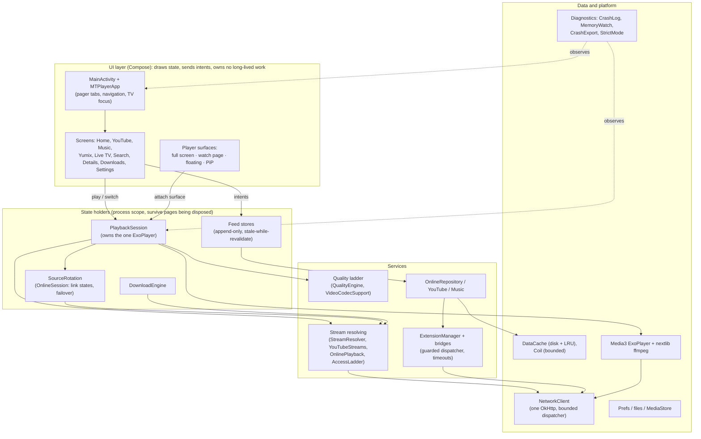
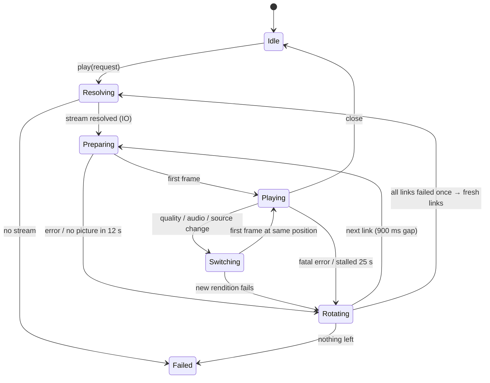
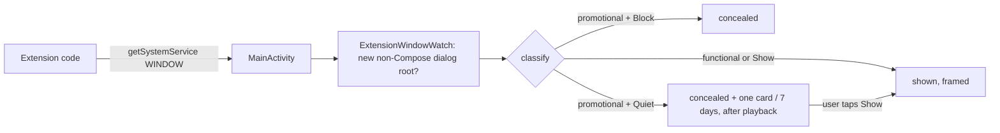

# Yumeiro system design (R15)

Written with the architecture-designer skill (jeffallan/claude-skills). Kotlin/Android specifics follow
the Kotlin agent skills. This document is the contract for how the app is built. Code that breaks a
rule here is a bug, and every rule has a test or a runtime guard named next to it.

Status markers: **[done]** implemented and covered by a test; **[in progress]** being moved now;
**[planned]** designed, not built yet.

## 1. Requirements

### Functional (what the app must do)

| Area | Requirement |
|---|---|
| Playback | One player for every kind of media: local files, YouTube, YouTube Music, IPTV/links, extension sources (CloudStream, Aniyomi, Stremio, JS, home servers). Quality, audio, subtitle, speed and source switching while playing. Full screen, docked watch page, in-app floating player, system picture-in-picture, background audio. |
| Sources | Extensions are installed by the user and run in-process. A dead link moves to the next one automatically, including after a manual pick. |
| Feeds | Home, YouTube, online music, Yumix (extensions) and live TV are endless and live: they never stop by themselves and are never replaced by an old saved copy while the user scrolls. |
| Downloads | Download any playable stream (direct, HLS, DASH, YouTube) during playback, even when the source page doesn't offer a download button. |
| Reliability | Crash, ANR and out-of-memory reports are written on the device and exported to a file automatically. |

### Non-functional (how well)

| Attribute | Target | How it is checked |
|---|---|---|
| Scale | 200,000 monthly users, every kind of device | Crash-free sessions ≥ 99.5 %; ANR rate < 0.47 % (Play "bad behaviour" line) |
| Devices | Android 7 TV boxes, 2 GB Android Go phones, flagships, Android TV | Device tiers in §5; emulator matrix in `.github/workflows/device-check.yml` |
| Main thread | No frame task ≥ 700 ms; no input event ≥ 5 s (ANR) | `MainThreadWatchdog` (debug), `StabilityStressDeviceTest` stall meter |
| Memory | No OOM on a 192 MB heap device under the stress test | `MemoryWatch` samples, stress test on the low-RAM emulator |
| Start-up | First frame without network, disk scans or extension loading on the main thread | `DevStrictMode`, start-up thread `yu-startup` |
| Privacy | No credential in code, logs, crash reports or backups | `CrashLog` scrubbing, secret scan before every commit |

### Constraints

Single Gradle module, Kotlin + Compose, minSdk 24. Extensions are third-party code that can block, throw,
leak or allocate without limit; the app must survive all of that. There is no app server: everything runs on
the device (GitHub Actions only builds the market and feeds).

## 2. Architecture at a glance

Dependency rule: arrows only point down. The UI never builds players, parses pages, compiles regexes or
talks to the network. State holders outlive any single composable.

### Code structure as measured (G12 X1, 2026-11-15)

| Package | Files | Lines | Role |
|---|---|---|---|
| `ui/` | 141 | 44,897 | Compose screens, components, theme, the one `MainViewModel` |
| `online/` | 61 | 8,779 | Extensions, online repository, Yumix, trackers' APIs |
| `sources/` | 30 | 5,151 | Drama, Tachiyomi/JS (Mangayomi) bridges, Stremio |
| `player/` | 32 | 3,550 | PlaybackSession, quality, heat guard, listening time |
| `stream/` | 20 | 3,250 | Resolving and forced downloading |
| others (21 packages) | 96 | 14,098 | update, youtube, notify, data, backup, network, lyrics, … |
| **total** | **380** | **79,725** | |

- State is held in 275 top-level `object`s (service-locator style; no DI framework) and one
  `MainViewModel`. This matches ADR-001/006 (process-scoped holders) and keeps start-up cheap, but
  makes unit tests reach into globals (`resetForTest` hooks) and hides dependencies. Proposal, not
  done: constructor-injected interfaces at the seams that tests fake most (network, prefs, clock).
- Largest files (review cost, recomposition scope): `VideoPlayerModal.kt` 2,388, `MediaComponents.kt`
  1,693, `MTPlayerApp.kt` 1,687, `HomeScreen.kt` 1,218 lines.
- Coroutines: 64 ad-hoc `CoroutineScope(...)`; those without a `SupervisorJob` are all
  `rememberCoroutineScope` (UI-bound, cancelled with the composable). `GlobalScope`: none (one comment).
  `runBlocking`: two, `JsBridge.extractor` (now bounded, X1-3) and `BrowserCheck` (guarded off main).
- `runCatching` around suspend calls catches cancellation; the shared `online/runCancellable` keeps
  timeouts as failures and rethrows real cancellation (X1-4). Other suspend `runCatching` sites were
  read: they check `isActive` afterwards or wrap `withTimeout` on purpose.
- Synchronous `SharedPreferences.commit()`: 10 calls, all deliberate (launch-time restore before
  anything loads, reset, crash export while the process may die).

## 3. Threading model **[done for regex/start-up/YouTube; enforced]**

| Work | Where it runs | Guard |
|---|---|---|
| Drawing, input, focus, small state updates | Main | `MainThreadWatchdog` logs `YuStall` (debug); stress test fails on a stall ≥ 4 s |
| Regex compilation | Never at run time on main; patterns are file-level constants or `RegexCache`. A file-level constant compiles in the class's static initialiser on whichever thread touches the class first, so `RegexWarmup` initialises all 91 holder classes on `yu-startup` | `RegexGuardTest` (no regex built inside a function; every holder class is in the warm-up list); stress test samples main for `Pattern.compile` |
| Focus and motion | Auto-advancing carousels (Home banner, Yumix hero) pause while focus is inside, on touch, with reduced motion and under `HeatGuard`, so a pager never moves a focused card away from bring-into-view. The tab pager takes no nested scroll from its pages: Compose's default page connection consumes `UserInput` pre-scroll while between pages, and bring-into-view is `UserInput`. An idle tab pager is always settled on a page | `dpadFocusSettles`, `swipeThenDpadSettles` (frames per 2 s must fall to 0); the stress test fails on any "Compose never idle" |
| Parsing (HTML, JSON, manifests), feed merging, sorting | `Dispatchers.Default` | code review + StrictMode |
| Network and disk | `Dispatchers.IO` through `NetworkClient` (16/32 requests, 4/6 per host) | StrictMode disk/network on main (debug) |
| Extension calls | `ExtensionGuard.dispatcher` with timeouts | crash guard, per-call timeout |
| Image fetch / decode | Coil, 4/8 fetchers, 2/3 decoders | `MTApplication` image loader |
| Start-up chores (workers, FCM, downloads resume, backups, janitor, regex warm-up) | `yu-startup` thread | — |
| YouTube extractor init | `yu-yt-init` thread | — |
| YouTube stream request (manifests, OTF) | `Dispatchers.IO` | `YouTubeStreams.videoRequest` |

Root cause fixed in R15: `Kana.forTitle()` compiled about 60 regexes per call and ran inside composition for
every card the pager prefetched, which matches the Xiaomi ANR stack (`Pattern.compile` under
`LazyLayoutPinnableItem` / `PrefetchHandleProvider`). See `docs/STABILITY-R15.md`.

## 4. Memory model **[done]**

| Budget | Low-end (≤192 MB heap, ≤3 GB RAM, ≤4 cores, Go) | Normal | TV |
|---|---|---|---|
| Image memory cache | 15 % of heap | Coil default (25 %) | Coil default |
| Image fetch / decode parallelism | 4 / 2 | 8 / 3 | 8 / 3 |
| Player buffer | `bufferBudgetBytes(memoryClass)` | same formula | same formula |
| `ReleaseTags` / `Kana` LRU | 1024 / 256 entries | same | same |
| Data cache in memory | 48 pages | same | same |
| Feed stores | rows × `MAX_ROW_ITEMS`, explore grows only as the user scrolls | same | same |

Pressure handling: `MemoryWatch` samples every 30 s (heap, native, free system memory, thread families),
clears the image cache at ≥ 85 % heap, and reacts to `onTrimMemory` / `onLowMemory`. `CrashLog` keeps a
512 KB reserve that is released when an OOM is thrown so the report can still be written. Background
low-memory kills reported by `ApplicationExitInfo` are labelled "Closed to free memory", not "Out of memory".

## 5. Device tiers

`DeviceClass.lowEnd` (pure function `isLowEnd`, unit tested) selects the low-end budgets. TV is detected
from `UI_MODE_TYPE_TELEVISION` and gets D-pad focus paths (see `docs/TV-AND-PHONE.md`). The emulator matrix
runs a low-RAM Android 13 device (2 GB RAM, 192 MB heap → low-end path) and a current Android image.

## 6. Feeds **[done for Yumix, Home, YouTube, online music, Live TV]**

Rules for every endless feed:

1. **Process-scoped store.** Feed state lives in an object that outlives the pager page. The main pager uses
   `beyondViewportPageCount = 0`, so a tab's composables are disposed when you leave it; state held in
   `remember` was thrown away and reloaded from the disk copy (up to 6 h old). That was the "suddenly shows
   saved cache" bug. Yumix: `YumixMemory` in `OnlineHomeScreen.kt`.
2. **Stale-while-revalidate.** A saved copy is shown at once; when it's older than the memory window
   (15 min) the live page is fetched in the background and merged with `mergeRows` (existing rows keep
   their order and items, new titles are appended, new rows go at the end).
3. **Append-only.** Cards already on screen never move, vanish or get replaced (`YumixFeed.appendNew`).
   Before R15 the explore feed was rebuilt and re-shuffled from scratch on each page, and round-robin put a
   short row's next page in the middle of what was already shown.
4. **A failed page is not the end.** `HueRowFeed.afterPage(null)` keeps the row open and retries with a
   back-off (2 s, 4 s, … up to 8 s, 3 tries in a row). Only an empty page or 3 failures in a row end it.
5. **Fetches survive navigation.** They run in the store's scope, so leaving a tab doesn't cancel them half
   way (a row stuck "loading").

6. **One store type for every feed (ADR-008).** `LiveFeed` / `LivePaged` hold the rows, the arrival order and
   a generation number. A load started for an older generation can't overwrite a newer one, and a failed
   refresh never wipes rows that are on screen. Home uses `HomeMemory` (rows in arrival order, a shuffle
   seed kept for the process), Live TV uses `LiveTvMemory` (per-playlist loads and stamps).

Tests: `LiveFeedTest` (append-only, retry, merge), `LivePagedTest`, `YumixFeedTest`.

## 7. Playback **[done: player ownership and recovery state machines; verified on device]**

### Before R15

The `ExoPlayer` was created inside `VideoPlayerModal` (`remember(video.id)`), so the player's life is tied
to one composable. Resolving, quality switching, failover timers and PiP handling also live in that
2,300-line composable. Consequences: a new video recreates the player; work that should survive a
navigation (download → downloads page with the video still playing) depends on the composable staying
alive; and blocking work started from the UI (the YouTube quality request) froze the screen.

### Target

- **One owner.** `PlaybackSession` (process scope) owns the single `ExoPlayer`, its media source factory and
  the state machine above. Surfaces (full screen, watch page, floating, PiP) attach and detach a
  `SurfaceView`; they never create or release the player.
- **Every expensive step runs off main.** Resolving and manifest building on IO, codec probing cached.
- **Quality ladder.** `QualityEngine` builds one list per source: the downloader's full list for
  YouTube/Video/Yumix; for single-rendition sources the engine adds scaled levels (GPU `Presentation`) and an
  upscaled level (Anime4K). `VideoCodecSupport` ranks codecs by hardware support so a 4K AV1 level on a
  phone without an AV1 decoder plays as VP9/H.264 instead of timing out.
- **Source rotation.** A link that fails, sends no picture in 12 s, or stalls 25 s hands over to the next
  link; a manual pick is just another start point for the same rotation.
- **Surface modes.** Starting a new video while the floating player or system PiP is showing expands to full
  screen. "View downloads" from the download toast moves the video to the floating player and opens
  Downloads.

### Player ownership (built in R15)

`player/PlaybackSession` owns the one `ExoPlayer` of the process:

- `acquire(key, uri)` returns a `Lease`. The next video reuses the same player (stopped, media cleared,
  speed, volume and track overrides back to their defaults) when the profile matches (network vs local
  file) and it never ran GPU effects. Otherwise the old player is released before a new one is built, so
  two players never exist together. Before R15 the next episode built a second player while the first
  was still alive: two sets of codecs and two media buffers on a 2 GB phone.
- Listeners are added through the lease. A handover revokes the old lease first: its listeners are
  removed, and its last position and duration are frozen for the old screen's final progress save. This
  stops the old screen from reacting to the new video's events, which ExoPlayer sends synchronously.
- On close the player pauses and is released after `GRACE_MS` (3 s). Reopening the same video inside the
  grace resumes it with no reload. `onTrimMemory(RUNNING_LOW)` releases a closed player at once.
- Header and DRM lookups read `PlaybackSession.currentUri`, so a reused player sends the new video's
  headers.

Tests: `PlaybackSessionTest` (reuse, fencing, grace, resume, local vs network) and
`PlaybackSessionDeviceTest` (three videos in a row through the real app = one player built, two reuses;
close → released after the grace; reopen inside the grace → resumed).

Migration (one step at a time, each with a device test):
1. **[done]** YouTube stream request off main; codec-aware rendition choice; start position passed to
   `setMedia`.
2. **[done]** Engine levels and DASH rendition switching, verified by `PlayerSwitchDeviceTest` on the
   emulator.
3. **[done]** Player creation, lifetime and listener ownership moved to `PlaybackSession`.
   **[done] 3b.** Recovery moved out of the composable: `StartWatch` (no picture: gives up after 12 s with
   10 s of no download, or 45 s in all; paused time does not count) and `StallWatch` (buffer frozen 25 s)
   in `player/SourceWatch.kt`, and `RecoveryRouter` (the order: GPU effect → local file → offline wait →
   link refresh → header ladder → quick retry → next source → generic bounded recovery). Retry and
   "stable playback" timers are lease-owned (`Lease.schedule`), so `revoke()`/`detach()` cancel them and a
   retry for one video can never fire on the next. Tests: `RecoveryStateTest`, `PlaybackSessionTest`
   (timer fence).
4. **[done]** Surface-mode rules (download → floating + Downloads; new video → full screen),
   `PlayerSurfaceRules` + `SurfaceModeDeviceTest`.

## 8. Failure modes

| Failure | Behaviour |
|---|---|
| Extension throws, hangs or returns junk | Guarded dispatcher, per-call timeout, row skipped; the rest of the feed continues |
| A feed page times out | Row stays open and retries with back-off (§6) |
| Network drops | `Connectivity.online` pauses stall timers; feeds keep what's on screen |
| Link dead / expired | Rotation (§7), then one fresh link extraction, then the site's own page |
| Decoder can't play a codec | Codec-aware choice; ffmpeg software decoders as fallback |
| Memory pressure | Image cache cleared, LRU bounded caches, OOM reserve for the report |
| Crash / ANR / LMK | `CrashLog` + `ApplicationExitInfo` import, breadcrumbs, auto export to `Download/Yumeiro/Crash reports` |

## 9. Security

Covered in `docs/ARCHITECTURE.md` (extension model, updates) and `docs/security/`. Additions in R15: crash
reports and breadcrumbs pass through `CrashLog` scrubbing (tokens, cookies, keys); the exported copy is the
scrubbed text. Credentials live only in CI secrets or the git-ignored `.secrets/` folder.

## 10. Decision records

### ADR-001: Process-scoped feed stores instead of composable state

- **Status:** Accepted, implemented for Yumix.
- **Context:** The main pager disposes tabs it isn't showing. Feed state held in `remember` was lost and
  reloaded from disk, which looked like the feed "stopped and showed old data".
- **Decision:** Keep feed state in process-scoped objects with bounded size; fetches run in the store's scope.
- **Alternatives:** `beyondViewportPageCount = 1+` (keeps more pages composed: more memory and prefetch work
  on low-end phones, the opposite of the ANR fix); Jetpack `ViewModel` per tab (the pager pages share one
  activity-scoped owner, so it would be the same lifetime with more plumbing); `rememberSaveable` (can't hold
  thousands of items in a Bundle).
- **Consequences:** Feeds survive tab switches and rotation; memory is held until the process dies, so every
  store must be bounded and cleared on "Clear caches".

### ADR-002: Append-only endless feeds

- **Status:** Accepted, implemented (`YumixFeed.appendNew`).
- **Context:** Rebuilding and re-shuffling the merged feed on every page moved and removed cards under the
  user's finger.
- **Decision:** A feed only appends entries it hasn't shown; each new batch is block-shuffled on its own.
- **Alternatives:** Stable sort by a per-item hash (still inserts new items between old ones).
- **Consequences:** Order is "arrival order", which is less evenly mixed than a full round-robin; acceptable
  for an endless feed.

### ADR-003: Stale-while-revalidate for saved pages

- **Status:** Accepted, implemented for extension home pages.
- **Decision:** Show the saved copy at once, refresh in the background when it's older than 15 min, merge.
- **Alternatives:** Always network first (blank screen on slow networks); always cache first with a 6 h
  freshness window (the old behaviour: old data until the window expired).
- **Consequences:** One extra request per stale extension per visit.

### ADR-004: No regex compilation at run time on hot paths

- **Status:** Accepted, implemented, enforced by `RegexGuardTest`.
- **Decision:** Patterns are file-level constants or come from `RegexCache` (LRU 128); heavy pattern
  objects are warmed on `yu-startup`.
- **Alternatives:** Only fixing `Kana` (the other ~70 call sites would come back as the next ANR).
- **Consequences:** Slightly more start-up work off main; a build-time rule developers must follow.

### ADR-005: One shared OkHttp client with bounded concurrency

- **Status:** Accepted, implemented.
- **Decision:** Coil, extensions, YouTube and the player share `NetworkClient` (dispatcher 16/32, 4/6 per
  host, one connection pool).
- **Alternatives:** Per-feature clients (dozens of `OkHttp` threads in the Pixel 6a report).
- **Consequences:** A slow host can't starve the others past its per-host limit.

### ADR-006: Player owned by a process-scoped PlaybackSession

- **Status:** Accepted. Ownership done (`PlaybackSession`, §7); recovery clocks and routing done (step 3b).
  The `PlaybackService` + `MediaController` move stays future work (see Consequences).
- **Context:** The player is tied to one composable, so player lifetime, surfaces and recovery depend on UI
  composition.
- **Decision:** One `PlaybackSession` owns the `ExoPlayer` and the playback state machine; UI surfaces attach.
- **Alternatives:** Keep the modal and patch each symptom (what earlier rounds did); move playback into
  `PlaybackService` + `MediaController` now (the long-term shape; bigger change, and the controller's async
  API would touch every player call at once).
- **Consequences:** Player survives navigation and mode changes; the modal shrinks to drawing and gestures.
  The `PlaybackService` move can follow without UI changes.

### ADR-007: Device evidence on emulators in CI

- **Status:** Accepted, implemented (`device-check.yml`).
- **Decision:** Instrumented tests on a low-RAM API 33 emulator and a current API image, uploading reports,
  logcat and optional heap dumps.
- **Alternatives:** Robolectric only (what v1.8.1 relied on; can't show ANRs, OOMs or decoder behaviour).
- **Consequences:** Each run costs about 30–45 minutes of CI time, so runs are manual.

### ADR-008: One live-feed store for every endless feed

- **Status:** Accepted, implemented (Yumix, Home, YouTube, online music, Live TV).
- **Context:** Every tab had its own copy of "load rows, keep them in `remember`, reload from disk when the
  page comes back". The disk copy could be hours old, so a live scroll was replaced by stale data.
- **Decision:** `LiveFeed` / `LivePaged` (process scope) with arrival order, append-only pages and a
  generation guard; loads run in `FeedScope`, never in the composable's scope.
- **Alternatives:** `beyondViewportPageCount` > 0 (more memory and prefetch work; the ANR cause); a
  `ViewModel` per tab (same lifetime as a process object here, more plumbing).
- **Consequences:** A feed survives tab switches; every store must be bounded and cleared on "Clear caches".

### ADR-009: Drama studio health as a background service

- **Status:** Accepted, implemented (`DramaHealth`, `YumeiroDramaProvider`).
- **Context:** Dramas often didn't appear and the banner showed episodes that never played: studios that
  refuse every episode were still shown, and each episode request could hang for 35 s.
- **Decision:** One `DramaHealth` checks each studio in the background and hides studios that refuse
  everything. Episode links run under one deadline (68 s): up to 3 tries on a hang, a refusal goes straight
  to mirrors, mirrors share what's left.
- **Consequences:** Studios come back by themselves when they recover. Evidence: live run b21, 24 of 24
  shown dramas played (`docs/evidence/round3/drama-live-b21.txt`).

### ADR-010: Forced downloading in the built-in engine (ForceGrab)

- **Status:** Accepted, implemented (`online/download/ForceGrab.kt`).
- **Context:** Some sources "don't allow downloads": they refuse a plain request, serve DASH, or keep the
  sound in a separate track.
- **Decision:** IDM-style engine: multi-connection byte ranges (2 connections on low-end phones, 4
  otherwise; 4 MB chunks, resumable with a `.chunks` file), header escalation on 401/403 (the player's
  headers, then browser UA + Origin + Sec-Fetch + WebView cookies, then without Referer), DASH saved as
  one file (one container family per pair, main or phone-language audio, joined with `MediaMuxer`), and
  torrents handed to TorrServer. DRM is never bypassed: protected tracks are skipped, and our own scan
  catches `<ContentProtection>` tags media3 drops.
- **Alternatives:** Hand everything to an external downloader (can't join DASH or split audio; such
  sources are now kept in the app).
- **Consequences:** More parallel requests per download, bounded by the shared client's per-host limit.
  Evidence: `ForceGrabTest` (live byte-identical multi-connection and resumed downloads),
  `ForceDownloadDeviceTest` (DASH save on the emulator).

### ADR-011: Pinned extensions

- **Status:** Accepted, implemented (`online/PinnedExtensions.kt`).
- **Decision:** Up to 8 pins kept in prefs, shown first in "Show videos from" and as a chip bar under
  the extension bar. 48 dp touch targets, labelled for TalkBack (UI/UX Pro Max rules).

### ADR-012: Start-up is measured on the R8 preview build (G12 X2)

- **Context:** debug builds are not optimised and JIT-only, so their start-up (X2-1: ~5.9 s first
  composition on the low-RAM emulator) says little about the release. A benchmark needs a
  non-debuggable, R8-optimised build that installs next to the store app.
- **Decision:** a `:benchmark` `com.android.test` module (Macrobenchmark 1.5.0) targets the existing
  `preview` build type; `src/preview` adds `<profileable shell=true>` for preview only. Cold start is
  measured with no AOT and with the baseline profile; the profile is generated by
  `BaselineProfileGenerator` and committed as `app/src/main/baseline-prof.txt`.
- **Consequences:** emulator numbers compare before/after on one image only; a real-phone number is
  an owner test. No release-manifest or signing change.
- **Status:** accepted (2026-11-15).
- **Amendment (2026-11-16, X2-1):** the first generated profile (43787473722) held obfuscated names
  (`La41;`) because `preview` is minified, so it could not be committed. Profile generation now
  builds `preview` with `-Pyu.profileGen=true`, which adds `app/proguard-profilegen.pro`
  (`-dontobfuscate`, `-dontoptimize`); release and normal preview builds are unchanged. Before
  numbers (43784533563, TTID median of 8): api33-lowram 3145 ms without AOT / 2905 ms with the
  library profiles; api36 3899 / 2731 ms.
  After the app profile (fef01c6, run 43790371337): api33-lowram 3924 / 2837 ms, api36 2509 / 1853 ms.
  Emulator run-to-run noise is larger than the gain, so the real-phone check is OMT-12.

### ADR-013: Keys in the APK, by class (G12 X7-3)

- **Context:** every BuildConfig value can be read out of an APK. The owner delegated the decision
  (orders 4): classify every key as (1) public identifier, (2) restricted public (public by nature,
  limited by the provider's own controls), or (3) true secret, following each provider's rules.
  Class 3 must not ship in an APK.
- **Table** (provider rule checked 2026-11-16):

| Key (BuildConfig) | Provider rule | Class | Decision |
|---|---|---|---|
| `ANILIST_CLIENT_ID` | AniList implicit grant uses the client id alone ([docs](https://docs.anilist.co/guide/auth/implicit)) | 1 | keep |
| `MAL_CLIENT_ID` | MAL Authorization Code with PKCE "mainly native apps" ([docs](https://myanimelist.net/apiconfig/references/authorization)); no secret in the build | 1 | keep |
| `SIMKL_CLIENT_ID` | "Your `client_id` is public and safe to commit" ([Simkl](https://api.simkl.org/authentication)) | 1 | keep |
| `TRAKT_CLIENT_ID` | id is public; PKCE/device sign-in | 1 | keep |
| `TRAKT_CLIENT_SECRET` | "The Client Secret is deprecated for user sign-in and should only be used server to server" ([Trakt](https://developer.trakt.tv/docs/authentication-oauth)) | 3 | **removed** from BuildConfig and release.yml; a user's own Trakt app may still carry its own secret (Settings) |
| `KITSU_CLIENT_ID` / `KITSU_CLIENT_SECRET` | "The client secret **must** be kept confidential", but "Application registration has not yet been implemented … can be omitted" ([Kitsu](https://kitsu.docs.apiary.io/)) | 3 | **removed**; the password grant is sent with no client fields. Live probe 2026-11-16 (kitsu.app and kitsu.io): no client fields → `invalid_grant` (user check reached), empty fields → `invalid_client` |
| `TMDB_API_KEY` | — | 3 by default | **removed**: shipped but read by no app code (it was reserved for the gated trailer feed; that feature's proposal must classify it again here before it ships) |
| `LASTFM_API_KEY` | key identifies the app; ToS has no confidentiality rule ([ToS](https://www.last.fm/api/tos)) | 2 | keep |
| `LASTFM_SHARED_SECRET` | the mobile flow signs `auth.getMobileSession` on the device with the secret ([mobile auth](https://www.last.fm/api/mobileauth)); no confidentiality rule in the ToS | 2 (accepted) | keep: the provider's own mobile flow requires it on the device. A Worker signing service would need the user's password to pass through our server for `getMobileSession`, which is worse for users. Users can enter their own key and secret |
| `OPENSUBTITLES_API_KEY` | key identifies the consumer app (sent as the `Api-Key` header from the client); the getting-started docs state no confidentiality rule | 2 | keep; users can enter their own |
| `LRCLIB_APP_ID` | client identification header | 1 | keep |
| `FCM_APP_ID`, `FCM_PROJECT_ID`, `FCM_SENDER_ID` | "API keys for Firebase services are not secret" ([Firebase checklist](https://firebase.google.com/support/guides/security-checklist?hl=en)) | 1 | keep |
| `FCM_API_KEY` | not secret, but "Always restrict an app's API key to the set of APIs used by that app" ([Firebase checklist](https://firebase.google.com/support/guides/security-checklist?hl=en)) | 2 | keep; restriction check is OMT-13 (owner's Google Cloud console). Probe of the v1.8.1 key without Android headers: Firebase Installations reached argument validation (no Android-app restriction seen) |
| `CLOUD_HOST`, `UPDATE_REPO_OWNER`, `UPDATE_REPO_NAME` | public host and public repository | 1 | keep |
| `UPDATER_TOKEN_BYTES` (`MT_UPDATER_TOKEN`) | GitHub token | 3 | the release repository is public, so the updater needs no token. The build now **fails** for any release or preview task when `MT_UPDATER_TOKEN` is set; CI has no such secret. Debug builds of a private fork can still use one |
| `UPDATER_TOKEN_KEY`, `INTEGRITY_BYTES` | XOR key and the SHA-256 of the public signing certificate | 1 | keep |
| Cloudflare token, Firebase service account, D1 ids | server-side only (`server/`, CI secrets) | 3 | never in the APK (unchanged) |

- **Guards:** `ApkSecretsTest` (unit) fails when a removed key returns or a new secret-like BuildConfig
  field is not in this table; `KitsuLoginTest`; the Gradle release/preview token guard; the APK and
  git-history secret scan before any release.
- **Status:** accepted (2026-11-16), implemented (X7-3).

### ADR-014: Windows that third-party extensions open (G12 X9-7)

- **Status:** accepted (owner orders 4: convert, never block; design delegated). Built; evidence in
  `docs/DONE-LEDGER.md` (X9-7 / ADR-014 row).
- **Context:** CloudStream plugins run in our process with the activity as context and open their
  own View windows. phisher98's repo opens "Support Phisher Repo" (donation, "Watch an Ad") while it
  loads; on TV it takes D-pad focus and the next Back closes it instead of the screen (TV
  43775191888, `docs/evidence/round3/x9-7-extension-dialog-tv.png`; EXT-T1 on api33-lowram). The
  same mechanism carries legitimate plugin UI (log-in forms, WebView captcha, settings, server
  choice), so blocking dialogs would break extensions.
- **Decision:**
  1. Two classes. **Functional** = has an input field or a WebView, or mentions log-in / password /
     captcha / verify / cookies / token / choose / select / settings / confirm, or has no readable
     text. **Promotional** = none of that, and mentions donate / Ko-fi / Patreon / PayPal / sponsor /
     "support the developer" / Telegram / Discord / "rate us" / "star the repo" / "watch an ad".
     Anything unclear is functional: it is shown, never lost (`ExtensionPopups.classify`, unit).
  2. Functional windows are always shown, in every mode and even over the player (a captcha while
     links resolve), inside a Yumeiro frame: a thin accent outline round the dialog card and the
     window title "From extension: <name>" for accessibility.
  3. Setting **Extensions → Pop-ups from extensions: Show / Quiet / Block promotional**, default
     **Quiet**. Show = every window as the extension built it (framed). Quiet = a promotional window
     is concealed in place and announced by one quiet, non-modal card ("<name> has a message ·
     Show", the app message bar, auto-dismissed), at most once per extension per 7 days, never
     while a video plays (full screen, mini player or PiP: the card waits until it closes). The
     message stays listed under the setting with Show / Dismiss. Block promotional = concealed, no
     card.
  4. Mechanism (`ExtensionWindowWatch`): MainActivity.getSystemService(WINDOW_SERVICE) reads the
     stack only while an extension is loaded; when extension code asks (Dialog / AlertDialog /
     PopupWindow do while they are built), the root windows are checked right after that message —
     before the next frame, so nothing flashes — and again at 16 ms … 5 s for dialogs built first
     and shown later. A new dialog-type, non-Compose root is the extension's. Concealing = the
     window stays attached but invisible, not focusable, not touchable, no dim, so Back and D-pad
     stay with the app on phone and TV and the extension's own `dismiss()` still works; "Show"
     restores its exact layout parameters.
  5. Main-thread guard: an extension window added after its screen is gone throws BadToken inside
     `ViewRootImpl.setView`; ExtensionGuard now swallows that (it is not a drawn frame) instead of
     crashing. Extension callbacks that throw on the main thread are swallowed as before; worker
     threads die quietly as before.
- **Alternatives rejected:** (a) wrap the WindowManager — the framework casts it to its own class in
  `Window.setWindowManager`, so every extension Dialog would crash while built (found while
  building, before any run); (b) remove promotional windows — the extension's later `dismiss()`
  throws "not attached"; (c) block all plugin dialogs — breaks log-ins and captchas; (d) re-parent
  the dialog into a Compose container — DecorView must be the window root (insets, Back dispatch),
  too risky for "no extension may break"; (e) remove the repo from the market — loses its sources.
- **Consequences / trade-offs:** + Back and focus are predictable; no extension code path changes;
  nothing is lost (Show from the card or the setting). − The classifier is word-based (English);
  an unknown promo wording is shown (safe side). − A dialog built and shown more than 5 s apart is
  not judged (shown as built). − A concealed window keeps its memory until the extension closes it
  or the screen goes.

- **NFRs:** no work unless an extension is loaded; one stack read per window-manager request; the
  check walks at most 400 views. **Failure modes:** conceal fails (updateViewLayout throws) → the
  window simply stays as built. **Security:** no extension code is skipped or rewritten; only window
  flags of its own window change.
- **Tests:** `ExtensionPopupsTest` + `ExtensionGuardSetViewTest` (unit); `ExtensionPopupsDeviceTest`
  p1–p7 with the `FakeExtension` test extension (donation + log-in dialogs, Back, modes, playback,
  BadToken, throwing callback) on both phone emulators and the TV emulator (emulator).

### ADR-015: Jackson 2.13.5 on the TV build (G12 X13-1)

- **Scope:** Android 7 TV boxes only (TV flavour, minSdk 24). The phone flavour keeps 2.19.4.
- **Context:** Jackson 2.14+ needs Android 8 (jackson-databind#4653); on Android 7 every CloudStream
  source failed with `NoClassDefFoundError` (run 43765162241). The TV classpaths resolve 2.13.5, the
  last release of the 2.13 line, which gets no more fixes. Approved by the owner with conditions
  (orders 4, X13-1).
- **Known advisories affecting 2.13.5** (OSV.dev query, 2026-11-16): jackson-core 3
  (CVE-2025-52999 deep nesting → StackOverflowError, fixed 2.15.0; CVE-2026-89425 error-token
  length; CVE-2026-68494 async-parser number length), jackson-databind 11 (CVE-2026-50193 deep
  `JsonNode.toString`; CVE-2026-54512 / -54513 / -83557 polymorphic-validator bypasses;
  CVE-2026-54514 / -77310 InetSocketAddress/InetAddress DNS on deserialisation; CVE-2026-19032
  `Path` deserialisation; CVE-2026-91776 / -91777 type-id retention and forward-reference cost;
  CVE-2026-54515 / -59889 ignore/view bypasses).
- **Exposure (checked in code):**
  - Who parses with Jackson: extension code and the bundled CloudStream extractors / sync
    providers, through the shared `com.lagradost.cloudstream3.mapper` (site JSON, untrusted). Our
    own repo, market and settings parsing uses `org.json`, not Jackson; `DataStore` reads only our
    own preferences.
  - The shared mapper is `JsonMapper.builder().addModule(kotlinModule())
    .configure(FAIL_ON_UNKNOWN_PROPERTIES, false)` (bytecode of CloudStream library 4.8.0
    `MainAPIKt.<clinit>`). It has no default typing, and neither the library, the app nor our
    bundled code uses `@JsonTypeInfo` or a `PolymorphicTypeValidator`, so the gadget and allowlist
    advisories need an extension that opts in itself. An extension is already arbitrary code in our
    process, so it gains nothing from them.
  - The realistic risk is denial of service from a hostile site: deep nesting can overflow the
    stack in bean binding and in `JsonNode.toString` (`readTree` itself is iterative in 2.13).
    Untyped binding (`readValue(json, Any::class.java)`) does not overflow: 2.13.5 has a depth guard
    in `UntypedObjectDeserializer.Vanilla` that throws `JsonParseException` "JSON is too deeply
    nested" at about 1000 levels (string present in the 2.13.5 jar; seen on CI 43825446008). The
    earlier text said it overflowed; CI 43803887311 and 43825446008 both failed the test on that
    assumption (correction 2026-11-16). For `toString` the test accepts overflow or success (frame
    sizes differ by JVM) and checks containment. Either way it fails only that call: home, search and detail calls sit in `runCatching` (catches Errors) or the
    `ExtensionGuard` handlers. No `InetSocketAddress`, `InetAddress` or `Path` fields exist in the
    provider models.
- **Mitigation:** `JacksonTvExposureTest` (testTv, in the CI TV unit step with
  `JacksonTvCompatTest`) fails if the shared mapper gains default typing, if deep nesting stops
  being contained by the caller pattern, or if normal JSON stops parsing. CI also fails if the TV
  classpath leaves the SDK-24 line.
- **Removal conditions:** remove the `tv*` resolution rule in `app/build.gradle.kts` and the
  `jacksonTv` version when either (a) the TV minSdk becomes 26 or higher, or (b) a Jackson release
  that runs on SDK 24 contains these fixes.
- **Related finding (phone, not changed):** OSV lists 16 advisories for the phone's 2.19.4 (the
  2.19 line is no longer patched). 2.18.11 has none and stays below the 2.20 `invokeExact` limit.
  Moving the phone to 2.18.11 conflicts with the owner's condition 3 (phone keeps its current
  version), so it is proposed (X13-6) and needs the owner's decision.
- **Status:** accepted (2026-11-16) with the owner's five conditions.

### ADR-016: Segmented downloads: request restarts against wasted data (G8 DL-11 part 2)

- **Scope:** `ForceGrab.Segmented` (direct files of 16 MB or more), `RequestPace`.
- **Context:** BUG-3 (owner, high): many hosts serve each request fast and then cap it. 3c85a72 made a
  request that falls under a third of its own baseline for one 256 KiB window ask for the rest in a new
  request. The closed request throws away the bytes already on the way. Measured on the device
  (emulator, cdn.kernel.org, 134.7 MB, a host that never caps a request), 44036060683 and 44037559115:
  1 to 29 restarts per download, 1.04 to 1.44× the file received, about 2 MB lost per restart; the
  download with 29 restarts was also the slowest (3.58 MB/s against 5.9–7.8). Local server, capped
  profile (CI 44026316670): segmented2 67.6 MB/s, tail 0.14×, 1.28× the file served.
- **Options measured:**
  - A. One slow window (current). Fast on capped hosts; wastes data on hosts with an uneven link.
  - B. Two slow windows in a row (6e40982, reverted in f60d808): CI 44037788044 segmented2 17.8 MB/s,
    tail 3.23×; segmented4 75.7 → 48.0 MB/s; 1.04× served. Rejected: a speed regression on the
    owner's case.
- **Options not yet measured:**
  - C. A smaller receive buffer on the segmented connections (`SO_RCVBUF`, e.g. 1 MiB), so less is on
    the way when a request is closed. Risk: caps one connection at buffer / round trip (1 MiB at
    100 ms = 10 MB/s; 4 connections 40 MB/s).
  - D. Stop pace restarts for the rest of a download when restarted requests are not faster than the
    ones they replaced (measured over their first window after the baseline).
- **Decision:** keep A until C or D is measured on the unit capped profile (no speed loss allowed)
  and on the real host (bytes received and restarts over at least three downloads per phone).
- **Status:** proposed (2026-11-17). DL-11 part 2 stays open.

## 11. Risks

| Risk | Mitigation |
|---|---|
| Extension code still compiles regexes or blocks inside its own calls | Runs on the guarded dispatcher, never on main |
| Process-scoped stores grow with very long sessions | Bounded rows/items; cleared on "Clear caches"; `MemoryWatch` evidence |
| Emulators don't reproduce every vendor decoder | Codec-aware ladder + ffmpeg fallback; crash export from real users |
| Large playback refactor regresses a niche path | One migration step at a time, each with `PlayerSwitchDeviceTest` / `OnlinePlaybackDeviceTest` |
