# What's new in Yumeiro

Release highlights with images, newest first. Every change, with how it was checked: [CHANGELOG.md](../CHANGELOG.md).

## What's new in 2.2.0

<!-- RELEASE-2.2-IMAGES: a table keeps the four posters side by side (loose  tags stacked one under another) -->

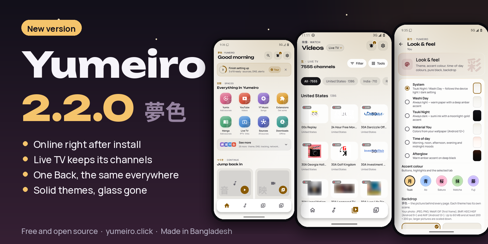

<table>
  <tr>
    <td align="center" width="25%">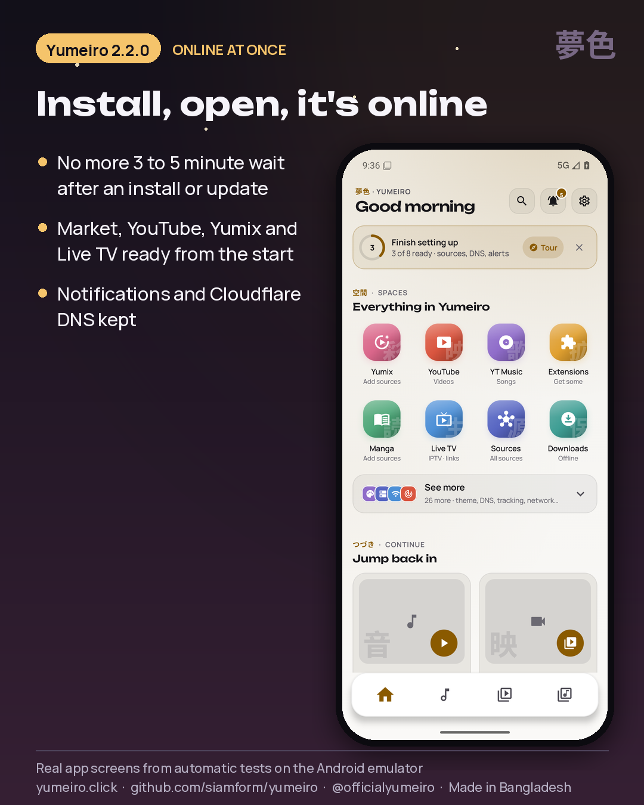</td>
    <td align="center" width="25%">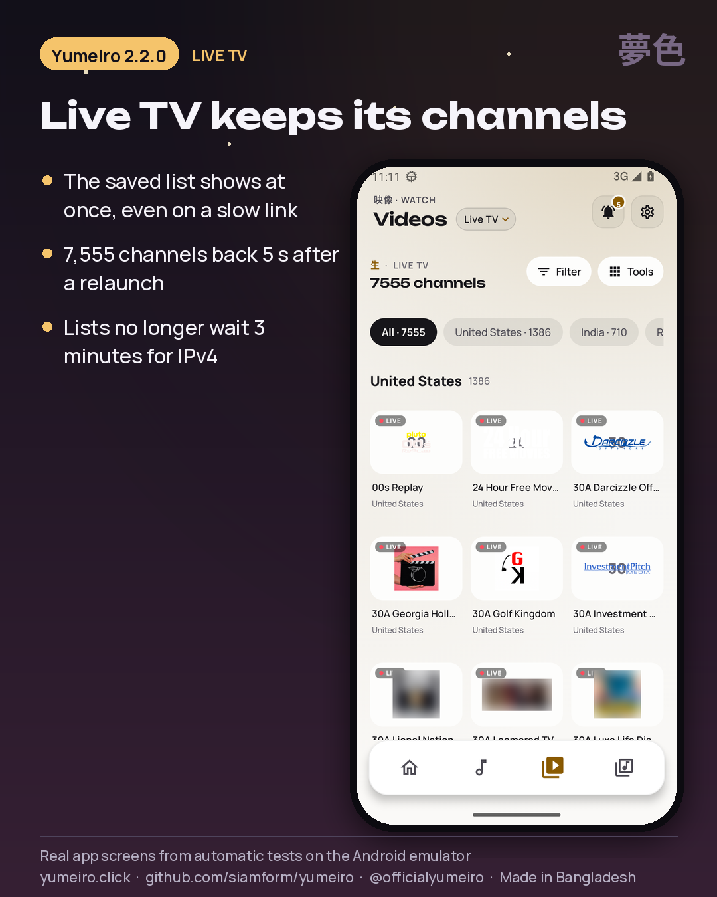</td>
    <td align="center" width="25%">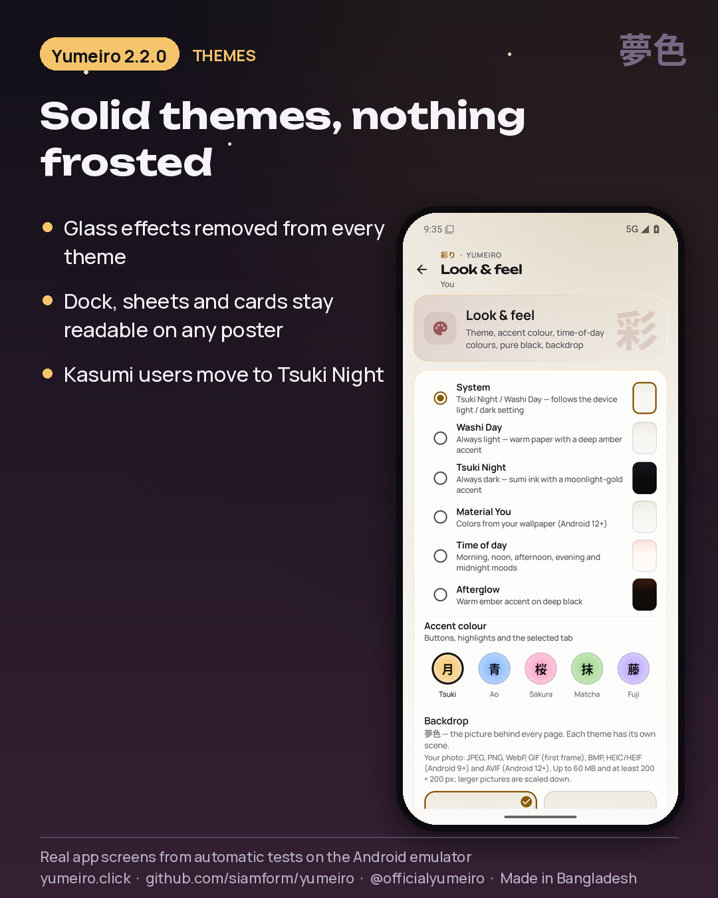</td>
    <td align="center" width="25%">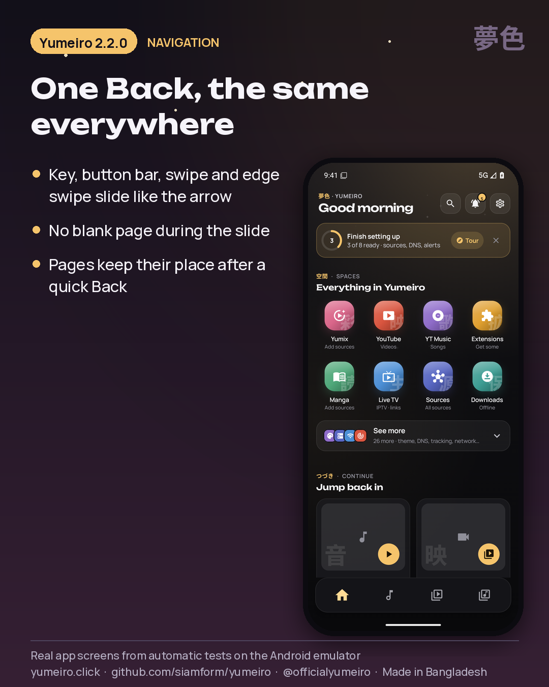</td>
  </tr>
</table>

Yumeiro 2.2.0 follows 2.1.0. Full notes, with how each item was checked: [CHANGELOG.md](../CHANGELOG.md).

| | |
|---|---|
| **Online at once** | Extension Market, YouTube, Yumix, online music and Live TV work right after an install or update; no more 3 to 5 minute wait. |
| **Live TV keeps its channels** | The saved list shows at once, even on a slow link, and is only replaced by a complete download. Lists no longer wait minutes for IPv4. |
| **One Back** | The Back key, button bar, swipe and edge swipe close a page with the same slide as the on-screen arrow, without a blank page. |
| **Solid themes** | Glass effects removed from every theme; Kasumi users move to Tsuki Night. |
| **Clearer extensions** | Unsupported extensions say what is missing and what to do; HindiSubAnime-style breakages offer an older working copy; Market cards open full details. |
| **Telegram page** | A clear sign-in card and wording about channels, not websites. Telegram's own sign-in is unchanged. |
| **Small fixes** | Library shows its size instead of "Unkn...", Live TV shows one country filter, nothing redrawn while the app sits still. |

## What's new in 2.1.0

<!-- RELEASE-2.1-IMAGES -->

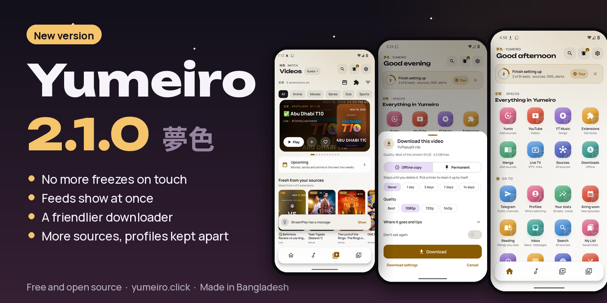

<table>
  <tr>
    <td align="center" width="25%">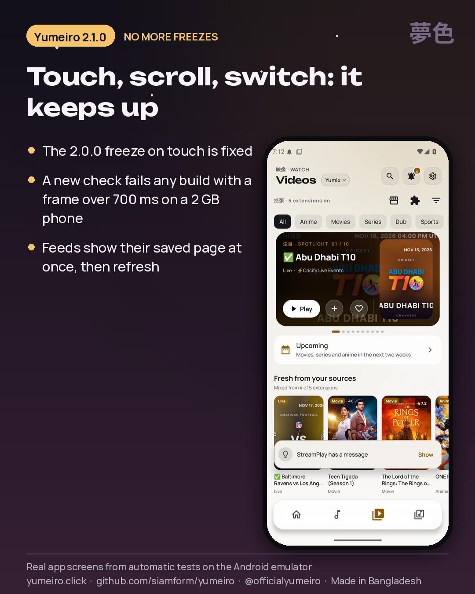</td>
    <td align="center" width="25%">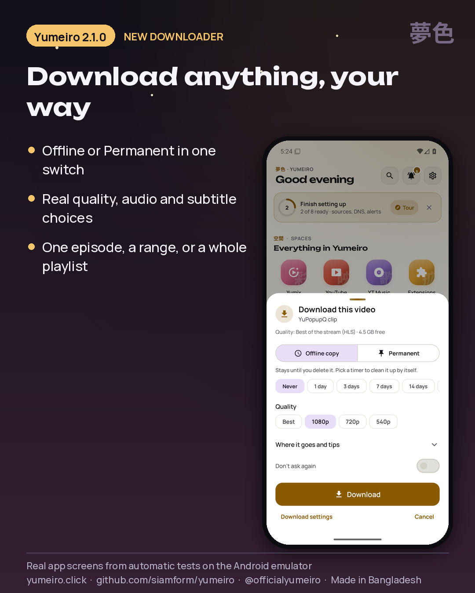</td>
    <td align="center" width="25%">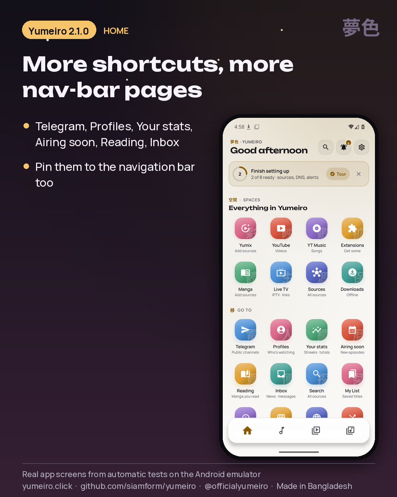</td>
    <td align="center" width="25%">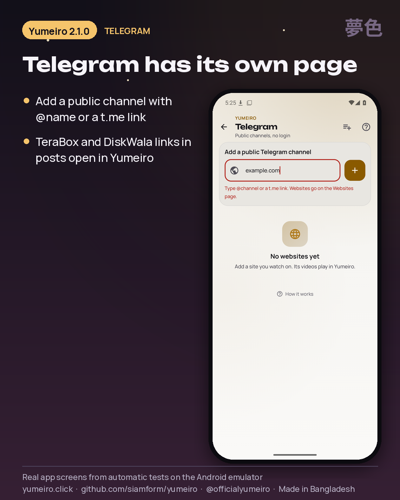</td>
  </tr>
</table>

Yumeiro 2.1.0 follows 2.0.0. Full notes:
[CHANGELOG.md](../CHANGELOG.md). Things that still need a real phone: [docs/release-2.1/MANUAL-TESTS-2.1.md](release-2.1/MANUAL-TESTS-2.1.md).

| | |
|---|---|
| **No more freezes** | The touch freeze of 2.0.0 is fixed, and a new automatic check fails the build on any frame over 700 ms on a low-RAM phone. |
| **Feeds at once** | Yumix and Home show the saved feed straight away, even after a night away or an update, and refresh behind it; fastest extensions first, dead sites set aside. |
| **A friendlier downloader** | Offline / Permanent switch, real quality, audio and subtitle choices for any stream, one episode or a range, whole music playlists. |
| **Websites that stay open** | One website tab stays open while a stream plays; the stream bar follows the video playing now. |
| **More sources** | Nuvio scraper repositories add their streams to any title; TeraBox plays full files when you are signed in; DiskWala hands off to its app. |
| **Vertical player** | Swipe through Shorts and any portrait video. |
| **Live TV by country** | Country filter in big playlists. |
| **Your profiles, really yours** | Extensions, repositories, pins and reading are per profile; "Forgot PIN" uses security questions. |
| **Yumeiro, all in one** | One built-in source for drama, films, documentaries, cartoons and TV, with no install; public-domain classics from the Internet Archive play with no source at all. |
| **Yumeiro Live** | One checked Live TV list from iptv-org, dead links removed every day, with a Country filter and "checked N hours ago". |
| **Smaller downloads** | Per-processor APKs (arm64-v8a, armeabi-v7a) next to the universal one; Settings → Updates shows your processor and the exact update file. |
| **Upcoming you can search** | Search, a filter icon, and filters built from the calendar itself. |

## What's new in 2.0.0

Yumeiro 2.0.0 replaces 1.9.0: [download it from Releases](https://github.com/siamform/yumeiro/releases/latest).
It has every 1.9.0 feature and fixes the 1.9.0 crash when a video opens. If you installed 1.9.0, update now.
Full notes: [CHANGELOG.md](../CHANGELOG.md). Per-feature test results: [docs/MASTER-CHECKLIST-FINAL.md](MASTER-CHECKLIST-FINAL.md).

| | |
|---|---|
| **Profiles with locks** | Up to 8 profiles with "Who's watching?", each with its own history, lists and 18+ setting; lock one with a PIN or the phone's fingerprint. |
| **Private downloads** | Hide a finished video from every list and the gallery; open Private with the PIN or phone lock. |
| **Your look, your speed** | Five accent colours; hold the video for 2x; Shorts player; volume boost to 200 %; external players. |
| **Faster start** | Setup, feed, extensions and catalog show at once; extensions load behind, pinned ones first. |
| **Live TV that keeps playing** | A dead link switches to the channel's other link; Now / Next from the playlist's guide. |
| **More sources** | Public Telegram channels, open TeraBox / DiskWala links, Vega provider repos in a sandbox, your own proxy, DNS fallback. |
| **Manga offline** | Saved chapters open without the source; on-device translation in the reader. |
| **Safer by design** | The app no longer carries Yumeiro's Last.fm shared secret. Built-in Last.fm sign-in stays off until Yumeiro Cloud (which will sign those calls) is live; your own Last.fm key still works. |

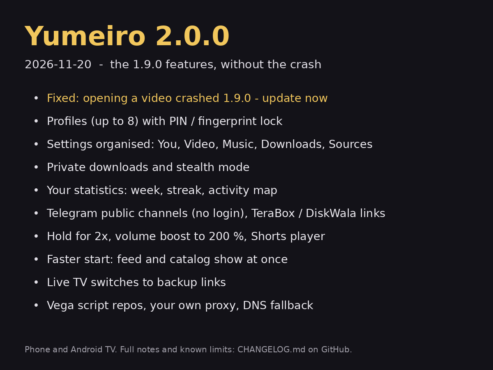

<table>
  <tr>
    <td align="center" width="33%">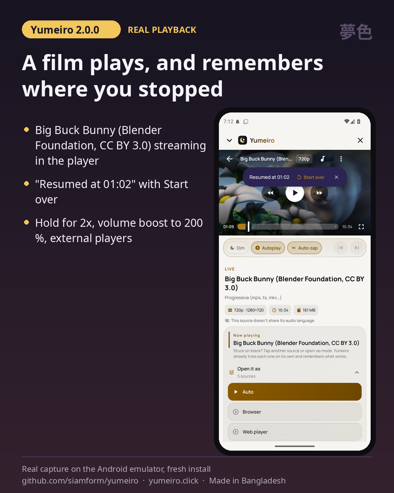 A film plays and resumes</td>
    <td align="center" width="33%">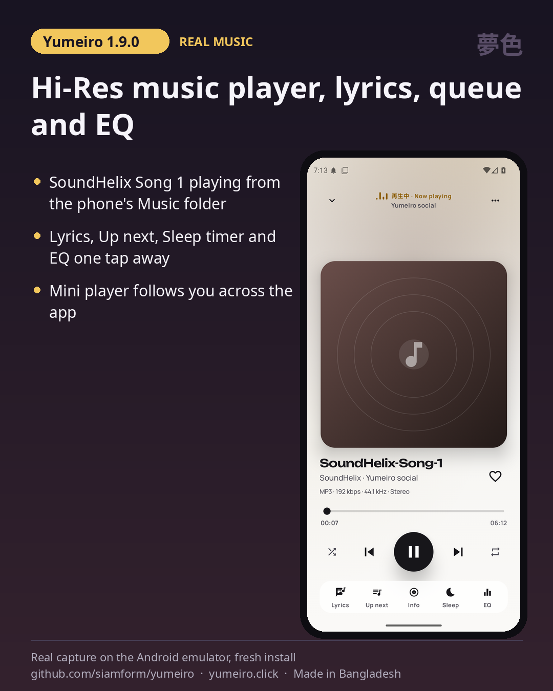 Real music playback</td>
    <td align="center" width="33%">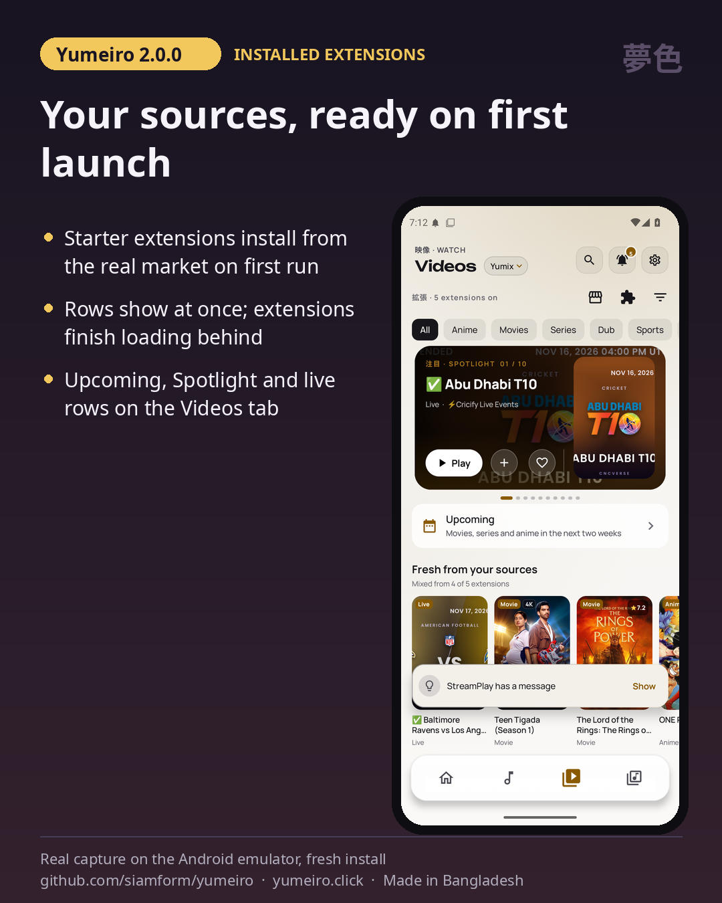 Installed extensions</td>
  </tr>
  <tr>
    <td align="center" width="33%">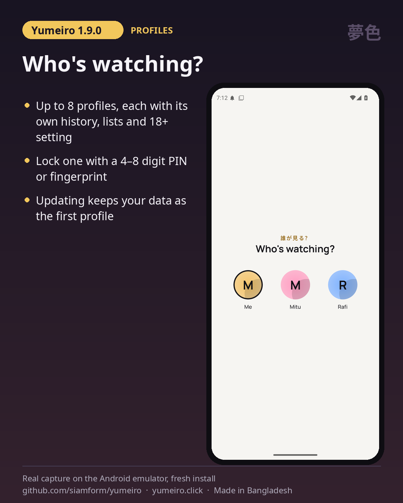 Who's watching?</td>
    <td align="center" width="33%">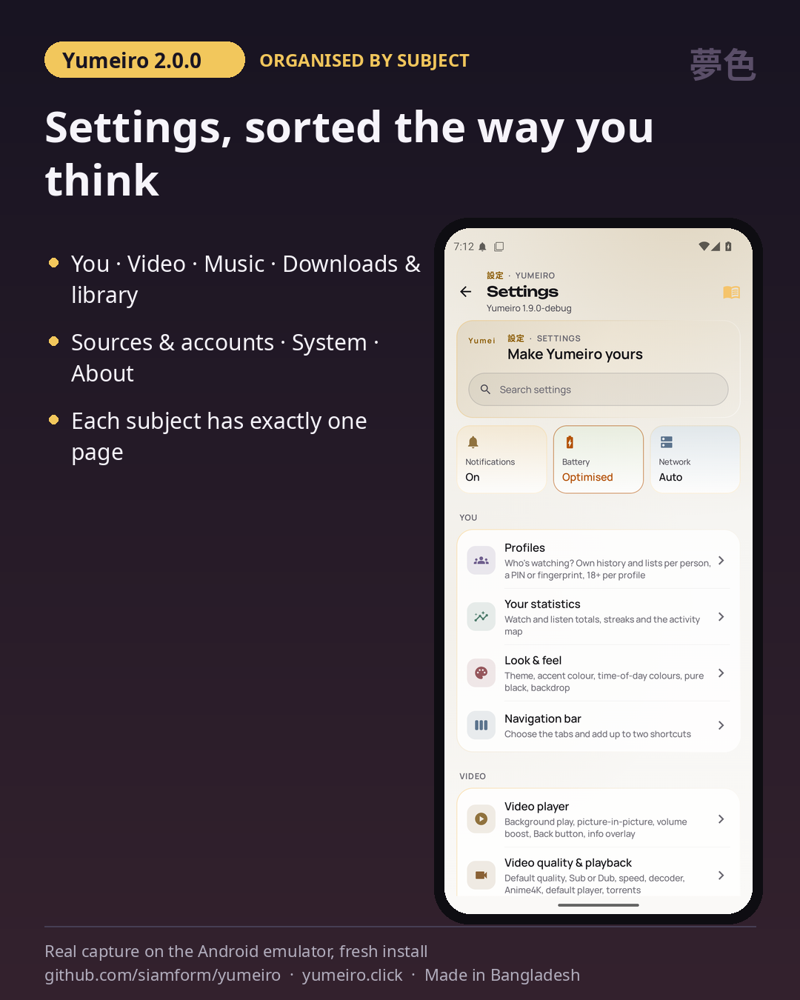 Settings by subject</td>
    <td align="center" width="33%">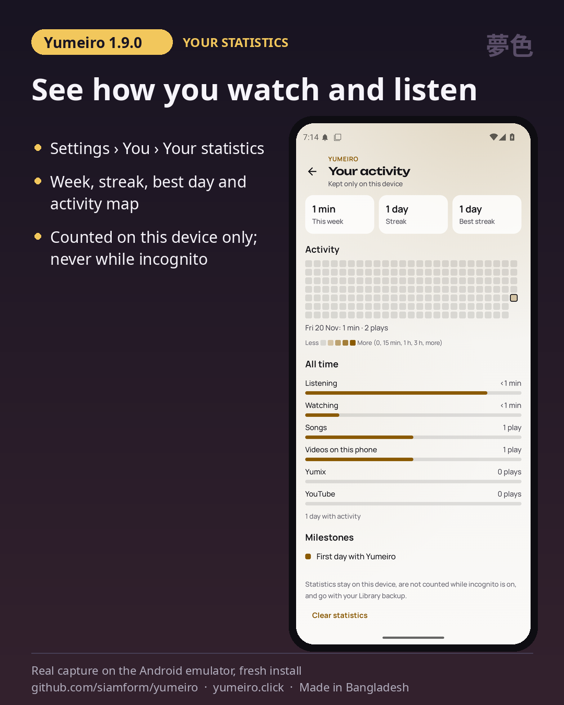 Your statistics</td>
  </tr>
  <tr>
    <td align="center" width="33%">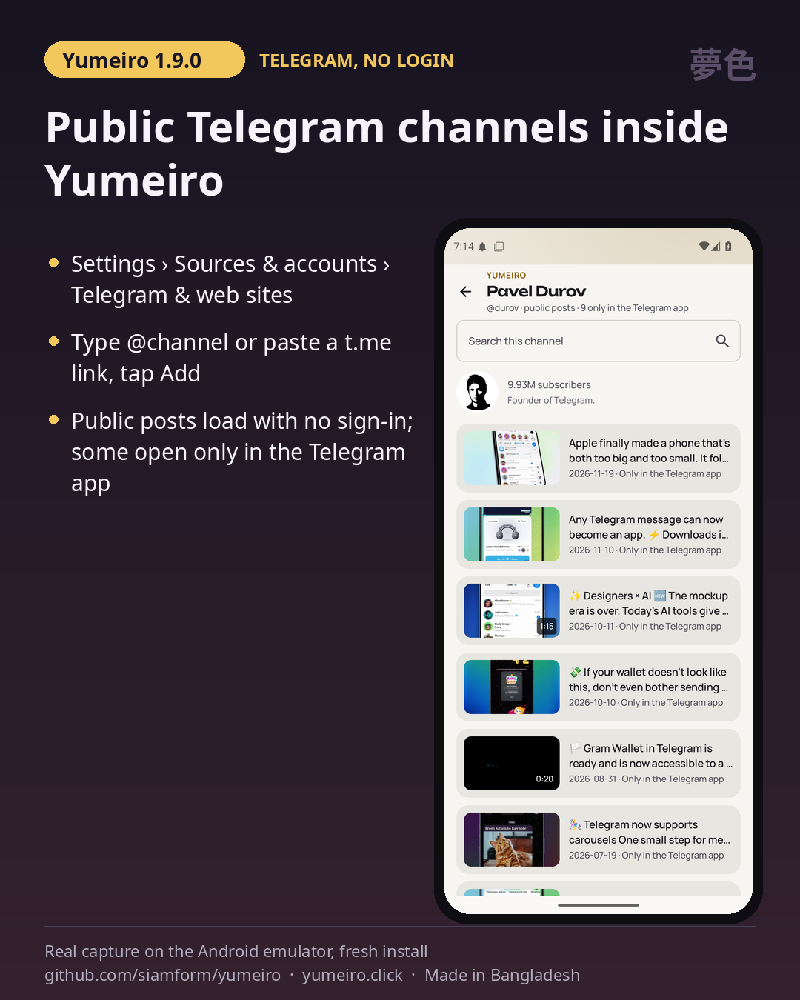 Public Telegram channels</td>
    <td align="center" width="33%">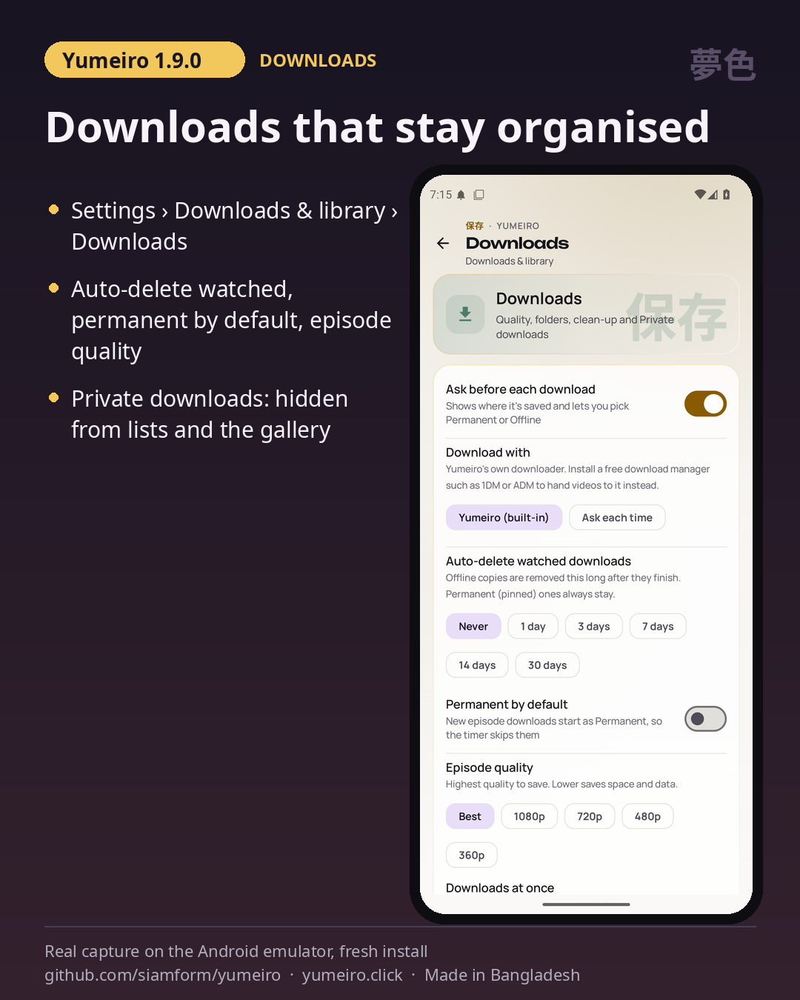 Downloads and Private</td>
    <td align="center" width="33%">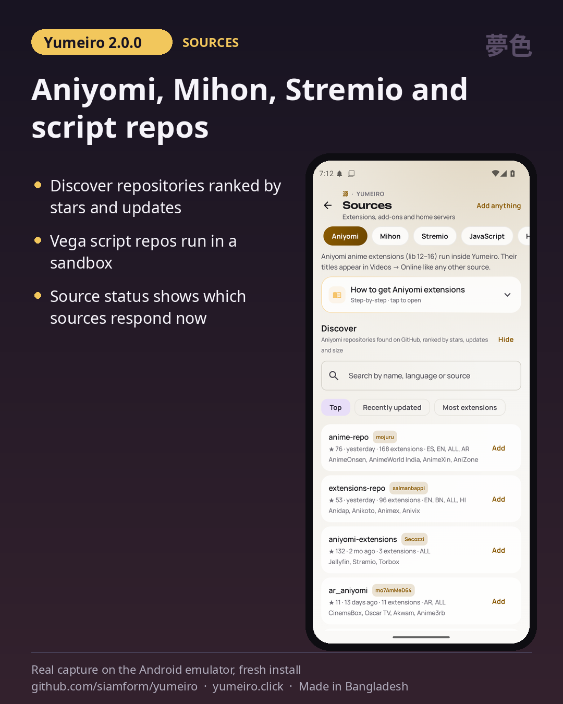 Sources and script repos</td>
  </tr>
  <tr>
    <td align="center" width="33%">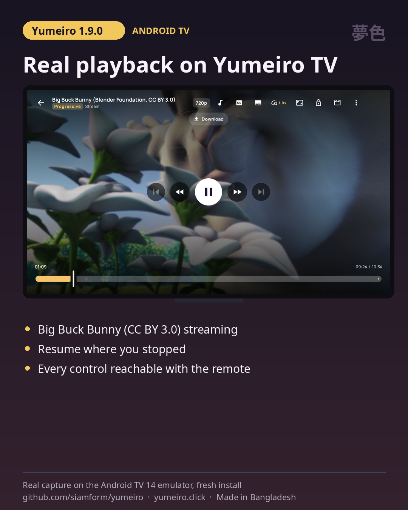 TV: video controls</td>
    <td align="center" width="33%">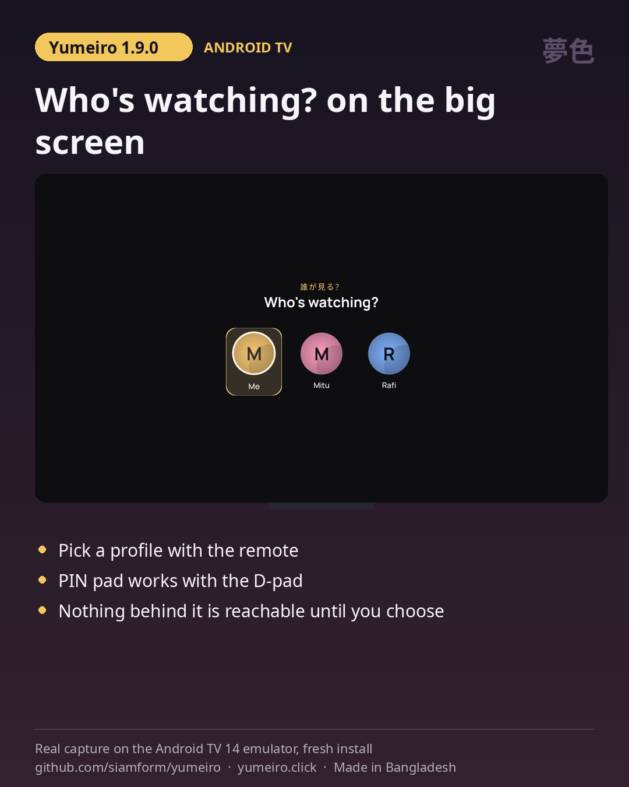 TV: Who's watching?</td>
    <td align="center" width="33%">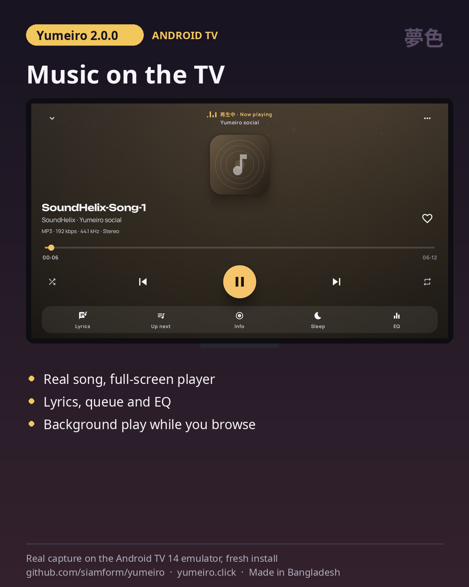 TV: music playing</td>
  </tr>
</table>

Real captures on CI emulators (Pixel 6 phone, Android TV 14) with a real extension, film and song from a fresh install.
All images: [docs/assets/social](assets/social/README.md).

### Where to find things

Settings is now organised by subject. Every page is also found by Settings search.

| You want | Go to |
|---|---|
| Profiles, PINs, "Who's watching?", 18+ per profile | Settings → You → Profiles |
| Your statistics (week, streak, activity map) | Settings → You → Your statistics |
| Public Telegram channels (no login) | Settings → Sources & accounts → Telegram |
| Saved web sites | Settings → Sources & accounts → Websites |
| Extensions, script repos (Vega, Nuvio, SkyStream), home servers | Settings → Sources & accounts → Sources |
| Video quality, decoder, TorrServer | Settings → Video → Video quality & playback |
| Subtitles, subtitle downloads, skip intros | Settings → Video → Subtitles & intros |
| Music quality, equalizer, lyrics, Last.fm | Settings → Music → Music & sound |
| Downloads and Private downloads | Settings → Downloads & library → Downloads |
| App lock, incognito | Settings → System → Privacy |
| Proxy, DNS fallback | Settings → System → Network |

## What's new in the redesign

The biggest Yumeiro update so far: a new design, TV support, and a few hundred fixes found by testing every screen
like a crowd of new users would. Full notes: [CHANGELOG.md](../CHANGELOG.md).

| | |
|---|---|
| **New, friendlier design** | The *Tsuki no Michi* design system across the shell, Home, Now Playing and Settings. A taller, easier floating dock, themed pop-ups with clear warning / error tones, readable tints in light and dark, smooth page transitions. |
| **A first-run guide** | A welcome screen that asks how you'll use the app (music, video, anime, live TV), then a short tutor-style tour. Extensions stay fully asleep until the guide is finished or skipped — no surprise installs or messages before you're in. |
| **New Home** | Reorganised around *Continue watching*, colour shortcuts, Quick picks and an endless *For you* feed. Library without tabs: colour shortcuts to Videos and Reading. |
| **Yumix** | The online video hub (formerly "online"): a hybrid feed with a filter sheet, a resume banner, categories, latest episodes and per-language Sub / Dub groups with an audio filter. Plus a built-in short-drama source. |
| **Audio online** | YouTube Music quick picks, search, background play and song downloads, no Google account. |
| **New video page** | A YouTube / HiAnime-style watch page under a docked player, with sources, dub, episodes and Live TV hub. |
| **Video player** | **Pinch to zoom** (100–400 %, pan, snap back, reset pill). **Subtitle style**: size, colour, outline / shadow / box, bold and height, with a live preview — and subtitles still load from your device (.srt, .vtt, .ass, .ttml), online search, delay sync and track select. Playback facts (size, duration, audio). Seek fixes. |
| **Android TV & Fire TV** | A left navigation rail, visible focus rings and full remote control. See [TV support](TV.md). |
| **One APK for every device** | A single universal APK per edition (arm64-v8a, armeabi-v7a, x86, x86_64 inside). Phones and tablets on Android 9+, Yumeiro TV on Android 7.0+. |
| **Instant notices** | Optional Firebase push for announcements, updates and maintenance through the existing Yumeiro Cloud Worker. Off-switch per kind; no account, no IDs shared with anyone else. |
| **Safer** | Fixed antivirus false positives at the cause (0 / 66 on VirusTotal for the preview build), a login-CSRF in tracker sign-in, private-file access through "Open with", backup restores that could carry code, and server abuse that could have stopped push for everyone. Details in [docs/security](security). |

Back to the [README](../README.md).
