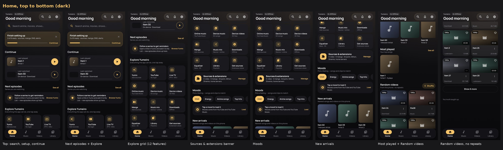
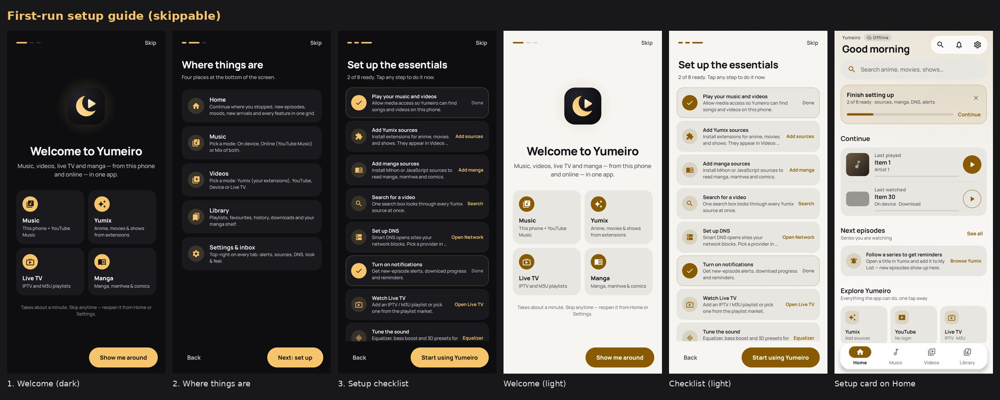
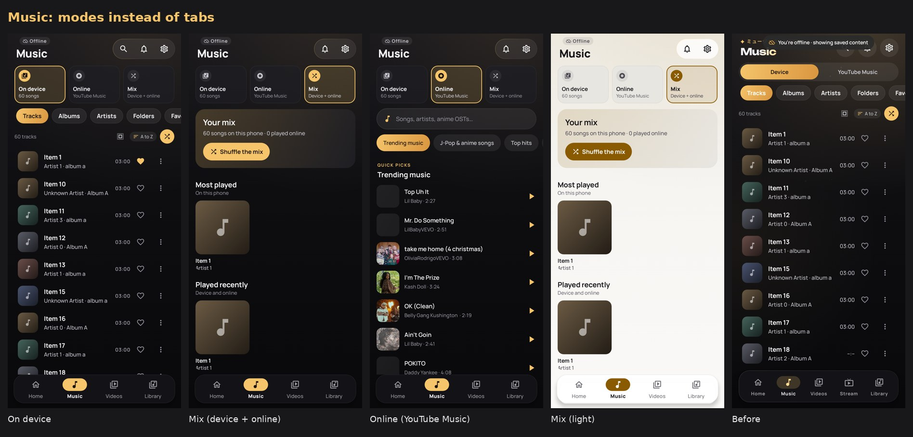
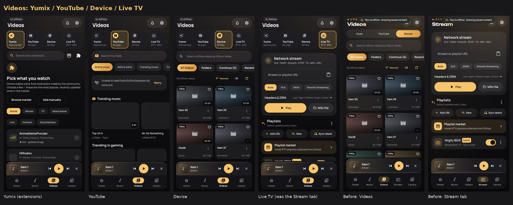
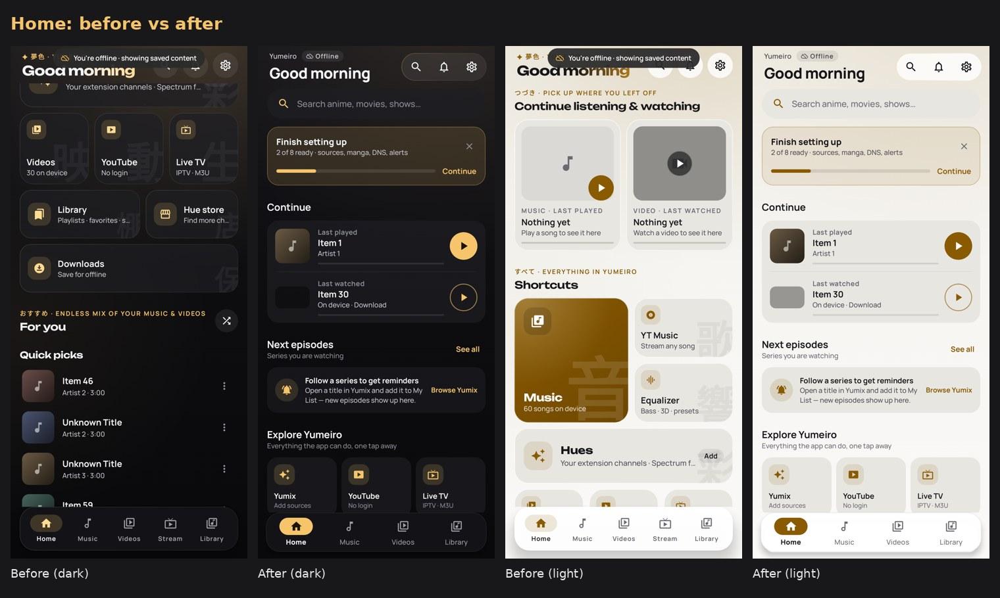
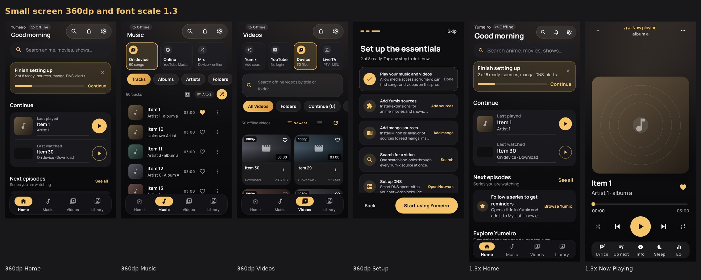

# Yumeiro redesign, round 2: modes, setup guide, Yumix and a new Home

Branch `redesign/yume-experience` · repo `siamform/yumeiro-redesign` · baseline `af8349e`.
Round 1 is commit `72fa3da` (described in [REPORT.md](REPORT.md)). Round 2 starts at commit `1bf8f31`.
**For approval only. Not merged, and no PR is open.**

Every screenshot here is rendered from the real app code under Robolectric (JVM) by
`RedesignTourTest`. None of them are mockups.

## A. Why round 2 exists
The owner rejected round 1. The feedback: it looked like a cheap copy of the old Yumeiro, it used
too many Japanese words, Home was weak, and the bottom bar, naming, weights, fonts and background
did not feel professionally designed. The owner then asked for these changes:

1. Home should explain the app clearly: features, extensions, manga, sources and the other key areas.
2. Music and Videos get **modes** (On device / Online / Mix, and Yumix / YouTube / Device / Live TV) instead of tabs. Each mode keeps its own page.
3. Rename **Hues to Yumix**.
4. Use far fewer Japanese words.
5. Add a **setup guide** on first launch. It must be skippable and suggest the first steps: extensions, manga, video search, DNS, notifications and so on.
6. Remove Stream from the bottom bar.
7. Home sections in this order: next-episode reminders, moods, new arrivals, most watched/played, then random videos. Device videos must never repeat. Online videos appear per extension, and every extension gets a banner.

The colours were **not** changed. `ui/theme/Color.kt` is untouched.

## B. Research for this round
- **Onboarding.** NN/g found that tutorials did not improve task success, and that people who read them rated the tasks as harder ([NN/g, Mobile Tutorials](https://www.nngroup.com/articles/mobile-tutorials/)). Their advice: keep onboarding brief and optional, and show only what is novel ([NN/g, Mobile-App Onboarding](https://www.nngroup.com/articles/mobile-app-onboarding/)). They also say help must be easy to dismiss and easy to find again ([NN/g, Tutorials vs Contextual Help](https://www.nngroup.com/articles/onboarding-tutorials/)). Material's onboarding guidance is: show it to first-time users only, don't force education upfront, and prioritise the first key action ([Material Design, Onboarding](https://m1.material.io/growth-communications/onboarding.html)).
  - What Yumeiro does with this: the guide is 3 pages long and has a progress indicator. **Skip** is visible on every page. Most of it is a **checklist of real actions** rather than instructions. It only auto-shows once. You can reopen it from the Home setup card or from Settings → Setup guide.
- **Recognition over recall** ([NN/g](https://www.nngroup.com/articles/recognition-and-recall/)). Modes are labelled cards with a live status line ("60 songs", "No login", "IPTV · M3U"). Hidden tabs are gone.
- **Progressive disclosure** ([NN/g](https://www.nngroup.com/articles/progressive-disclosure/)). Home shows one row per topic with "See all". Details stay on each mode's page.
- **Extensions** ([Mihon](https://mihon.app/docs/faq/browse/extensions), [Stremio add-ons](https://docs.stremio-addons.net/addons/install), [CloudStream](https://recloudstream.github.io/csdocs/)). Sources belong to the user, so each installed extension gets its own banner, labelled as a "Yumix source". The trust and repo flows in the Sources hub are unchanged.

## C. What changed
| Area | Before (round 1 and baseline) | Now |
|---|---|---|
| Bottom bar | 5 tabs, including Stream. Thin moon-path stroke | **4 tabs**: Home · Music · Videos · Library. A solid gold capsule glides behind the active icon, which is drawn in ink on gold. Labels are bold |
| Music | Device / YouTube Music switch, plus content tabs | **Mode cards**: On device (song count), Online (YouTube Music), **Mix** (new page: device and online together). The device content tabs (Tracks/Albums/…) are kept inside On device |
| Videos | Hues / YouTube / Device pills | **Mode cards**: Yumix (extension count), YouTube, Device (file count), **Live TV** (the former Stream tab, with exactly the same screen and features) |
| Stream route | A bottom tab | `Screen.Stream` still exists and redirects to Videos → Live TV, so deep links and the Home tiles still work |
| Naming | "Hues", Japanese overlines, kana keys (音 歌 響 …) | "Yumix" in user-facing text. Plain English labels. Japanese words removed from the header, the player, the inbox, support, the guide and the watch pages |
| Home | Tonight · 10 kana keys · For you | Search → **Finish setting up** card → Continue → **Next episodes** → **Explore Yumeiro** (12 labelled feature tiles with live status) → **Sources & extensions** banner → **Moods** → **New arrivals** → **Most played** → Watched recently → **Random videos** (no repeats) → Yumix picks (a banner for every extension, then its row) → On YouTube for you |
| First launch | Nothing | **Setup guide**: Welcome → Where things are → Set up the essentials. Its checklist covers 8 steps (media access, Yumix sources, manga sources, video search, DNS, notifications, Live TV, equalizer). Each step reads real state and opens the real screen |
| Type and background | Unbounded display, gradient title, decorative sparkles | Manrope ExtraBold display, plain title, a softer background glow, no sparkles |

## D. Screens
| What | Image |
|---|---|
| Home, top to bottom (dark) |  |
| Setup guide (dark and light) and the Home setup card |  |
| Music modes |  |
| Video modes, including Live TV (the former Stream tab) |  |
| Home, before vs after |  |
| 360dp small screen and font scale 1.3 |  |

## E. Navigation
See [NAVIGATION.md](NAVIGATION.md), which is updated for round 2.

## F. Functionality preservation
- **Every destination still exists.** `Screen.Stream` remains a route. Only its bottom-bar item was removed. Its screen (`StreamScreen`, with the same parameters) now opens from Videos → Live TV, from the Home "Live TV" tile, from the setup guide, and from any `stream` deep link (redirected).
- **Music**: On device is the old device Music screen, unchanged inside (tabs, sort, folders, favourites). Online is the old YouTube Music screen. Mix is new and only reuses existing data: `filteredTracks`, `mostPlayed`, `recentlyPlayed` and `YtHistory`. Playback goes through `viewModel.playTrack` and `YouTubePlayback.toTrack`.
- **Videos**: the Yumix, YouTube and Device pages are the same composables as before (`OnlineHomeScreen`, `YouTubeVideoScreen`, `VideoScreen`).
- **Setup guide** status comes from real sources only:
  - `PermissionCenter.mediaAllowed` and `notificationsAllowed`
  - `ExtensionManager.state.installed`
  - `SourceHub.mangaProviders()`
  - `NetworkSettings.dns.usesAlternative`
  - A "visited" flag for steps that have no stored state (search, Live TV, equalizer)

  Its preferences (`setup_guide`: `seen`, `visited`, `card_hidden`) are new keys. No existing key was touched.
- **Settings** gained one category, **Setup guide** (`SETUP`, About group). `SettingsLaunch` lets the guide open Settings directly on Network or Notifications.
- **Bug fixed along the way**: the Home "New arrivals" row mixes songs and videos. Their MediaStore IDs can collide, which crashed the LazyRow with "Key was already used". The keys are now `new_t_<id>` and `new_v_<id>`. Other rows were de-duplicated by id too.
- **Tests actually run** (JVM/Robolectric on this branch): `./gradlew :app:testDebugUnitTest --no-configuration-cache` gave **409 tests, 0 failures, 0 errors, 0 skipped**. All four tour configurations finished with empty `missing` files. **No device or emulator test was run.**

## G. Implementation summary
- **New files**:
  - `ui/components/ModeSwitcher.kt` (`ModeOption`, `ModeSwitcher`)
  - `ui/screens/extras/SetupGuide.kt` (`SetupStep`, `SetupStatus`, `SetupGuide`, `rememberSetupStatus`, `SetupGuideOverlay`)
  - `ui/screens/music/MusicMix.kt` (`MusicMixScreen`)
  - `ui/screens/online/ExtensionBanner.kt` (`ExtensionBanner`, `ExtensionBannerStrip`)
- **Main changes**:
  - `HomeScreen.kt` (rewritten. `FeedGenerator`, `KanaKey` and `DreamDeckCard` were removed from Home)
  - `MTPlayerApp.kt` (music modes, the Live TV branch, the guide overlay and action mapping, the Stream redirect)
  - `MusicScreen.kt` (`MusicMode`, `MusicSourceSwitch`)
  - `OnlineHomeScreen.kt` (`VideoSource.LIVE`, `VideoSourceSwitch`, the extension banner strip)
  - `OnlineHomePicks.kt` (a banner for each extension row)
  - `MTBottomBar.kt`, `MTTopBar.kt`, `Screen.kt` (4 nav items), `Type.kt`, `DesignSystem.kt`
  - `SettingsCatalog.kt`, `SettingsScreen.kt`
  - String-only edits in `OnlineFeed`, `OnlineSearchScreen`, `UserGuide`, `ErrorHelp`, `NowPlayingScreen`, `StateViews`, `InboxScreen`, `SupportScreen`, `WatchKit`, `WatchScreens`, `StreamWatchPanel`, `LibraryDesign` and `YouTubeScreens`
- **Tests updated**:
  - `AppNavigationCrashTest`: the Stream tab is now reached via Videos → Live TV.
  - `RedesignTourTest`: adds Home section stops, the setup guide, music and video modes, and Settings → Setup guide.
  - `SettingsCatalogTest`: adds the new `setup` route.
  - `PlaylistPagesTest`: scrolls to "Clear filters" before tapping it. The new type made the empty state taller than Robolectric's default window.
- **Dependencies**: none added. **Colours**: unchanged.

## H. Known limitations (honest)
1. **Moods do not load in the screenshots.** They call YouTube (`YouTube.shelf`), and the test JVM has no network. Under Robolectric the shelf does not auto-load, so the shots show the "Tap a mood to load it" state. On a phone, the first mood loads by itself.
2. **"Most watched" is "Watched recently" for videos.** Device videos have no watch counter, only a last-watched time. Songs do have `playCount`, so **Most played** is real.
3. **Extension banners are not visible in these screenshots.** No extension is installed in the test environment, and starter extensions are skipped under Robolectric. The banners appear as soon as an installed extension returns a home row.
4. **Next episodes** shows its empty hint in the shots, because the test profile has no bookmarks.
5. **The YouTube mode shows a network error in the shots** ("PublicSuffixDatabase"). That is a Robolectric/OkHttp resource quirk without network, not an app bug.
6. **The player, the manga reader and live playback cannot be captured offline**, so they are not in this round's shots.
7. **No device or emulator testing.** TalkBack, real gestures, real fonts and performance still need a device check.
8. **CI was not run.** Actions stay disabled on the private repo until approval (Stage 6).
9. The setup guide's **Media** step asks for permission in place. It does not open a screen, so the step shows "Done" once access is granted.
